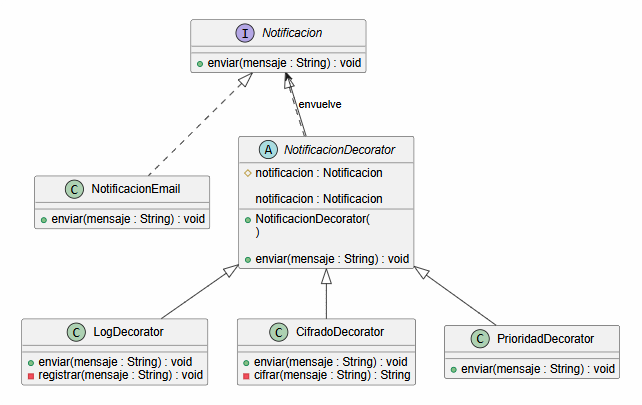
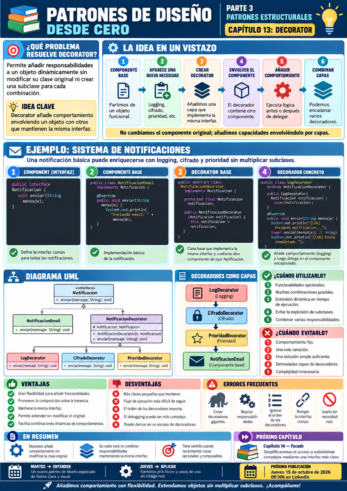

# 📚 Patrones de Diseño desde Cero

> **Aprende a diseñar software mantenible con ejemplos reales.**

# 📖 Capítulo 13 - Decorator

> **📚 Patrones de Diseño desde Cero**  
> **🧱 Parte III - Patrones Estructurales**

---

## 🧠 Introducción

Continuamos nuestro recorrido por los **patrones estructurales**.

Hasta ahora hemos estudiado:

### 🔌 Adapter

> **¿Cómo hacemos colaborar interfaces incompatibles?**

### 🌉 Bridge

> **¿Cómo separamos dos dimensiones para que evolucionen de forma independiente?**

### 🌳 Composite

> **¿Cómo tratamos objetos individuales y grupos de objetos de forma uniforme?**

Ahora nos encontramos con otro problema.

Imaginemos un sistema de notificaciones.

Inicialmente tenemos:

```text
Notificación básica
```

Pero después aparecen nuevos requisitos:

```text
+ cifrado
+ registro
+ prioridad
+ compresión
```

Una primera solución podría consistir en crear subclases:

```text
Notificacion
│
├── NotificacionCifrada
├── NotificacionConLog
├── NotificacionPrioritaria
├── NotificacionCifradaConLog
├── NotificacionCifradaPrioritaria
├── NotificacionConLogPrioritaria
└── ...
```

El problema aparece rápidamente.

Cada nueva combinación puede necesitar una nueva clase.

La pregunta será:

> **¿Cómo podemos añadir responsabilidades a un objeto dinámicamente sin modificar su clase original y sin multiplicar las subclases?**

Aquí aparece:

# 🎁 Decorator

Decorator permite añadir comportamiento adicional a un objeto **envolviéndolo con otros objetos que mantienen la misma interfaz**.

---

# 🎯 Objetivos de aprendizaje

Al finalizar este capítulo deberías ser capaz de:

- Comprender qué problema intenta resolver Decorator.
- Identificar situaciones donde la herencia genera demasiadas combinaciones.
- Comprender cómo añadir comportamiento mediante composición.
- Identificar `Component`, `ConcreteComponent`, `Decorator` y `ConcreteDecorator`.
- Implementar Decorator en Java.
- Encadenar varios decoradores.
- Comprender por qué todos los decoradores mantienen la misma interfaz.
- Añadir responsabilidades en tiempo de ejecución.
- Diferenciar Decorator de Adapter.
- Diferenciar Decorator de Composite.
- Diferenciar Decorator de Proxy.
- Comprender sus ventajas y desventajas.
- Reconocer cuándo Decorator aporta valor.
- Evitar decoradores excesivamente complejos.

---

# ❌ El problema

Imaginemos que tenemos un servicio sencillo de notificaciones:

```java
public interface Notificacion {

    void enviar(String mensaje);
}
```

Una implementación básica:

```java
public class NotificacionEmail
        implements Notificacion {

    @Override
    public void enviar(
            String mensaje) {

        System.out.println(
            "📧 Enviando email: "
            + mensaje
        );
    }
}
```

Hasta aquí todo funciona.

Pero aparece un requisito:

> **Debemos registrar cada notificación enviada.**

Podríamos crear:

```java
public class NotificacionEmailConLog
        extends NotificacionEmail {

    @Override
    public void enviar(
            String mensaje) {

        System.out.println(
            "📝 Registrando notificación"
        );

        super.enviar(mensaje);
    }
}
```

Después aparece otro requisito:

> **Algunas notificaciones deben enviarse cifradas.**

Creamos:

```text
NotificacionEmailCifrada
```

Pero...

¿Qué ocurre si queremos:

```text
Email
+
Log
+
Cifrado
```

?

Podríamos crear:

```text
NotificacionEmailCifradaConLog
```

Después añadimos:

```text
Prioridad
```

Y aparecen todavía más combinaciones.

---

# 📈 Explosión de subclases

Tenemos diferentes funcionalidades:

```text
LOG
CIFRADO
PRIORIDAD
COMPRESIÓN
```

Con herencia podríamos terminar con combinaciones como:

```text
NotificacionConLog

NotificacionCifrada

NotificacionPrioritaria

NotificacionConLogCifrada

NotificacionConLogPrioritaria

NotificacionCifradaPrioritaria

NotificacionConLogCifradaPrioritaria

...
```

Cuantas más funcionalidades tenemos, más combinaciones aparecen.

El problema no es únicamente tener muchas clases.

El problema es que estamos utilizando **herencia para representar combinaciones dinámicas de comportamiento**.

---

# 💡 Motivación

Queremos separar:

```text
OBJETO ORIGINAL
```

de:

```text
COMPORTAMIENTOS ADICIONALES
```

Y queremos poder combinarlos dinámicamente.

Por ejemplo:

```text
NotificacionEmail
       │
       ▼
DecoratorLog
       │
       ▼
DecoratorCifrado
```

Cada capa añade una responsabilidad.

Pero todas siguen implementando:

```java
Notificacion
```

Por eso el cliente puede continuar utilizando:

```java
notificacion.enviar(...)
```

sin preocuparse de cuántos decoradores existen alrededor.

---

# 🎁 La solución

Decorator envuelve un objeto manteniendo su misma interfaz.

Conceptualmente:

```text
Cliente
   │
   ▼
Component
   ▲
   │
Decorator
   │
   ▼
Component
```

Un decorador:

1. implementa la misma interfaz;
2. mantiene una referencia a otro componente;
3. delega la operación;
4. añade comportamiento antes o después.

En nuestro ejemplo:

```text
Notificacion
      ▲
      │
NotificacionEmail
```

y:

```text
Notificacion
      ▲
      │
NotificacionDecorator
      │
      ▼
Notificacion
```

---

# 🧱 Participantes del patrón

Decorator suele estar formado por cuatro participantes principales.

## 1️⃣ Component

Define la interfaz común.

```java
public interface Notificacion {

    void enviar(String mensaje);
}
```

---

## 2️⃣ Concrete Component

Es el objeto básico que queremos decorar.

```text
NotificacionEmail
```

---

## 3️⃣ Decorator

Implementa la misma interfaz y mantiene una referencia al componente decorado.

```java
public abstract class NotificacionDecorator
        implements Notificacion {

    protected final Notificacion notificacion;
}
```

---

## 4️⃣ Concrete Decorator

Añade una responsabilidad concreta.

Por ejemplo:

```text
LogDecorator
CifradoDecorator
PrioridadDecorator
```

---

# ☕ Implementación en Java

## Component - Notificacion.java

```java
public interface Notificacion {

    void enviar(String mensaje);
}
```

---

# 📧 Concrete Component - NotificacionEmail.java

```java
public class NotificacionEmail
        implements Notificacion {

    @Override
    public void enviar(
            String mensaje) {

        System.out.println(
            "📧 Enviando email: "
            + mensaje
        );
    }
}
```

---

# 🎁 Decorator base - NotificacionDecorator.java

```java
public abstract class NotificacionDecorator
        implements Notificacion {

    protected final Notificacion notificacion;

    protected NotificacionDecorator(
            Notificacion notificacion) {

        this.notificacion =
                notificacion;
    }

    @Override
    public void enviar(
            String mensaje) {

        notificacion.enviar(
            mensaje
        );
    }
}
```

Este decorador todavía no añade comportamiento.

Su función es servir como base para decoradores concretos.

---

# 📝 Concrete Decorator - LogDecorator.java

```java
public class LogDecorator
        extends NotificacionDecorator {

    public LogDecorator(
            Notificacion notificacion) {

        super(notificacion);
    }

    @Override
    public void enviar(
            String mensaje) {

        registrar(mensaje);

        super.enviar(
            mensaje
        );
    }

    private void registrar(
            String mensaje) {

        System.out.println(
            "📝 LOG: "
            + mensaje
        );
    }
}
```

---

# 🔐 Concrete Decorator - CifradoDecorator.java

```java
public class CifradoDecorator
        extends NotificacionDecorator {

    public CifradoDecorator(
            Notificacion notificacion) {

        super(notificacion);
    }

    @Override
    public void enviar(
            String mensaje) {

        String mensajeCifrado =
                cifrar(mensaje);

        super.enviar(
            mensajeCifrado
        );
    }

    private String cifrar(
            String mensaje) {

        return "[CIFRADO] "
                + mensaje;
    }
}
```

---

# 🚨 Concrete Decorator - PrioridadDecorator.java

```java
public class PrioridadDecorator
        extends NotificacionDecorator {

    public PrioridadDecorator(
            Notificacion notificacion) {

        super(notificacion);
    }

    @Override
    public void enviar(
            String mensaje) {

        super.enviar(
            "[URGENTE] "
            + mensaje
        );
    }
}
```

---

# ▶️ Cliente - Main.java

Podemos utilizar únicamente el componente básico:

```java
Notificacion notificacion =
        new NotificacionEmail();

notificacion.enviar(
        "Tu pedido ha sido enviado"
);
```

Resultado:

```text
📧 Enviando email:
Tu pedido ha sido enviado
```

---

# 🎁 Añadir un decorador

Podemos añadir registro:

```java
Notificacion notificacion =
        new LogDecorator(
            new NotificacionEmail()
        );
```

Y utilizar exactamente la misma interfaz:

```java
notificacion.enviar(
        "Tu pedido ha sido enviado"
);
```

---

# 🧅 Encadenar decoradores

La verdadera potencia aparece cuando combinamos varios decoradores.

```java
Notificacion notificacion =
        new LogDecorator(
            new CifradoDecorator(
                new PrioridadDecorator(
                    new NotificacionEmail()
                )
            )
        );
```

El objeto queda estructurado como:

```text
LogDecorator
     │
     ▼
CifradoDecorator
     │
     ▼
PrioridadDecorator
     │
     ▼
NotificacionEmail
```

Y todos implementan:

```java
Notificacion
```

Por eso podemos escribir:

```java
notificacion.enviar(
    "Servidor no disponible"
);
```

---

# 🔎 Explicación paso a paso

## 1️⃣ Definimos una interfaz común

```java
Notificacion
```

Todos los componentes y decoradores implementan esta interfaz.

---

## 2️⃣ Creamos el componente base

```java
NotificacionEmail
```

representa el comportamiento original.

---

## 3️⃣ Creamos un Decorator

```java
NotificacionDecorator
```

también implementa:

```java
Notificacion
```

pero contiene otra:

```java
Notificacion
```

---

## 4️⃣ Delegamos

El decorador ejecuta:

```java
notificacion.enviar(
    mensaje
);
```

---

## 5️⃣ Añadimos comportamiento

Un decorador concreto puede ejecutar lógica:

```text
ANTES
```

de delegar.

O:

```text
DESPUÉS
```

de delegar.

O incluso modificar los datos enviados.

---

## 6️⃣ Encadenamos decoradores

Como cada Decorator también es:

```java
Notificacion
```

podemos envolverlo nuevamente.

Esto permite composiciones dinámicas.

---

# 📊 UML

La estructura puede representarse mediante:



Conceptualmente:

```text
             Component
                 ▲
          ┌──────┴───────┐
          │              │
ConcreteComponent    Decorator
                         │
                         │ envuelve
                         ▼
                     Component
```

---

# 🎁 La idea clave: misma interfaz

Decorator funciona porque:

```text
Componente original
```

y:

```text
Decoradores
```

comparten la misma interfaz.

Por ejemplo:

```java
Notificacion
```

Por tanto, para el cliente:

```text
NotificacionEmail
```

y:

```text
LogDecorator
```

son utilizables de la misma forma.

---

# 🧅 Decoradores como capas

Una buena forma de visualizar Decorator es imaginar capas:

```text
┌─────────────────────────────┐
│         LOG                 │
│  ┌───────────────────────┐  │
│  │       CIFRADO         │  │
│  │  ┌─────────────────┐  │  │
│  │  │    PRIORIDAD    │  │  │
│  │  │  ┌───────────┐  │  │  │
│  │  │  │   EMAIL   │  │  │  │
│  │  │  └───────────┘  │  │  │
│  │  └─────────────────┘  │  │
│  └───────────────────────┘  │
└─────────────────────────────┘
```

Cada capa añade comportamiento sin modificar las anteriores.

---

# ➕ Añadir un nuevo decorador

Imaginemos que necesitamos comprimir el mensaje.

Creamos:

```java
public class CompresionDecorator
        extends NotificacionDecorator {

    public CompresionDecorator(
            Notificacion notificacion) {

        super(notificacion);
    }

    @Override
    public void enviar(
            String mensaje) {

        super.enviar(
            comprimir(mensaje)
        );
    }

    private String comprimir(
            String mensaje) {

        return "[COMPRIMIDO] "
                + mensaje;
    }
}
```

Ahora podemos combinarlo:

```java
Notificacion notificacion =
        new CompresionDecorator(
            new CifradoDecorator(
                new NotificacionEmail()
            )
        );
```

No hemos modificado:

```text
NotificacionEmail
CifradoDecorator
```

---

# 🔄 Orden de los decoradores

Existe un detalle importante.

El orden puede cambiar el resultado.

Por ejemplo:

```java
new CifradoDecorator(
    new CompresionDecorator(
        new NotificacionEmail()
    )
);
```

no tiene necesariamente el mismo comportamiento que:

```java
new CompresionDecorator(
    new CifradoDecorator(
        new NotificacionEmail()
    )
);
```

Conceptualmente:

```text
COMPRIMIR → CIFRAR
```

puede producir un resultado diferente de:

```text
CIFRAR → COMPRIMIR
```

Por eso:

> **El orden de los decoradores forma parte del comportamiento final.**

---

# 🏗️ Caso de uso real: Streams de Java

Un ejemplo muy conocido dentro de Java aparece en las APIs de entrada/salida.

Podemos encontrar estructuras similares a:

```java
InputStream input =
        new BufferedInputStream(
            new FileInputStream(
                "datos.txt"
            )
        );
```

Conceptualmente:

```text
FileInputStream
       ↓
BufferedInputStream
```

Ambos trabajan mediante una abstracción compatible.

Una capa añade funcionalidad sobre otra.

Esta idea es muy cercana al patrón Decorator.

---

# ☕ Caso de uso: bebidas

Otro ejemplo clásico:

```text
Café
```

al que añadimos:

```text
Leche
Azúcar
Caramelo
Nata
```

En lugar de crear:

```text
CafeConLeche
CafeConAzucar
CafeConLecheYAzucar
CafeConLecheAzucarCaramelo
...
```

podemos componer:

```text
CarameloDecorator
        ↓
LecheDecorator
        ↓
Cafe
```

El precio total puede calcularse acumulativamente.

---

# 🎯 ¿Cuándo utilizar Decorator?

Decorator puede resultar adecuado cuando:

- Queremos añadir comportamiento dinámicamente.
- Tenemos funcionalidades opcionales.
- Existen muchas combinaciones posibles.
- Queremos evitar una explosión de subclases.
- Necesitamos combinar responsabilidades.
- Queremos activar o desactivar capacidades en tiempo de ejecución.
- No podemos o no queremos modificar la clase original.
- Preferimos composición frente a herencia para combinar comportamientos.

---

# 🚫 ¿Cuándo evitarlo?

Probablemente no necesitamos Decorator cuando:

- Solo existe una funcionalidad adicional.
- El comportamiento es fijo.
- Una modificación directa de la clase es sencilla y adecuada.
- Las combinaciones no son necesarias.
- La cadena de decoradores sería difícil de comprender.
- El orden de los decoradores genera demasiada complejidad.
- Una solución más sencilla resuelve el problema.

---

# ✅ Ventajas

## 🔹 Añade comportamiento dinámicamente

Podemos elegir las capacidades en tiempo de ejecución.

---

## 🔹 Evita explosiones de subclases

No necesitamos crear una clase para cada combinación.

---

## 🔹 Favorece la composición

Los comportamientos se combinan envolviendo objetos.

---

## 🔹 Mantiene la misma interfaz

El cliente continúa utilizando:

```java
Notificacion
```

---

## 🔹 Facilita combinar responsabilidades

Podemos aplicar:

```text
log
+
cifrado
+
prioridad
```

según las necesidades.

---

## 🔹 Facilita extensión

Añadir un nuevo decorador no obliga necesariamente a modificar los existentes.

---

# ❌ Desventajas

## 🔸 Puede generar muchos objetos pequeños

Cada funcionalidad puede convertirse en una clase.

---

## 🔸 Puede dificultar seguir el flujo

Una llamada puede atravesar:

```text
Decorator A
   ↓
Decorator B
   ↓
Decorator C
   ↓
Component
```

---

## 🔸 El orden puede importar

Combinaciones diferentes pueden producir resultados distintos.

---

## 🔸 Puede complicar el debugging

El comportamiento final está distribuido entre varias capas.

---

## 🔸 Puede dificultar identificar el objeto original

Después de varias capas puede no resultar evidente qué componente está debajo.

---

# ⚠️ Decorator no es simplemente una clase wrapper

Una clase que contiene otro objeto no es automáticamente Decorator.

Decorator requiere una intención concreta:

> **añadir responsabilidades manteniendo la misma interfaz del componente.**

La relación clave es:

```text
Decorator IS-A Component
```

y al mismo tiempo:

```text
Decorator HAS-A Component
```

Es decir:

```java
class Decorator
    implements Component {

    private Component component;
}
```

Esta combinación es fundamental.

---

# ⚠️ Decorator no modifica necesariamente el objeto original

El decorador no necesita alterar internamente:

```text
NotificacionEmail
```

Simplemente lo envuelve.

Esto permite añadir capacidades sin modificar su implementación.

---

# 🚨 Errores frecuentes

## ❌ Crear decoradores gigantes

Cada decorador debería representar una responsabilidad clara.

---

## ❌ Introducir demasiada lógica de negocio

Decorator debe añadir comportamiento relacionado con la responsabilidad que representa.

---

## ❌ Mezclar responsabilidades

Por ejemplo:

```text
LogCifradoCompresionAuditoriaDecorator
```

es una señal de que quizá necesitamos separar mejor los comportamientos.

---

## ❌ Ignorar el orden de composición

La secuencia de decoradores puede afectar al resultado.

---

## ❌ Romper la interfaz común

Si el cliente necesita saber continuamente qué decorador concreto está utilizando, perdemos parte del beneficio.

---

## ❌ Crear decoradores cuando no hay combinaciones

Si el comportamiento es fijo y sencillo, probablemente no necesitamos este patrón.

---

# 🧠 Buenas prácticas

## 1️⃣ Mantén decoradores pequeños

Cada uno debería añadir una responsabilidad clara.

---

## 2️⃣ Utiliza la misma interfaz

Todos deberían poder utilizarse donde se espera:

```java
Component
```

---

## 3️⃣ Documenta el orden

Si:

```text
cifrar → comprimir
```

es diferente de:

```text
comprimir → cifrar
```

debe quedar claro.

---

## 4️⃣ Evita conocer decoradores concretos desde el cliente

El cliente debería trabajar principalmente con la abstracción común.

---

## 5️⃣ Usa nombres descriptivos

Por ejemplo:

```text
CifradoDecorator
LogDecorator
CompresionDecorator
```

---

## 6️⃣ Valora una configuración centralizada

Si las cadenas de decoradores empiezan a ser muy complejas, puede resultar útil encapsular su construcción.

---

# 🆚 Decorator vs. herencia

Esta comparación es fundamental.

## Herencia

Podemos añadir comportamiento creando subclases:

```text
Notificacion
      ▲
      │
NotificacionCifrada
```

Pero si necesitamos combinar muchas características:

```text
A × B × C
```

el número de clases puede crecer rápidamente.

---

## Decorator

En lugar de representar cada combinación mediante herencia:

```text
Decorator A
     ↓
Decorator B
     ↓
Decorator C
     ↓
Component
```

Las capacidades se combinan dinámicamente.

---

| Herencia | Decorator |
|---|---|
| Comportamiento definido en la clase | Comportamiento compuesto en runtime |
| Combinaciones estáticas | Combinaciones dinámicas |
| Puede provocar muchas subclases | Puede provocar muchos objetos pequeños |
| Relación `IS-A` | Combina `IS-A` y `HAS-A` |
| Menos flexible para combinaciones | Muy flexible |

---

# 🆚 Decorator vs. Adapter

Ambos pueden envolver otro objeto.

Pero la intención es completamente diferente.

| Decorator | Adapter |
|---|---|
| Mantiene la interfaz | Cambia la interfaz |
| Añade comportamiento | Busca compatibilidad |
| Puede encadenarse | Traduce llamadas |
| El cliente usa la misma abstracción | El cliente espera otra interfaz |

Podemos resumirlo:

```text
ADAPTER

Interfaz A
   ↓
Adapter
   ↓
Interfaz B
```

Mientras que:

```text
DECORATOR

Interfaz A
   ↓
Decorator
   ↓
Interfaz A
```

---

# 🆚 Decorator vs. Composite

Visualmente pueden parecer muy similares.

Ambos contienen objetos con una interfaz común.

Pero:

| Decorator | Composite |
|---|---|
| Normalmente envuelve un componente | Puede contener muchos componentes |
| Añade comportamiento | Construye jerarquías |
| Estructura lineal de capas | Estructura en árbol |
| Busca extensión dinámica | Busca tratamiento uniforme |

Conceptualmente:

```text
DECORATOR

Component
   ↑
Decorator
   │
   ▼
Component
```

Frente a:

```text
COMPOSITE

Component
   ↑
Composite
   │
   ├── Component
   ├── Component
   └── Component
```

---

# 🆚 Decorator vs. Proxy

Decorator y Proxy pueden tener prácticamente la misma estructura.

Ambos:

```text
implementan la misma interfaz
+
contienen otro objeto
```

La diferencia principal está en la intención.

| Decorator | Proxy |
|---|---|
| Añade comportamiento | Controla acceso |
| Puede encadenar responsabilidades | Representa otro objeto |
| Busca extensión | Busca intermediación |
| Composición funcional | Control de acceso, carga, caché... |

Proxy aparecerá más adelante en esta Parte III.

---

# 🧠 Principios relacionados

Decorator conecta especialmente con varios principios de diseño.

## 🧩 Composición sobre herencia

Los comportamientos se combinan mediante composición.

---

## 🎯 Responsabilidad única

Cada decorador puede representar una responsabilidad concreta.

---

## 🔄 Extensibilidad

Podemos añadir nuevas capacidades sin modificar las existentes.

---

## 🔗 Bajo acoplamiento

El cliente trabaja mediante la interfaz común.

---

## 🧱 Abierto para extensión

Podemos incorporar nuevos decoradores sin modificar el componente original.

---

# 📌 Resumen

En este capítulo hemos aprendido que:

- Decorator pertenece a los patrones estructurales.
- Permite añadir responsabilidades dinámicamente.
- El decorador mantiene la misma interfaz que el componente.
- Un decorador contiene otro componente.
- Puede añadir comportamiento antes o después de delegar.
- Los decoradores pueden encadenarse.
- El orden de los decoradores puede afectar al resultado.
- Ayuda a evitar explosiones de subclases.
- Favorece composición sobre herencia.
- Permite combinar funcionalidades opcionales.
- Puede generar muchas clases pequeñas.
- Las cadenas largas pueden complicar el debugging.
- Decorator y Adapter pueden parecer similares, pero tienen intenciones diferentes.
- Decorator mantiene la interfaz; Adapter la transforma.
- Decorator y Composite comparten composición, pero uno crea capas y el otro árboles.
- No debemos utilizar Decorator cuando una solución más sencilla es suficiente.

La pregunta fundamental de Decorator es:

> **¿Necesitamos añadir funcionalidades combinables a un objeto sin modificar su clase ni crear una subclase para cada combinación?**

---

# 🎓 Conclusiones

Decorator introduce una idea especialmente poderosa:

> **Podemos extender un objeto envolviéndolo en lugar de heredarlo.**

Sin Decorator podríamos terminar con:

```text
Notificacion
│
├── NotificacionCifrada
├── NotificacionConLog
├── NotificacionCifradaConLog
├── NotificacionPrioritaria
├── NotificacionPrioritariaConLog
└── ...
```

Con Decorator podemos construir:

```text
Log
 ↓
Cifrado
 ↓
Prioridad
 ↓
Email
```

Cada capa:

```text
mantiene la interfaz
+
añade una responsabilidad
```

Esto nos proporciona mucha flexibilidad.

Pero esa flexibilidad también tiene un coste:

```text
más objetos
más clases
más indirección
más combinaciones posibles
```

Por eso seguimos aplicando nuestra metodología:

```text
PROBLEMA
   ↓
CONTEXTO
   ↓
¿HAY FUNCIONALIDADES OPCIONALES?
   ↓
¿EXISTEN MUCHAS COMBINACIONES?
   ↓
ALTERNATIVAS
   ↓
¿DECORATOR APORTA VALOR?
```

No utilizamos Decorator simplemente porque queramos envolver un objeto.

Lo utilizamos cuando necesitamos **añadir y combinar responsabilidades dinámicamente manteniendo una interfaz común**.

> **Decorator convierte funcionalidades independientes en capas que podemos combinar según las necesidades del sistema.**

---

# 🖼️ Infografía

Aquí os dejo una infografía sobre este **capítulo 13**.



---

**📚 Patrones de Diseño desde Cero**

*Aprende a diseñar software mantenible con ejemplos reales.*