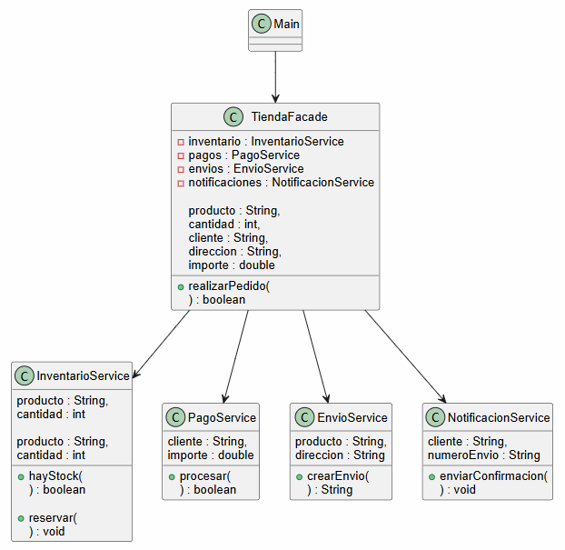
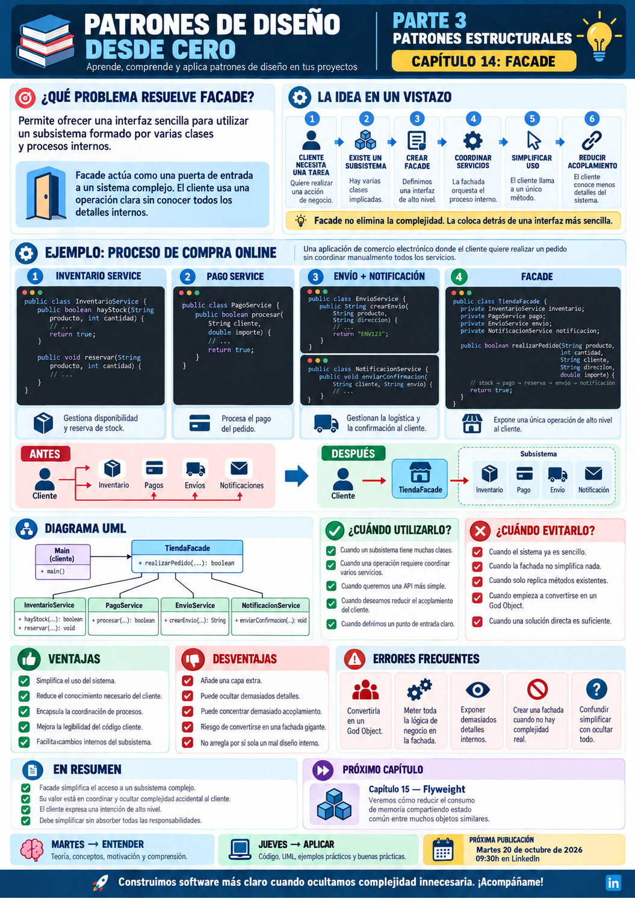

# 📚 Patrones de Diseño desde Cero

> **Aprende a diseñar software mantenible con ejemplos reales.**

# 📖 Capítulo 14 - Facade

> **📚 Patrones de Diseño desde Cero**  
> **🧱 Parte III - Patrones Estructurales**

---

## 🧠 Introducción

Continuamos nuestro recorrido por los **patrones estructurales**.

Hasta ahora hemos estudiado:

### 🔌 Adapter

> **¿Cómo hacemos colaborar interfaces incompatibles?**

### 🌉 Bridge

> **¿Cómo separamos dos dimensiones para que evolucionen de forma independiente?**

### 🌳 Composite

> **¿Cómo tratamos objetos individuales y grupos de objetos de forma uniforme?**

### 🎁 Decorator

> **¿Cómo añadimos responsabilidades dinámicamente sin modificar la clase original?**

Ahora nos encontramos con un problema diferente.

Imaginemos una aplicación de comercio electrónico.

Para completar una compra necesitamos:

```text
Comprobar inventario
        ↓
Procesar el pago
        ↓
Crear el envío
        ↓
Actualizar el pedido
        ↓
Enviar una notificación
```

Cada operación puede depender de una clase diferente.

El cliente podría terminar necesitando conocer:

```text
InventarioService
PagoService
EnvioService
PedidoService
NotificacionService
```

y además saber:

> **en qué orden debe utilizarlas.**

El problema ya no es que las clases sean incompatibles.

Tampoco necesitamos añadirles comportamiento.

El problema es que el cliente está obligado a conocer **demasiados detalles del subsistema**.

La pregunta será:

> **¿Cómo podemos proporcionar una interfaz sencilla para utilizar un subsistema complejo?**

Aquí aparece:

# 🏛️ Facade

Facade proporciona una **interfaz simplificada y de alto nivel** a un conjunto de clases, servicios u objetos que forman un subsistema.

---

# 🎯 Objetivos de aprendizaje

Al finalizar este capítulo deberías ser capaz de:

- Comprender qué problema intenta resolver Facade.
- Identificar subsistemas cuya utilización resulta demasiado compleja para el cliente.
- Comprender el papel de una fachada.
- Implementar Facade en Java.
- Ocultar procesos de coordinación detrás de operaciones de alto nivel.
- Reducir el acoplamiento entre el cliente y múltiples componentes.
- Comprender que Facade no sustituye necesariamente las interfaces originales.
- Diseñar fachadas pequeñas y orientadas a casos de uso.
- Diferenciar Facade de Adapter.
- Diferenciar Facade de Mediator.
- Diferenciar Facade de Proxy.
- Comprender sus ventajas y desventajas.
- Reconocer cuándo una fachada puede convertirse en un God Object.
- Saber cuándo utilizar Facade y cuándo una solución más directa es suficiente.

---

# ❌ El problema

Imaginemos que nuestro sistema de compras tiene varios servicios.

## InventarioService

```java
public class InventarioService {

    public boolean hayStock(
            String producto,
            int cantidad) {

        System.out.println(
            "📦 Comprobando stock..."
        );

        return true;
    }

    public void reservar(
            String producto,
            int cantidad) {

        System.out.println(
            "📦 Stock reservado"
        );
    }
}
```

---

## PagoService

```java
public class PagoService {

    public boolean procesar(
            String cliente,
            double importe) {

        System.out.println(
            "💳 Procesando pago de "
            + importe
        );

        return true;
    }
}
```

---

## EnvioService

```java
public class EnvioService {

    public String crearEnvio(
            String producto,
            String direccion) {

        System.out.println(
            "🚚 Creando envío"
        );

        return "ENV-001";
    }
}
```

---

## NotificacionService

```java
public class NotificacionService {

    public void enviarConfirmacion(
            String cliente,
            String numeroEnvio) {

        System.out.println(
            "📧 Confirmación enviada a "
            + cliente
        );
    }
}
```

Cada clase es perfectamente válida.

El problema aparece cuando el cliente tiene que coordinar todo el proceso.

---

# 😵 Cliente acoplado al subsistema

Sin Facade podríamos terminar escribiendo:

```java
InventarioService inventario =
        new InventarioService();

PagoService pagos =
        new PagoService();

EnvioService envios =
        new EnvioService();

NotificacionService notificaciones =
        new NotificacionService();

String producto =
        "PORTATIL";

int cantidad = 1;

String cliente =
        "jose@email.com";

String direccion =
        "Palma";

double importe =
        1200.00;

if (
    inventario.hayStock(
        producto,
        cantidad
    )
) {

    boolean pagoCorrecto =
            pagos.procesar(
                cliente,
                importe
            );

    if (pagoCorrecto) {

        inventario.reservar(
            producto,
            cantidad
        );

        String numeroEnvio =
                envios.crearEnvio(
                    producto,
                    direccion
                );

        notificaciones
            .enviarConfirmacion(
                cliente,
                numeroEnvio
            );
    }
}
```

El cliente necesita conocer:

- qué servicios existen;
- cómo crear cada uno;
- qué operaciones llamar;
- en qué orden;
- qué resultado necesita cada paso;
- cómo coordinar el flujo.

Tenemos:

```text
Cliente
   │
   ├── InventarioService
   ├── PagoService
   ├── EnvioService
   └── NotificacionService
```

El cliente está demasiado acoplado al funcionamiento interno del subsistema.

---

# 💡 Motivación

Queremos que el cliente pueda expresar su intención de una forma mucho más sencilla.

En lugar de:

```text
comprobar inventario
procesar pago
reservar stock
crear envío
enviar confirmación
```

queremos algo parecido a:

```java
tienda.realizarPedido(
    producto,
    cantidad,
    cliente,
    direccion,
    importe
);
```

El cliente debería decir:

> **"Quiero realizar un pedido."**

Y no:

> **"Quiero ejecutar estos cinco pasos internos en este orden concreto."**

Aquí aparece la fachada.

---

# 🏛️ La solución

Creamos una clase:

```text
TiendaFacade
```

que conoce el subsistema:

```text
TiendaFacade
      │
      ├── InventarioService
      ├── PagoService
      ├── EnvioService
      └── NotificacionService
```

El cliente solamente necesita utilizar:

```java
realizarPedido(...)
```

Conceptualmente:

```text
                CLIENTE
                   │
                   ▼
             ┌───────────┐
             │  FACADE   │
             └─────┬─────┘
                   │
        ┌──────────┼──────────┐
        │          │          │
        ▼          ▼          ▼
   Inventario    Pagos      Envíos
                              │
                              ▼
                       Notificaciones
```

La fachada proporciona una operación de alto nivel y coordina internamente las operaciones necesarias.

---

# 🧱 Participantes del patrón

Facade es estructuralmente uno de los patrones más sencillos.

Podemos identificar tres elementos principales.

## 1️⃣ Client

Es el código que necesita utilizar el subsistema.

Por ejemplo:

```text
Main
Controlador
API
Aplicación
```

---

## 2️⃣ Facade

Expone una interfaz sencilla.

En nuestro ejemplo:

```java
TiendaFacade
```

con:

```java
realizarPedido(...)
```

---

## 3️⃣ Subsystem

Está formado por las clases que realizan el trabajo real:

```text
InventarioService
PagoService
EnvioService
NotificacionService
```

La fachada **no sustituye necesariamente** estas clases.

Las coordina.

---

# ☕ Implementación en Java

## InventarioService.java

```java
public class InventarioService {

    public boolean hayStock(
            String producto,
            int cantidad) {

        System.out.println(
            "📦 Comprobando stock de "
            + producto
        );

        return true;
    }

    public void reservar(
            String producto,
            int cantidad) {

        System.out.println(
            "📦 Reservadas "
            + cantidad
            + " unidades de "
            + producto
        );
    }
}
```

---

## PagoService.java

```java
public class PagoService {

    public boolean procesar(
            String cliente,
            double importe) {

        System.out.println(
            "💳 Procesando pago de "
            + importe
            + " € para "
            + cliente
        );

        return true;
    }
}
```

---

## EnvioService.java

```java
public class EnvioService {

    public String crearEnvio(
            String producto,
            String direccion) {

        String numeroEnvio =
                "ENV-001";

        System.out.println(
            "🚚 Envío creado para "
            + producto
            + " hacia "
            + direccion
        );

        return numeroEnvio;
    }
}
```

---

## NotificacionService.java

```java
public class NotificacionService {

    public void enviarConfirmacion(
            String cliente,
            String numeroEnvio) {

        System.out.println(
            "📧 Confirmación enviada a "
            + cliente
            + ". Envío: "
            + numeroEnvio
        );
    }
}
```

---

## 🏛️ Facade - TiendaFacade.java

```java
public class TiendaFacade {

    private final InventarioService inventario;
    private final PagoService pagos;
    private final EnvioService envios;
    private final NotificacionService notificaciones;

    public TiendaFacade() {

        this.inventario =
                new InventarioService();

        this.pagos =
                new PagoService();

        this.envios =
                new EnvioService();

        this.notificaciones =
                new NotificacionService();
    }

    public boolean realizarPedido(
            String producto,
            int cantidad,
            String cliente,
            String direccion,
            double importe) {

        if (
            !inventario.hayStock(
                producto,
                cantidad
            )
        ) {

            System.out.println(
                "❌ No hay stock suficiente"
            );

            return false;
        }

        if (
            !pagos.procesar(
                cliente,
                importe
            )
        ) {

            System.out.println(
                "❌ No se pudo procesar el pago"
            );

            return false;
        }

        inventario.reservar(
            producto,
            cantidad
        );

        String numeroEnvio =
                envios.crearEnvio(
                    producto,
                    direccion
                );

        notificaciones
            .enviarConfirmacion(
                cliente,
                numeroEnvio
            );

        return true;
    }
}
```

---

## ▶️ Cliente - Main.java

Ahora el cliente solamente necesita conocer la fachada:

```java
public class Main {

    public static void main(String[] args) {

        TiendaFacade tienda =
                new TiendaFacade();

        tienda.realizarPedido(
            "PORTATIL",
            1,
            "jose@email.com",
            "Palma",
            1200.00
        );
    }
}
```

El cliente ya no necesita coordinar directamente:

```text
Inventario
Pagos
Envíos
Notificaciones
```

---

# 📤 Posible salida

```text
📦 Comprobando stock de PORTATIL
💳 Procesando pago de 1200.0 € para jose@email.com
📦 Reservadas 1 unidades de PORTATIL
🚚 Envío creado para PORTATIL hacia Palma
📧 Confirmación enviada a jose@email.com. Envío: ENV-001
```

---

# 🔎 Explicación paso a paso

## 1️⃣ Tenemos un subsistema

Está formado por varias clases especializadas:

```text
InventarioService
PagoService
EnvioService
NotificacionService
```

Cada una mantiene su responsabilidad.

---

## 2️⃣ El proceso requiere coordinación

Realizar un pedido implica:

```text
Stock
  ↓
Pago
  ↓
Reserva
  ↓
Envío
  ↓
Notificación
```

---

## 3️⃣ Creamos una fachada

```java
TiendaFacade
```

conoce qué componentes necesita.

---

## 4️⃣ Exponemos una operación de alto nivel

```java
realizarPedido(...)
```

representa una intención comprensible para el cliente.

---

## 5️⃣ La fachada coordina el subsistema

Internamente ejecuta las operaciones necesarias.

---

## 6️⃣ Simplificamos el cliente

El cliente pasa de necesitar múltiples dependencias a una única puerta de entrada.

```text
ANTES

Cliente
 ├── Inventario
 ├── Pago
 ├── Envío
 └── Notificación
```

```text
DESPUÉS

Cliente
    │
    ▼
Facade
    │
    ├── Inventario
    ├── Pago
    ├── Envío
    └── Notificación
```

---

# 📊 UML

Podemos representar el ejemplo mediante:



Conceptualmente:

```text
              CLIENTE
                 │
                 ▼
          ┌──────────────┐
          │    FACADE    │
          └──────┬───────┘
                 │
      ┌──────────┼──────────┐
      │          │          │
      ▼          ▼          ▼
  Servicio    Servicio   Servicio
      │                     │
      └──────────┬──────────┘
                 ▼
            SUBSISTEMA
```

---

# 🔑 La idea clave

Facade no pretende cambiar cómo funciona el subsistema.

Pretende cambiar:

> **cómo accede el cliente a él.**

El subsistema puede seguir teniendo muchas clases y operaciones.

La fachada ofrece una interfaz:

```text
más pequeña
más clara
más orientada al caso de uso
```

---

# 🚪 Una puerta de entrada

Podemos visualizar Facade como una puerta:

```text
     CLIENTE
        │
        │
        ▼
┌───────────────┐
│    FACADE     │
│               │
│ realizarPedido│
└───────┬───────┘
        │
        ▼

SUBSISTEMA COMPLEJO

Inventario
Pagos
Envíos
Notificaciones
...
```

El cliente no necesita conocer todos los pasillos internos del sistema.

Solo necesita saber:

> **qué puerta utilizar.**

---

# ⚠️ Facade no oculta necesariamente todo

Una cuestión importante:

> **Facade no obliga a impedir el acceso directo al subsistema.**

Podemos tener:

```java
TiendaFacade
```

para operaciones habituales.

Pero determinado código avanzado podría utilizar directamente:

```java
InventarioService
```

si realmente lo necesita.

Facade proporciona una interfaz simplificada.

No tiene por qué convertirse en la única forma técnicamente posible de acceder al subsistema.

---

# 🏛️ Podemos tener varias fachadas

Un subsistema grande no tiene por qué tener una única fachada gigantesca.

Podríamos tener:

```text
PedidoFacade
PagoFacade
AdministracionFacade
ClienteFacade
```

Cada una orientada a diferentes casos de uso.

Esto suele ser preferible a terminar con:

```text
MegaSistemaFacade
```

con cientos de métodos.

---

# 🏗️ Caso de uso: aplicación multimedia

Imaginemos que para reproducir una película necesitamos:

```text
Proyector
Amplificador
Reproductor
Luces
Pantalla
```

Sin Facade:

```java
luces.apagar();
pantalla.bajar();
proyector.encender();
amplificador.encender();
reproductor.encender();
reproductor.reproducir();
```

Podríamos ofrecer:

```java
cine.verPelicula();
```

La fachada se encarga de coordinar todo el proceso.

---

# 💻 Caso de uso: API / SDK

Una librería puede tener muchas clases internas:

```text
AuthClient
HttpClient
TokenManager
Serializer
RetryManager
ConnectionPool
```

Pero ofrecer al usuario:

```java
api.obtenerUsuario(id);
```

Facade resulta especialmente útil para crear **APIs sencillas sobre sistemas internamente complejos**.

---

# 🧪 Caso de uso: tests

Si una operación necesita coordinar cinco componentes, el cliente puede terminar dependiendo de todos ellos.

Introducir una fachada bien diseñada puede permitir probar el caso de uso desde una interfaz más clara.

Pero cuidado:

> **Facade no debe utilizarse para ocultar un mal diseño del subsistema.**

---

# 🎯 ¿Cuándo utilizar Facade?

Facade puede resultar adecuado cuando:

- Un subsistema tiene muchas clases.
- El cliente necesita conocer demasiados detalles internos.
- Existen operaciones que requieren coordinar varios componentes.
- Queremos ofrecer una API más sencilla.
- Queremos reducir el acoplamiento entre cliente y subsistema.
- Necesitamos definir puntos de entrada claros.
- Estamos diseñando una librería o SDK.
- Queremos encapsular secuencias habituales de operaciones.
- Estamos trabajando con código legado complejo.

---

# 🚫 ¿Cuándo evitarlo?

Probablemente no necesitamos Facade cuando:

- El subsistema ya es sencillo.
- El cliente solo necesita utilizar una clase.
- La fachada simplemente replica todas las operaciones existentes.
- No existe una simplificación real.
- El cliente necesita constantemente acceder directamente al subsistema.
- La fachada empieza a acumular demasiada lógica.
- Estamos utilizando Facade para esconder responsabilidades mal distribuidas.

---

# ✅ Ventajas

## 🔹 Simplifica el uso del sistema

El cliente necesita conocer menos clases y operaciones.

---

## 🔹 Reduce el acoplamiento

En lugar de depender de:

```text
A
B
C
D
E
```

puede depender de:

```text
Facade
```

---

## 🔹 Encapsula coordinación

La secuencia de operaciones queda centralizada.

---

## 🔹 Proporciona una API de alto nivel

Podemos expresar:

```java
realizarPedido();
```

en lugar de los detalles internos.

---

## 🔹 Facilita cambios internos

Podemos modificar parte del subsistema sin afectar necesariamente a todos los clientes.

---

## 🔹 Mejora la legibilidad

El código cliente expresa mejor su intención.

---

# ❌ Desventajas

## 🔸 Puede convertirse en un God Object

Si añadimos demasiadas responsabilidades:

```text
Facade
├── usuarios
├── pagos
├── pedidos
├── informes
├── seguridad
├── facturación
├── notificaciones
└── ...
```

terminamos creando un nuevo problema.

---

## 🔸 Puede ocultar demasiados detalles

A veces el cliente necesita funcionalidades avanzadas que la fachada no expone.

---

## 🔸 Añade otra capa

Existe una nueva clase entre cliente y subsistema.

---

## 🔸 Puede aumentar el acoplamiento hacia la propia fachada

Si absolutamente todo el sistema depende de una enorme Facade, habremos concentrado el acoplamiento en otro lugar.

---

## 🔸 Puede esconder un mal diseño

Una fachada sencilla sobre un subsistema caótico no arregla automáticamente la arquitectura interna.

---

# ⚠️ Facade no significa mover toda la lógica

Un error habitual sería hacer:

```text
InventarioService
PagoService
EnvioService
NotificacionService
```

prácticamente vacíos y trasladar toda la lógica a:

```text
TiendaFacade
```

❌ Ese no es el objetivo.

Las clases del subsistema deberían seguir realizando sus responsabilidades.

Facade principalmente:

```text
coordina
simplifica
orquesta
```

---

# ⚠️ Facade no es una clase "Utils"

Una clase con:

```java
static metodoA()
static metodoB()
static metodoC()
```

no es automáticamente una fachada.

Facade tiene una intención concreta:

> **proporcionar una interfaz de alto nivel que simplifique la utilización de un subsistema.**

---

# 🚨 Errores frecuentes

## ❌ Crear una Facade gigantesca

Una fachada con decenas o cientos de responsabilidades puede convertirse en un God Object.

---

## ❌ Meter toda la lógica de negocio dentro

La fachada debe coordinar, no absorber todas las responsabilidades.

---

## ❌ Exponer todos los detalles internos

Si tenemos:

```text
Facade.metodoAInterno()
Facade.metodoBInterno()
Facade.metodoCInterno()
...
```

quizá no estamos simplificando nada.

---

## ❌ Crear Facade sin complejidad real

Si solo tenemos:

```java
servicio.procesar();
```

no necesitamos necesariamente:

```java
facade.procesar();
```

---

## ❌ Acoplar la fachada a demasiados dominios

Es preferible varias fachadas cohesionadas que una fachada universal.

---

## ❌ Confundir simplificar con ocultar

Facade no debería impedir casos de uso legítimos más avanzados.

---

# 🧠 Buenas prácticas

## 1️⃣ Diseña operaciones orientadas a casos de uso

Mejor:

```java
realizarPedido();
```

que:

```java
ejecutarProceso1();
```

---

## 2️⃣ Mantén la fachada pequeña

Expón únicamente lo que simplifique realmente al cliente.

---

## 3️⃣ Delega el trabajo

La fachada debe utilizar:

```text
servicios
componentes
subsistemas
```

en lugar de absorber toda su lógica.

---

## 4️⃣ Evita convertirla en un God Object

Si empieza a crecer demasiado:

> **divide la fachada.**

---

## 5️⃣ Mantén las responsabilidades internas

Por ejemplo:

```text
PagoService → pagos
EnvioService → envíos
```

La fachada solo coordina.

---

## 6️⃣ Utiliza inyección de dependencias cuando sea apropiado

En una aplicación real podríamos escribir:

```java
public TiendaFacade(
        InventarioService inventario,
        PagoService pagos,
        EnvioService envios,
        NotificacionService notificaciones) {

    this.inventario = inventario;
    this.pagos = pagos;
    this.envios = envios;
    this.notificaciones =
            notificaciones;
}
```

Esto puede facilitar:

- pruebas;
- sustitución de dependencias;
- configuración;
- desacoplamiento.

---

# 🆚 Facade vs. Adapter

Esta comparación es especialmente importante.

Ambos pueden situarse entre cliente y otra clase.

Pero su intención es diferente.

| Facade | Adapter |
|---|---|
| Simplifica una interfaz | Hace compatible una interfaz |
| Puede representar varias clases | Suele adaptar un componente |
| Proporciona una API de alto nivel | Traduce una API a otra |
| No necesita incompatibilidad | Parte de una incompatibilidad |
| Simplifica | Traduce |

Podemos resumirlo:

```text
ADAPTER

Cliente espera A
      │
      ▼
   Adapter
      │
      ▼
Sistema ofrece B
```

Mientras que:

```text
FACADE

Cliente
   │
   ▼
Interfaz sencilla
   │
   ▼
Subsistema complejo
```

> **Adapter traduce. Facade simplifica.**

---

# 🆚 Facade vs. Decorator

| Facade | Decorator |
|---|---|
| Proporciona una interfaz simplificada | Mantiene la misma interfaz |
| Simplifica el acceso | Añade comportamiento |
| Puede envolver un subsistema completo | Normalmente envuelve un componente |
| No busca combinar capas | Puede encadenarse |

Decorator pregunta:

> **¿Cómo añado responsabilidades?**

Facade pregunta:

> **¿Cómo oculto complejidad de uso?**

---

# 🆚 Facade vs. Proxy

Facade y Proxy también pueden actuar como intermediarios.

Pero:

| Facade | Proxy |
|---|---|
| Simplifica el subsistema | Controla acceso a un objeto |
| Puede cambiar completamente la interfaz | Suele conservar la interfaz |
| Puede representar muchas clases | Representa normalmente un objeto |
| Reduce complejidad de uso | Añade control/intermediación |

Proxy lo estudiaremos en el **Capítulo 16**.

---

# 🆚 Facade vs. Mediator

Esta comparación es más sutil.

### Facade

Organiza cómo **el exterior accede al subsistema**.

```text
Cliente
  ↓
Facade
  ↓
Subsistema
```

### Mediator

Organiza cómo **los componentes se comunican entre ellos**.

```text
Componente A
      ↘
      Mediator
      ↗
Componente B
```

Podemos resumirlo:

> **Facade simplifica hacia fuera. Mediator coordina hacia dentro.**

Mediator aparecerá posteriormente entre los **patrones de comportamiento**, en el **capítulo 23** de la **Parte IV**.

---

# 🧠 Principios relacionados

Facade conecta especialmente con varios principios de diseño.

## 🔗 Bajo acoplamiento

El cliente puede depender de una única fachada en lugar de múltiples clases internas.

---

## 🧩 Separación de responsabilidades

Cada servicio continúa realizando su trabajo.

La fachada coordina el caso de uso.

---

## 🔒 Encapsulación

Los detalles de coordinación quedan ocultos al cliente.

---

## 🎯 Interfaces orientadas a intención

Podemos expresar:

```java
realizarPedido();
```

en lugar de una secuencia de operaciones técnicas.

---

## 🔄 Diseñar para el cambio

Cambios internos del subsistema pueden quedar contenidos detrás de la fachada.

---

# 📌 Resumen

En este capítulo hemos aprendido que:

- Facade pertenece a los patrones estructurales.
- Proporciona una interfaz simplificada a un subsistema complejo.
- Puede coordinar varias clases y servicios.
- Permite expresar operaciones de alto nivel.
- Reduce el conocimiento que necesita el cliente sobre detalles internos.
- Puede reducir el acoplamiento entre cliente y subsistema.
- No sustituye necesariamente las interfaces originales.
- Podemos tener varias fachadas para un mismo subsistema.
- La fachada debe delegar y coordinar, no absorber toda la lógica.
- Puede convertirse en un God Object si acumula demasiadas responsabilidades.
- Facade y Adapter tienen intenciones diferentes.
- Adapter traduce interfaces.
- Facade simplifica el acceso.
- No necesitamos una fachada cuando el subsistema ya es sencillo.

La pregunta fundamental de Facade es:

> **¿Nuestro cliente necesita conocer demasiados detalles de un subsistema para realizar una operación que conceptualmente debería ser sencilla?**

---

# 🎓 Conclusiones

Facade introduce una idea muy sencilla, pero extremadamente útil:

> **La complejidad interna no tiene por qué convertirse en complejidad para el cliente.**

Sin Facade podemos tener:

```text
Cliente
 ├── Inventario
 ├── Pagos
 ├── Envíos
 └── Notificaciones
```

Y además el cliente debe saber cómo coordinarlos.

Con Facade:

```text
Cliente
   │
   ▼
TiendaFacade
   │
   ├── Inventario
   ├── Pagos
   ├── Envíos
   └── Notificaciones
```

El cliente expresa:

```java
realizarPedido();
```

y la fachada conoce los detalles necesarios para llevarlo a cabo.

Pero esa simplificación no significa trasladar toda la lógica a una única clase.

Una buena Facade:

```text
SIMPLIFICA
    +
 COORDINA
    +
  DELEGA
```

Una mala Facade:

```text
SABE TODO
    +
HACE TODO
    +
CONTROLA TODO
```

Por eso seguimos aplicando nuestra metodología:

```text
PROBLEMA
   ↓
CONTEXTO
   ↓
¿EL CLIENTE CONOCE
DEMASIADOS DETALLES?
   ↓
¿PODEMOS EXPONER
UN CASO DE USO MÁS SIMPLE?
   ↓
ALTERNATIVAS
   ↓
¿FACADE APORTA VALOR?
```

No utilizamos Facade simplemente para añadir otra capa.

Lo utilizamos cuando esa capa **reduce de verdad la complejidad que el cliente necesita conocer**.

> **Facade no elimina la complejidad del sistema. La coloca detrás de una interfaz mejor diseñada.**

---

# 🖼️ Infografía

Aquí os dejo una infografía sobre este **capítulo 14**.



---

**📚 Patrones de Diseño desde Cero**

*Aprende a diseñar software mantenible con ejemplos reales.*