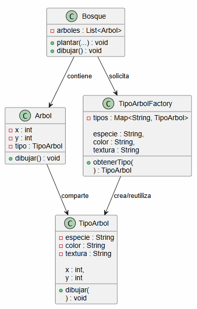
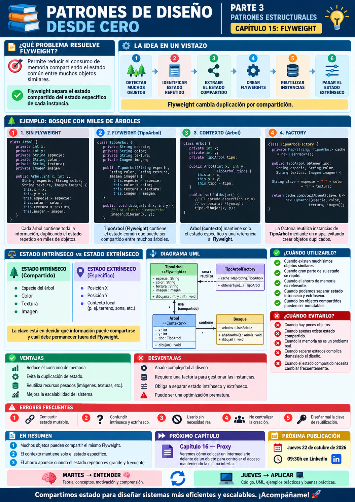

# 📚 Patrones de Diseño desde Cero

> **Aprende a diseñar software mantenible con ejemplos reales.**

# 📖 Capítulo 15 - Flyweight

> **📚 Patrones de Diseño desde Cero**  
> **🧱 Parte III - Patrones Estructurales**

---

## 🧠 Introducción

Continuamos nuestro recorrido por los **patrones estructurales**.

Hasta ahora hemos estudiado:

### 🔌 Adapter

> **¿Cómo hacemos colaborar interfaces incompatibles?**

### 🌉 Bridge

> **¿Cómo separamos dos dimensiones para que evolucionen de forma independiente?**

### 🌳 Composite

> **¿Cómo tratamos objetos individuales y grupos de objetos de forma uniforme?**

### 🎁 Decorator

> **¿Cómo añadimos responsabilidades dinámicamente sin modificar la clase original?**

### 🏛️ Facade

> **¿Cómo simplificamos el acceso a un subsistema complejo?**

Ahora nos encontramos con un problema completamente diferente.

Imaginemos una aplicación que representa un bosque.

Podemos tener:

```text
10.000 árboles
100.000 árboles
1.000.000 árboles
```

Cada árbol necesita información como:

```text
posición X
posición Y
especie
color
textura
imagen
```

Pero aparece una observación importante.

Miles de árboles pueden compartir exactamente:

```text
la misma especie
el mismo color
la misma textura
la misma imagen
```

Mientras que únicamente cambia:

```text
su posición
```

Entonces surge una pregunta:

> **¿Tiene sentido almacenar una copia completa de toda esa información en cada objeto?**

Aquí aparece:

# 🪶 Flyweight

Flyweight permite reducir el consumo de memoria **compartiendo el estado común entre muchos objetos similares**.

---

# 🎯 Objetivos de aprendizaje

Al finalizar este capítulo deberías ser capaz de:

- Comprender qué problema intenta resolver Flyweight.
- Identificar objetos que comparten gran cantidad de información.
- Diferenciar estado intrínseco y estado extrínseco.
- Comprender qué información puede compartirse.
- Implementar Flyweight en Java.
- Comprender el papel de `FlyweightFactory`.
- Reutilizar objetos Flyweight existentes.
- Reducir la duplicación de estado en memoria.
- Comprender cuándo el patrón puede mejorar el uso de recursos.
- Identificar el coste adicional de separar estados.
- Diferenciar Flyweight de Singleton.
- Diferenciar Flyweight de Prototype.
- Reconocer cuándo Flyweight introduce complejidad innecesaria.

---

# ❌ El problema

Imaginemos una clase:

```java
public class Arbol {

    private int x;
    private int y;

    private String especie;
    private String color;
    private String textura;
    private byte[] imagen;

    // ...
}
```

Cada árbol almacena:

```text
posición
+
especie
+
color
+
textura
+
imagen
```

Ahora imaginemos:

```java
List<Arbol> bosque =
        new ArrayList<>();
```

Y añadimos:

```text
500.000 árboles
```

Muchos pueden ser del mismo tipo:

```text
Roble
Pino
Olivo
```

Pero cada instancia mantiene una copia de:

```text
especie
color
textura
imagen
```

aunque esa información sea idéntica.

Conceptualmente:

```text
Árbol 1
├── x = 10
├── y = 20
├── especie = Roble
├── color = Verde
├── textura = ...
└── imagen = ...

Árbol 2
├── x = 40
├── y = 70
├── especie = Roble
├── color = Verde
├── textura = ...
└── imagen = ...

Árbol 3
├── x = 100
├── y = 300
├── especie = Roble
├── color = Verde
├── textura = ...
└── imagen = ...
```

Estamos duplicando mucha información.

---

# 💡 Motivación

Queremos separar la información que:

```text
CAMBIA EN CADA OBJETO
```

de la información que:

```text
PUEDE COMPARTIRSE
```

Por ejemplo:

```text
Cada árbol
│
├── x
└── y
```

Pero muchos árboles pueden compartir:

```text
TipoArbol
│
├── especie
├── color
├── textura
└── imagen
```

Entonces la estructura puede convertirse en:

```text
Árbol 1 ──┐
Árbol 2 ──┼──► TipoArbol: Roble
Árbol 3 ──┘
```

En lugar de almacenar:

```text
3 copias
```

de la misma información, almacenamos:

```text
1 única instancia compartida
```

---

# 🧠 Estado intrínseco y extrínseco

Para comprender Flyweight debemos distinguir dos conceptos fundamentales.

## 🔵 Estado intrínseco

Es la información que puede compartirse entre muchos objetos.

En nuestro ejemplo:

```text
especie
color
textura
imagen
```

Esta información pertenece al Flyweight.

---

## 🟠 Estado extrínseco

Es la información específica de cada contexto.

En nuestro ejemplo:

```text
x
y
```

Cada árbol tiene su propia posición.

---

Podemos resumirlo:

```text
FLYWEIGHT

ESTADO INTRÍNSECO
       ↓
   compartido


CONTEXTO

ESTADO EXTRÍNSECO
       ↓
   específico
```

---

# 🪶 La solución

Creamos una clase que represente el estado compartido:

```java
public class TipoArbol {

    private final String especie;
    private final String color;
    private final String textura;

    // ...
}
```

Cada árbol mantiene únicamente:

```text
posición
+
referencia a TipoArbol
```

Por ejemplo:

```java
public class Arbol {

    private final int x;
    private final int y;

    private final TipoArbol tipo;
}
```

Ahora muchos árboles pueden utilizar:

```text
el mismo TipoArbol
```

---

# 🧱 Participantes del patrón

Flyweight suele incluir varios participantes.

## 1️⃣ Flyweight

Contiene el estado intrínseco compartido.

En nuestro ejemplo:

```text
TipoArbol
```

---

## 2️⃣ Context

Contiene el estado extrínseco.

En nuestro ejemplo:

```text
Arbol
```

---

## 3️⃣ FlyweightFactory

Se encarga de crear o reutilizar Flyweights.

Por ejemplo:

```text
TipoArbolFactory
```

---

## 4️⃣ Client

Solicita Flyweights y proporciona el estado extrínseco.

Por ejemplo:

```text
Bosque
```

---

# ☕ Implementación en Java

## Flyweight - TipoArbol.java

```java
public class TipoArbol {

    private final String especie;
    private final String color;
    private final String textura;

    public TipoArbol(
            String especie,
            String color,
            String textura) {

        this.especie = especie;
        this.color = color;
        this.textura = textura;
    }

    public void dibujar(
            int x,
            int y) {

        System.out.println(
            "🌳 Dibujando "
            + especie
            + " en ("
            + x
            + ", "
            + y
            + ")"
        );
    }
}
```

Observa que:

```java
x
y
```

no forman parte de `TipoArbol`.

Son información extrínseca.

---

## 🌳 Context - Arbol.java

```java
public class Arbol {

    private final int x;
    private final int y;

    private final TipoArbol tipo;

    public Arbol(
            int x,
            int y,
            TipoArbol tipo) {

        this.x = x;
        this.y = y;
        this.tipo = tipo;
    }

    public void dibujar() {

        tipo.dibujar(
            x,
            y
        );
    }
}
```

Cada árbol mantiene únicamente:

```text
x
y
referencia al TipoArbol
```

---

## 🏭 FlyweightFactory - TipoArbolFactory.java

Necesitamos reutilizar los tipos existentes.

Podemos utilizar un mapa:

```java
import java.util.HashMap;
import java.util.Map;

public class TipoArbolFactory {

    private static final Map<String, TipoArbol>
            tipos =
            new HashMap<>();

    public static TipoArbol obtenerTipo(
            String especie,
            String color,
            String textura) {

        String clave =
                especie
                + "-"
                + color
                + "-"
                + textura;

        return tipos.computeIfAbsent(
            clave,
            k -> new TipoArbol(
                especie,
                color,
                textura
            )
        );
    }

    public static int numeroTipos() {

        return tipos.size();
    }
}
```

La fábrica comprueba si el Flyweight ya existe.

Si existe:

```text
lo reutiliza
```

Si no existe:

```text
lo crea
+
lo almacena
```

---

## 🌲 Bosque.java

```java
import java.util.ArrayList;
import java.util.List;

public class Bosque {

    private final List<Arbol> arboles =
            new ArrayList<>();

    public void plantar(
            int x,
            int y,
            String especie,
            String color,
            String textura) {

        TipoArbol tipo =
                TipoArbolFactory
                    .obtenerTipo(
                        especie,
                        color,
                        textura
                    );

        Arbol arbol =
                new Arbol(
                    x,
                    y,
                    tipo
                );

        arboles.add(
            arbol
        );
    }

    public void dibujar() {

        for (
            Arbol arbol :
            arboles
        ) {

            arbol.dibujar();
        }
    }

    public int numeroArboles() {

        return arboles.size();
    }
}
```

---

## ▶️ Cliente - Main.java

```java
public class Main {

    public static void main(String[] args) {

        Bosque bosque =
                new Bosque();

        bosque.plantar(
            10,
            20,
            "Roble",
            "Verde",
            "rugosa"
        );

        bosque.plantar(
            50,
            60,
            "Roble",
            "Verde",
            "rugosa"
        );

        bosque.plantar(
            100,
            120,
            "Roble",
            "Verde",
            "rugosa"
        );

        bosque.plantar(
            200,
            240,
            "Pino",
            "Verde oscuro",
            "fina"
        );

        bosque.dibujar();

        System.out.println(
            "Árboles: "
            + bosque.numeroArboles()
        );

        System.out.println(
            "Tipos compartidos: "
            + TipoArbolFactory
                .numeroTipos()
        );
    }
}
```

---

# 📤 Posible salida

```text
🌳 Dibujando Roble en (10, 20)
🌳 Dibujando Roble en (50, 60)
🌳 Dibujando Roble en (100, 120)
🌳 Dibujando Pino en (200, 240)

Árboles: 4
Tipos compartidos: 2
```

Tenemos:

```text
4 árboles
```

pero solamente:

```text
2 tipos de árbol
```

---

# 🔎 Explicación paso a paso

## 1️⃣ Identificamos información repetida

Muchos árboles tienen:

```text
misma especie
mismo color
misma textura
```

---

## 2️⃣ Extraemos el estado compartido

Creamos:

```java
TipoArbol
```

que contiene el estado intrínseco.

---

## 3️⃣ Dejamos el estado específico en el contexto

Cada:

```java
Arbol
```

mantiene únicamente:

```text
x
y
```

y una referencia al Flyweight.

---

## 4️⃣ Utilizamos una Factory

```java
TipoArbolFactory
```

evita crear Flyweights duplicados.

---

## 5️⃣ Reutilizamos

Si solicitamos:

```text
Roble + Verde + rugosa
```

varias veces, recibimos la misma instancia.

---

## 6️⃣ Proporcionamos el estado extrínseco

Cuando llamamos:

```java
tipo.dibujar(
    x,
    y
);
```

pasamos la información específica de ese árbol.

---

# 📊 UML

Podemos representar el patrón así:



Conceptualmente:

```text
                 FlyweightFactory
                         │
                         ▼
                     TipoArbol
                    /    |    \
                   /     |     \
                  /      |      \
            Árbol 1  Árbol 2  Árbol 3
               │        │        │
              x,y      x,y      x,y
```

---

# 🪶 ¿Dónde está el ahorro?

Sin Flyweight podríamos tener:

```text
100.000 árboles
×
imagen
×
textura
×
información de especie
```

Con Flyweight:

```text
100.000 árboles
│
├── posiciones individuales
│
└── referencias
      ↓
   unos pocos
   TipoArbol
```

El ahorro será especialmente importante cuando el estado compartido sea:

```text
grande
+
costoso
+
muy repetido
```

---

# 📦 Ejemplo conceptual de memoria

Supongamos que cada árbol guarda:

```text
posición = 16 bytes

tipo + textura + imagen =
10 KB
```

Para:

```text
100.000 árboles
```

sin compartir podríamos necesitar aproximadamente:

```text
100.000 × 10 KB
≈ 1 GB
```

Si solo existen:

```text
10 tipos
```

con Flyweight almacenamos el estado pesado unas pocas veces.

El ejemplo es simplificado, pero muestra la idea:

> **El beneficio aparece cuando existe una gran cantidad de objetos y mucho estado repetido.**

---

# 🔑 La idea clave

Flyweight no consiste simplemente en:

> **reutilizar objetos.**

Consiste en:

> **extraer y compartir el estado intrínseco que se repite entre muchos objetos.**

Mientras el estado extrínseco permanece fuera.

Podemos visualizarlo:

```text
ANTES

Objeto
├── estado único
└── estado repetido

Objeto
├── estado único
└── estado repetido

Objeto
├── estado único
└── estado repetido
```

Después:

```text
OBJETOS

Objeto ──┐
Objeto ──┼──► ESTADO COMPARTIDO
Objeto ──┘
```

---

# 🏭 El papel de la Factory

La fábrica es muy importante porque queremos evitar esto:

```java
new TipoArbol(...);
new TipoArbol(...);
new TipoArbol(...);
```

Necesitamos controlar la reutilización.

Por eso hacemos:

```java
TipoArbolFactory.obtenerTipo(...);
```

La fábrica funciona como:

```text
CACHE DE FLYWEIGHTS
```

---

# 🔒 Los Flyweights deberían ser inmutables

Como un mismo Flyweight puede compartirse entre muchos objetos, modificarlo podría afectar a todos ellos.

Por ejemplo:

```text
Árbol 1 ─┐
Árbol 2 ─┼─► TipoArbol
Árbol 3 ─┘
```

Si modificamos:

```text
TipoArbol.color
```

el cambio afectaría conceptualmente a todos.

Por eso suele ser recomendable que el estado intrínseco sea:

> **inmutable**

En nuestro ejemplo utilizamos:

```java
private final String especie;
private final String color;
private final String textura;
```

y no proporcionamos setters.

---

# 🏗️ Caso de uso: editor de texto

Imaginemos un documento con:

```text
1.000.000 caracteres
```

Cada carácter podría contener:

```text
letra
fuente
tamaño
color
estilo
posición
```

Pero muchos caracteres comparten:

```text
fuente
tamaño
color
estilo
```

Podemos separar:

```text
GlyphStyle
```

como estado compartido.

Mientras:

```text
posición
carácter
```

pueden mantenerse como contexto.

---

# 🎮 Caso de uso: videojuegos

En un videojuego podemos tener:

```text
10.000 enemigos
```

Muchos comparten:

```text
modelo 3D
texturas
animaciones
tipo
```

pero cada uno tiene:

```text
posición
vida
dirección
estado actual
```

Flyweight puede ayudar a compartir los recursos pesados.

---

# 🗺️ Caso de uso: mapas

Un mapa puede representar:

```text
miles de árboles
señales
edificios
iconos
```

Los iconos visuales pueden compartirse mientras cada instancia mantiene su posición.

---

# 🎯 ¿Cuándo utilizar Flyweight?

Flyweight puede resultar adecuado cuando:

- Tenemos una cantidad enorme de objetos.
- Muchos objetos comparten gran parte de su estado.
- El estado compartido consume bastante memoria.
- El consumo de memoria es un problema real.
- Podemos separar claramente estado intrínseco y extrínseco.
- Los Flyweights pueden mantenerse inmutables.
- La reutilización de instancias ofrece un beneficio medible.

---

# 🚫 ¿Cuándo evitarlo?

Probablemente no necesitamos Flyweight cuando:

- Tenemos pocos objetos.
- Los objetos apenas comparten información.
- El estado compartido es pequeño.
- La memoria no representa un problema.
- Separar los estados complica demasiado el diseño.
- La identidad individual del objeto es importante.
- El estado compartido necesita modificarse frecuentemente.
- La optimización no aporta una mejora real.

---

# ✅ Ventajas

## 🔹 Reduce el consumo de memoria

El estado repetido se almacena una sola vez.

---

## 🔹 Permite gestionar grandes cantidades de objetos

Especialmente cuando el estado intrínseco es pesado.

---

## 🔹 Centraliza recursos compartidos

Por ejemplo:

```text
texturas
fuentes
imágenes
configuraciones
```

---

## 🔹 Reduce duplicación

Múltiples objetos pueden utilizar el mismo Flyweight.

---

## 🔹 Puede mejorar el rendimiento indirectamente

Menos objetos pesados pueden significar menor presión sobre memoria y garbage collector.

---

# ❌ Desventajas

## 🔸 Aumenta la complejidad

Debemos separar:

```text
estado intrínseco
estado extrínseco
```

correctamente.

---

## 🔸 Añade indirección

Los objetos dependen de recursos compartidos.

---

## 🔸 Puede aumentar el coste de cálculo

Parte del estado debe proporcionarse en cada operación.

---

## 🔸 Puede complicar el código

Una estructura antes sencilla puede pasar a tener:

```text
Context
Flyweight
Factory
Cache
```

---

## 🔸 Puede ser una optimización prematura

Si la memoria no es realmente un problema, quizá estamos añadiendo complejidad sin beneficio.

---

# ⚠️ Flyweight no es simplemente cachear objetos

Un cache puede almacenar objetos para evitar volver a crearlos.

Flyweight tiene una intención más concreta:

> **compartir estado intrínseco entre muchas entidades lógicas.**

La fábrica puede utilizar una caché como mecanismo, pero:

```text
CACHE ≠ FLYWEIGHT
```

automáticamente.

---

# ⚠️ Flyweight no elimina las instancias

Podemos seguir teniendo:

```text
100.000 Árboles
```

Lo que reducimos es la información pesada almacenada dentro de cada uno.

Es decir:

```text
muchos Context
+
pocos Flyweight
```

---

# 🚨 Errores frecuentes

## ❌ Compartir estado mutable

Puede provocar efectos laterales difíciles de detectar.

---

## ❌ Confundir estado intrínseco y extrínseco

Si almacenamos datos específicos dentro del Flyweight, puede dejar de ser compartible.

---

## ❌ Utilizar Flyweight con pocos objetos

Probablemente añadimos complejidad sin obtener beneficio.

---

## ❌ Aplicarlo sin medir

No deberíamos asumir que existe un problema de memoria.

Primero debemos comprobarlo.

---

## ❌ Crear Flyweights manualmente

Si cada cliente hace:

```java
new TipoArbol(...)
```

perdemos la reutilización.

---

## ❌ Crear una clave incorrecta en la Factory

Dos objetos con estados intrínsecos diferentes no deberían compartir el mismo Flyweight.

---

# 🧠 Buenas prácticas

## 1️⃣ Mide antes de optimizar

Determina si realmente existe un problema de memoria.

---

## 2️⃣ Haz inmutable el estado intrínseco

Reduce errores derivados de compartir instancias.

---

## 3️⃣ Mantén el estado extrínseco fuera

El Flyweight no debería conocer información específica de cada contexto.

---

## 4️⃣ Centraliza la creación

Utiliza una Factory para controlar la reutilización.

---

## 5️⃣ Diseña una clave estable

La clave debe representar correctamente el estado intrínseco.

---

## 6️⃣ No compartas por compartir

El patrón debe aportar un ahorro real.

---

# 🆚 Flyweight vs. Singleton

Ambos patrones pueden compartir una instancia.

Pero su intención es diferente.

| Flyweight | Singleton |
|---|---|
| Puede haber muchos Flyweights | Existe una única instancia |
| Cada Flyweight representa un estado compartido | La clase controla su unicidad |
| Busca ahorrar memoria | Busca controlar cantidad |
| Normalmente utiliza Factory | Normalmente utiliza `getInstance()` |
| Comparte por equivalencia de estado | Comparte por identidad global |

Podemos resumirlo:

```text
SINGLETON

Una clase
   ↓
Una instancia
```

Mientras que:

```text
FLYWEIGHT

Muchas entidades
   ↓
Comparten unas pocas instancias
```

---

# 🆚 Flyweight vs. Prototype

| Flyweight | Prototype |
|---|---|
| Comparte objetos | Copia objetos |
| Reduce duplicación | Genera nuevas instancias |
| Busca ahorrar memoria | Busca simplificar creación |
| Muchas referencias al mismo objeto | Cada clon es independiente |

Podemos resumirlo:

```text
FLYWEIGHT
    ↓
COMPARTIR
```

```text
PROTOTYPE
    ↓
  COPIAR
```

---

# 🆚 Flyweight vs. Facade

| Flyweight | Facade |
|---|---|
| Optimiza almacenamiento | Simplifica uso |
| Comparte estado | Oculta complejidad |
| Está relacionado con memoria | Está relacionado con interfaz |
| Muchos objetos similares | Subsistema complejo |

Sus objetivos son completamente distintos.

---

# 🧠 Principios relacionados

Flyweight conecta con varios conceptos importantes.

## ♻️ Reutilización

Compartimos información que no necesita duplicarse.

---

## 🔒 Inmutabilidad

El estado compartido debería ser estable.

---

## 📦 Separación de estado

Diferenciamos:

```text
intrínseco
extrínseco
```

---

## 🎯 Optimización basada en contexto

Flyweight tiene sentido cuando existe un problema real de recursos.

---

## 🧩 Responsabilidades claras

La Factory controla la reutilización.

El Context mantiene el estado específico.

El Flyweight mantiene el estado compartido.

---

# 📌 Resumen

En este capítulo hemos aprendido que:

- Flyweight pertenece a los patrones estructurales.
- Su objetivo principal es reducir duplicación de estado.
- Resulta especialmente útil cuando existen muchísimos objetos similares.
- El estado intrínseco se comparte.
- El estado extrínseco permanece fuera del Flyweight.
- Una Factory suele encargarse de reutilizar instancias.
- Los Flyweights deberían ser preferiblemente inmutables.
- Flyweight puede reducir significativamente el consumo de memoria.
- También aumenta la complejidad del diseño.
- Debemos medir antes de introducir una optimización.
- Flyweight no es simplemente una caché.
- Flyweight no elimina los objetos de contexto.
- Flyweight y Singleton tienen intenciones diferentes.
- Flyweight comparte; Prototype copia.
- No debemos utilizarlo cuando el ahorro de recursos no justifica la complejidad añadida.

La pregunta fundamental de Flyweight es:

> **¿Tenemos una gran cantidad de objetos similares que duplican un estado pesado que podría compartirse?**

---

# 🎓 Conclusiones

Flyweight introduce una idea especialmente interesante:

> **No todo el estado de un objeto tiene por qué pertenecer exclusivamente a ese objeto.**

Imaginemos:

```text
100.000 árboles
```

Si cada uno almacena:

```text
textura
imagen
especie
color
```

podemos estar repitiendo miles de veces la misma información.

Flyweight cambia la estructura:

```text
muchos objetos ligeros
        +
pocos objetos compartidos
```

La clave consiste en separar correctamente:

```text
ESTADO INTRÍNSECO
       ↓
   compartido
```

de:

```text
ESTADO EXTRÍNSECO
       ↓
   específico
```

Pero debemos recordar algo fundamental:

Flyweight es un patrón fuertemente relacionado con **optimización**.

Y optimizar sin necesidad puede producir exactamente lo contrario de lo que buscamos:

```text
más clases
más indirección
más complejidad
```

Por eso seguimos nuestra metodología:

```text
PROBLEMA
   ↓
MEDIR
   ↓
¿EXISTE DUPLICACIÓN
DE ESTADO SIGNIFICATIVA?
   ↓
¿PODEMOS SEPARAR
ESTADO INTRÍNSECO
Y EXTRÍNSECO?
   ↓
ALTERNATIVAS
   ↓
¿FLYWEIGHT APORTA VALOR?
```

No utilizamos Flyweight porque tengamos muchos objetos.

Lo utilizamos cuando **esos objetos comparten suficiente información como para que reutilizarla produzca un beneficio real**.

> **Flyweight cambia duplicación por compartición.**

---

# 🖼️ Infografía

Aquí os dejo una infografía sobre este **capítulo 15**.



---

**📚 Patrones de Diseño desde Cero**

*Aprende a diseñar software mantenible con ejemplos reales.*