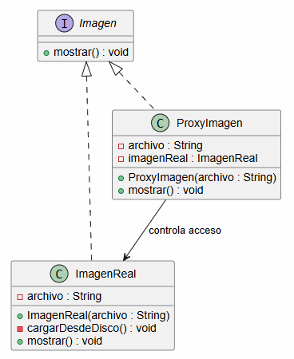
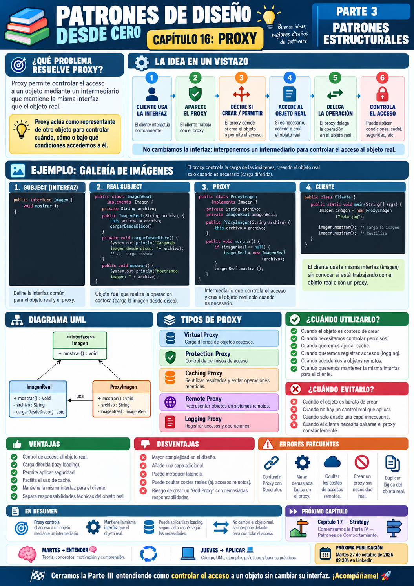

# 📚 Patrones de Diseño desde Cero

> **Aprende a diseñar software mantenible con ejemplos reales.**

# 📖 Capítulo 16 - Proxy

> **📚 Patrones de Diseño desde Cero**  
> **🧱 Parte III - Patrones Estructurales**

---

## 🧠 Introducción

Llegamos al último patrón de la **Parte III - Patrones Estructurales**.

Hasta ahora hemos estudiado:

### 🔌 Adapter

> **¿Cómo hacemos colaborar interfaces incompatibles?**

### 🌉 Bridge

> **¿Cómo separamos dos dimensiones para que evolucionen de forma independiente?**

### 🌳 Composite

> **¿Cómo tratamos objetos individuales y grupos de objetos de forma uniforme?**

### 🎁 Decorator

> **¿Cómo añadimos responsabilidades dinámicamente sin modificar la clase original?**

### 🏛️ Facade

> **¿Cómo simplificamos el acceso a un subsistema complejo?**

### 🪶 Flyweight

> **¿Cómo compartimos estado para reducir el consumo de memoria?**

Ahora nos encontramos con otro problema.

Imaginemos una aplicación que trabaja con imágenes pesadas.

Cada vez que creamos una imagen, tenemos que:

```text
Leer el archivo
        ↓
Decodificarlo
        ↓
Cargarlo en memoria
        ↓
Prepararlo para mostrar
```

Pero quizá muchas de esas imágenes:

```text
nunca llegan a mostrarse
```

Entonces aparece una pregunta:

> **¿Necesitamos crear inmediatamente el objeto real aunque todavía no vayamos a utilizarlo?**

O quizá queremos controlar:

```text
quién puede acceder
cuándo se crea
si reutilizamos un resultado
si debemos registrar el acceso
```

Aquí aparece:

# 🛡️ Proxy

Proxy proporciona un **objeto intermediario** que controla el acceso a otro objeto manteniendo normalmente la misma interfaz.

---

# 🎯 Objetivos de aprendizaje

Al finalizar este capítulo deberías ser capaz de:

- Comprender qué problema intenta resolver Proxy.
- Identificar el papel de `Subject`, `RealSubject` y `Proxy`.
- Implementar Proxy en Java.
- Comprender por qué Proxy mantiene normalmente la misma interfaz que el objeto real.
- Implementar carga diferida mediante Virtual Proxy.
- Comprender Protection Proxy.
- Comprender Caching Proxy.
- Comprender Remote Proxy a nivel conceptual.
- Añadir control de acceso sin modificar el objeto real.
- Diferenciar Proxy de Decorator.
- Diferenciar Proxy de Adapter.
- Diferenciar Proxy de Facade.
- Reconocer cuándo Proxy aporta valor.
- Identificar riesgos de ocultar demasiada lógica detrás del Proxy.

---

# ❌ El problema

Imaginemos que tenemos una interfaz:

```java
public interface Imagen {

    void mostrar();
}
```

Y una implementación real:

```java
public class ImagenReal
        implements Imagen {

    private final String archivo;

    public ImagenReal(
            String archivo) {

        this.archivo = archivo;

        cargarDesdeDisco();
    }

    private void cargarDesdeDisco() {

        System.out.println(
            "📂 Cargando imagen pesada: "
            + archivo
        );
    }

    @Override
    public void mostrar() {

        System.out.println(
            "🖼️ Mostrando imagen: "
            + archivo
        );
    }
}
```

Ahora hacemos:

```java
Imagen imagen =
        new ImagenReal(
            "foto-alta-resolucion.jpg"
        );
```

En ese momento:

```text
la imagen ya se carga
```

aunque quizá nunca llamemos a:

```java
imagen.mostrar();
```

---

# ⚠️ Creación innecesariamente costosa

Imaginemos una galería con:

```text
1.000 imágenes
```

Si hacemos:

```java
new ImagenReal(...)
```

para todas ellas durante el inicio de la aplicación, podemos provocar:

```text
más memoria
+
más tiempo de carga
+
más operaciones de disco
```

aunque el usuario solo termine viendo:

```text
20 imágenes
```

Queremos poder trabajar con algo que:

```text
parezca una Imagen
```

pero que solo cree:

```text
ImagenReal
```

cuando sea realmente necesario.

---

# 💡 Motivación

Queremos colocar un intermediario entre:

```text
CLIENTE
```

y:

```text
OBJETO REAL
```

De forma que el cliente siga escribiendo:

```java
imagen.mostrar();
```

pero sea el intermediario quien decida:

```text
¿Existe ya el objeto real?
        │
        NO
        ↓
     Crearlo
        │
        ↓
     Delegar
```

Este intermediario es el:

> **Proxy**

---

# 🛡️ La solución

Conceptualmente:

```text
Cliente
   │
   ▼
Subject
   ▲
   │
 Proxy
   │
   ▼
RealSubject
```

Tanto:

```text
Proxy
```

como:

```text
RealSubject
```

implementan la misma interfaz.

En nuestro ejemplo:

```text
          Imagen
            ▲
            │
    ┌───────┴────────┐
    │                │
ProxyImagen      ImagenReal
```

El cliente trabaja con:

```java
Imagen
```

sin necesitar saber si está utilizando:

```text
ProxyImagen
```

o:

```text
ImagenReal
```

---

# 🧱 Participantes del patrón

Proxy suele tener tres participantes principales.

## 1️⃣ Subject

Define la interfaz común.

```java
public interface Imagen {

    void mostrar();
}
```

---

## 2️⃣ RealSubject

Es el objeto real que realiza el trabajo.

```text
ImagenReal
```

---

## 3️⃣ Proxy

Implementa la misma interfaz y mantiene una referencia al objeto real.

```text
ProxyImagen
```

Puede:

```text
crear
controlar
registrar
cachear
autorizar
delegar
```

antes de acceder al objeto real.

---

# ☕ Implementación en Java

## Subject - Imagen.java

```java
public interface Imagen {

    void mostrar();
}
```

---

## 🖼️ RealSubject - ImagenReal.java

```java
public class ImagenReal
        implements Imagen {

    private final String archivo;

    public ImagenReal(
            String archivo) {

        this.archivo = archivo;

        cargarDesdeDisco();
    }

    private void cargarDesdeDisco() {

        System.out.println(
            "📂 Cargando desde disco: "
            + archivo
        );
    }

    @Override
    public void mostrar() {

        System.out.println(
            "🖼️ Mostrando imagen: "
            + archivo
        );
    }
}
```

---

## 🛡️ Proxy - ProxyImagen.java

```java
public class ProxyImagen
        implements Imagen {

    private final String archivo;

    private ImagenReal imagenReal;

    public ProxyImagen(
            String archivo) {

        this.archivo = archivo;
    }

    @Override
    public void mostrar() {

        if (imagenReal == null) {

            imagenReal =
                    new ImagenReal(
                        archivo
                    );
        }

        imagenReal.mostrar();
    }
}
```

---

## ▶️ Cliente - Main.java

```java
public class Main {

    public static void main(String[] args) {

        Imagen imagen =
                new ProxyImagen(
                    "foto.jpg"
                );

        System.out.println(
            "Proxy creado"
        );

        System.out.println(
            "Primera visualización"
        );

        imagen.mostrar();

        System.out.println(
            "Segunda visualización"
        );

        imagen.mostrar();
    }
}
```

---

# 📤 Posible salida

```text
Proxy creado

Primera visualización
📂 Cargando desde disco: foto.jpg
🖼️ Mostrando imagen: foto.jpg

Segunda visualización
🖼️ Mostrando imagen: foto.jpg
```

Observa que:

```text
ImagenReal
```

solo se crea cuando llamamos por primera vez a:

```java
mostrar()
```

---

# 🔎 Explicación paso a paso

## 1️⃣ El cliente trabaja con una abstracción

```java
Imagen
```

---

## 2️⃣ Creamos el Proxy

```java
new ProxyImagen(...)
```

pero todavía no creamos:

```java
ImagenReal
```

---

## 3️⃣ El cliente solicita una operación

```java
imagen.mostrar();
```

---

## 4️⃣ El Proxy comprueba el estado

```java
if (imagenReal == null)
```

---

## 5️⃣ Crea el objeto real si es necesario

```java
imagenReal =
        new ImagenReal(
            archivo
        );
```

---

## 6️⃣ Delega

```java
imagenReal.mostrar();
```

---

## 7️⃣ Reutiliza el objeto

Las siguientes llamadas ya no necesitan volver a cargarlo.

---

# 📊 UML

La estructura del patrón puede representarse así:



Conceptualmente:

```text
             Subject
                ▲
        ┌───────┴────────┐
        │                │
      Proxy          RealSubject
        │                ▲
        └────────────────┘
             delega
```

---

# 🔑 La idea clave

Proxy funciona porque:

```text
Proxy
```

y:

```text
RealSubject
```

comparten normalmente la misma interfaz.

Para el cliente:

```java
Imagen imagen;
```

puede apuntar a cualquiera de los dos.

Por eso podemos introducir un intermediario:

```text
sin cambiar el código cliente
```

---

# 🛡️ Proxy controla el acceso

La idea central no es simplemente:

> **envolver un objeto.**

La intención es:

> **controlar cómo, cuándo o bajo qué condiciones accedemos al objeto real.**

Ese control puede adoptar muchas formas.

Por eso existen diferentes variantes de Proxy.

---

# ⏳ Virtual Proxy

Es el ejemplo que acabamos de implementar.

Su objetivo es:

> **retrasar la creación de un objeto costoso hasta que sea realmente necesario.**

Por ejemplo:

```text
Imagen pesada
Documento grande
Conexión costosa
Recurso remoto
```

Conceptualmente:

```text
Proxy
  │
  │ primera llamada
  ▼
Crear RealSubject
  │
  ▼
Delegar
```

---

# 🔐 Protection Proxy

Otra posibilidad es controlar:

> **quién puede acceder al objeto real.**

Imaginemos:

```java
public interface Documento {

    void eliminar();
}
```

El objeto real:

```java
public class DocumentoReal
        implements Documento {

    @Override
    public void eliminar() {

        System.out.println(
            "🗑️ Documento eliminado"
        );
    }
}
```

Podemos introducir:

```java
public class DocumentoProxy
        implements Documento {

    private final Documento documento;

    private final String rol;

    public DocumentoProxy(
            Documento documento,
            String rol) {

        this.documento = documento;
        this.rol = rol;
    }

    @Override
    public void eliminar() {

        if (
            !"ADMIN".equals(rol)
        ) {

            throw new SecurityException(
                "Acceso denegado"
            );
        }

        documento.eliminar();
    }
}
```

Ahora el Proxy controla:

```text
AUTORIZACIÓN
```

antes de delegar.

---

# 💾 Caching Proxy

También podemos utilizar un Proxy para almacenar resultados.

Imaginemos una operación costosa:

```java
servicio.obtenerDatos();
```

El Proxy puede hacer:

```text
¿resultado en caché?
      │
   ┌──┴──┐
   │     │
  SÍ     NO
   │     │
   │     ▼
   │  consultar
   │     │
   │   guardar
   │     │
   └─────┴────► devolver
```

Esto puede evitar llamadas repetidas al objeto real.

---

# 🌐 Remote Proxy

Un Proxy también puede representar un objeto que realmente se encuentra:

```text
en otro proceso
en otro servidor
en otro sistema
```

Para el cliente:

```java
servicio.consultar();
```

parece una llamada normal.

Pero el Proxy puede encargarse internamente de:

```text
serializar datos
hacer petición HTTP/RPC
recibir respuesta
deserializar
```

El cliente utiliza:

```text
una representación local
```

de un objeto remoto.

---

# 📋 Otros tipos de Proxy

Podemos encontrar distintos usos:

```text
Virtual Proxy
      ↓
Carga diferida

Protection Proxy
      ↓
Control de permisos

Caching Proxy
      ↓
Reutilizar resultados

Remote Proxy
      ↓
Representar objetos remotos

Logging Proxy
      ↓
Registrar accesos
```

La estructura puede ser parecida.

Lo que cambia es:

> **la intención del control de acceso.**

---

# 🔄 Antes y después

## ❌ Sin Proxy

```text
Cliente
   │
   ▼
ObjetoReal
```

El cliente accede directamente.

---

## ✅ Con Proxy

```text
Cliente
   │
   ▼
 Proxy
   │
   ▼
ObjetoReal
```

Ahora tenemos un punto donde podemos ejecutar:

```text
validación
caché
logging
carga diferida
seguridad
acceso remoto
```

---

# 🏗️ Caso de uso: carga de imágenes

Imaginemos una galería.

Tenemos:

```text
1.000 imágenes
```

pero el usuario solamente visualiza:

```text
20
```

Con Proxy podemos crear:

```text
1.000 objetos ligeros
```

y cargar únicamente las imágenes realmente utilizadas.

---

# 🔐 Caso de uso: seguridad

Imaginemos:

```text
ServicioUsuarios
```

con:

```java
eliminarUsuario();
```

Podemos utilizar un Proxy para comprobar:

```text
rol
permisos
sesión
```

antes de permitir la operación.

---

# 🌐 Caso de uso: microservicios

Una aplicación puede utilizar:

```java
CatalogoService catalogo;
```

pero internamente un Proxy puede realizar:

```text
HTTP
autenticación
reintentos
serialización
```

El cliente continúa utilizando una abstracción local.

---

# 🎯 ¿Cuándo utilizar Proxy?

Proxy puede resultar adecuado cuando:

- Queremos retrasar la creación de un objeto costoso.
- Necesitamos controlar permisos.
- Queremos añadir caché.
- Necesitamos registrar accesos.
- Queremos representar un objeto remoto.
- Debemos controlar la frecuencia de acceso.
- Queremos aislar determinadas responsabilidades técnicas.
- Necesitamos introducir lógica antes o después del acceso al objeto real.
- Queremos mantener la misma interfaz para el cliente.

---

# 🚫 ¿Cuándo evitarlo?

Probablemente no necesitamos Proxy cuando:

- El acceso al objeto ya es sencillo.
- No necesitamos controlar nada.
- El objeto real es barato de crear.
- No existe un beneficio en añadir intermediación.
- Añade complejidad innecesaria.
- Introduce una latencia o coste que no aporta valor.
- El cliente necesita continuamente saltarse el Proxy.
- La lógica de control pertenece realmente a otro componente.

---

# ✅ Ventajas

## 🔹 Controla el acceso

Podemos decidir:

```text
cuándo
cómo
quién
```

accede al objeto real.

---

## 🔹 Permite carga diferida

Evita crear objetos costosos antes de necesitarlos.

---

## 🔹 Facilita seguridad

Puede controlar permisos sin modificar el objeto real.

---

## 🔹 Permite caché

Puede evitar repetir operaciones costosas.

---

## 🔹 Mantiene la misma interfaz

El cliente puede continuar trabajando con:

```java
Subject
```

---

## 🔹 Separa responsabilidades técnicas

Por ejemplo:

```text
logging
seguridad
caché
red
```

pueden quedar fuera del objeto principal.

---

# ❌ Desventajas

## 🔸 Añade otra capa

Tenemos:

```text
Cliente
↓
Proxy
↓
ObjetoReal
```

---

## 🔸 Puede aumentar la complejidad

Especialmente si el Proxy realiza demasiadas funciones.

---

## 🔸 Puede añadir latencia

Un Proxy remoto o de seguridad puede introducir trabajo adicional.

---

## 🔸 Puede ocultar operaciones costosas

Una llamada aparentemente simple:

```java
servicio.consultar();
```

podría implicar una petición de red.

---

## 🔸 Puede convertirse en un God Proxy

Si añadimos:

```text
seguridad
logging
caché
métricas
reintentos
transformaciones
```

en una única clase, tendremos otro problema.

---

# ⚠️ Proxy no significa simplemente envolver

Una clase que contiene otro objeto no es automáticamente Proxy.

La intención debe ser:

> **controlar el acceso al objeto representado.**

---

# ⚠️ Proxy debe respetar el contrato

Si:

```java
Proxy
```

implementa:

```java
Subject
```

debería comportarse de forma compatible con el objeto real.

El cliente no debería necesitar reescribirse porque ahora exista un Proxy.

---

# 🚨 Errores frecuentes

## ❌ Añadir demasiadas responsabilidades

Un Proxy debería tener una finalidad clara.

---

## ❌ Ocultar efectos muy importantes

Si una llamada provoca:

```text
una petición remota lenta
```

conviene que el diseño no genere falsas expectativas.

---

## ❌ Duplicar lógica de negocio

El Proxy controla el acceso.

No debería reimplementar toda la lógica del objeto real.

---

## ❌ Permitir bypass continuo

Si todo el código necesita acceder directamente a:

```text
RealSubject
```

quizá el Proxy no está bien integrado.

---

## ❌ Confundir Proxy con Decorator

La estructura puede parecer prácticamente idéntica.

La diferencia está en la intención.

---

## ❌ Crear Proxy sin necesidad real

Añadir otra clase solo porque existe el patrón no aporta valor.

---

# 🧠 Buenas prácticas

## 1️⃣ Define claramente qué controla

Por ejemplo:

```text
lazy loading
seguridad
caché
red
```

---

## 2️⃣ Mantén la misma interfaz

El cliente debería trabajar con:

```java
Subject
```

---

## 3️⃣ Mantén el Proxy pequeño

Evita convertirlo en un punto central de toda la lógica técnica.

---

## 4️⃣ Separa responsabilidades si crece

Si necesitas:

```text
seguridad
+
caché
+
logging
```

quizá debas combinar mecanismos o abstraer responsabilidades.

---

## 5️⃣ Ten cuidado con concurrencia

En un Lazy Proxy:

```java
if (real == null) {
    real = new Real();
}
```

pueden aparecer problemas si varios hilos acceden simultáneamente.

---

## 6️⃣ Documenta costes ocultos

Especialmente en:

```text
Remote Proxy
Caching Proxy
```

---

# 🆚 Proxy vs. Decorator

Esta comparación es probablemente la más importante.

Estructuralmente pueden parecer casi iguales.

Ambos:

```text
implementan la misma interfaz
+
contienen otro objeto
```

Pero su intención es distinta.

| Proxy | Decorator |
|---|---|
| Controla acceso | Añade comportamiento |
| Representa otro objeto | Extiende otro objeto |
| Puede gestionar seguridad, caché o carga | Añade responsabilidades funcionales |
| El Proxy puede decidir si delega | El Decorator normalmente delega añadiendo funcionalidad |
| Intermediación | Extensión |

Podemos resumirlo:

```text
  PROXY
    ↓
CONTROLAR
```

```text
DECORATOR
    ↓
 EXTENDER
```

---

# 🆚 Proxy vs. Adapter

| Proxy | Adapter |
|---|---|
| Mantiene la interfaz | Cambia la interfaz |
| Controla acceso | Traduce |
| Representa un objeto | Hace compatible otro objeto |
| Cliente usa el mismo contrato | Cliente utiliza un contrato distinto al original |

Conceptualmente:

```text
PROXY

Interfaz A
   ↓
Proxy
   ↓
Interfaz A
```

Mientras que:

```text
ADAPTER

Interfaz A
   ↓
Adapter
   ↓
Interfaz B
```

---

# 🆚 Proxy vs. Facade

| Proxy | Facade |
|---|---|
| Representa normalmente un objeto | Representa un subsistema |
| Mantiene generalmente la interfaz | Ofrece una interfaz simplificada |
| Controla acceso | Simplifica uso |
| Intermediación | Punto de entrada |

Facade pregunta:

> **¿Cómo simplifico este sistema?**

Proxy pregunta:

> **¿Cómo controlo el acceso a este objeto?**

---

# 🆚 Proxy vs. Flyweight

| Proxy | Flyweight |
|---|---|
| Controla acceso | Comparte estado |
| Representa otro objeto | Reutiliza objetos comunes |
| Puede crear el objeto de forma diferida | Reduce duplicación |
| Busca intermediación | Busca ahorro de memoria |

---

# 🔄 Comparación dentro de la Parte III

Completamos los patrones estructurales:

```text
10. Adapter
       ↓
Compatibilidad

11. Bridge
       ↓
Independencia

12. Composite
       ↓
Jerarquías

13. Decorator
       ↓
Extensión dinámica

14. Facade
       ↓
Simplificación

15. Flyweight
       ↓
Compartición

16. Proxy
       ↓
Control de acceso
```

Podemos visualizarlo:

```text
PATRONES ESTRUCTURALES
        │
        ├── Adapter
        │      ↓
        │   Conectar
        │
        ├── Bridge
        │      ↓
        │   Separar
        │
        ├── Composite
        │      ↓
        │   Agrupar
        │
        ├── Decorator
        │      ↓
        │   Extender
        │
        ├── Facade
        │      ↓
        │   Simplificar
        │
        ├── Flyweight
        │      ↓
        │   Compartir
        │
        └── Proxy
               ↓
            Controlar
```

---

# 🧠 Principios relacionados

Proxy conecta con varios principios importantes.

## 🔗 Bajo acoplamiento

El cliente depende de:

```java
Subject
```

y no necesariamente del objeto concreto.

---

## 🔒 Encapsulación

La lógica de acceso queda escondida detrás del Proxy.

---

## 🧩 Separación de responsabilidades

El objeto real se centra en su función.

El Proxy puede encargarse de:

```text
seguridad
caché
lazy loading
```

---

## 🔄 Programar hacia abstracciones

El cliente trabaja con una interfaz común.

---

## 🛡️ Control localizado

Las políticas de acceso pueden concentrarse en un único punto.

---

# 📌 Resumen

En este capítulo hemos aprendido que:

- Proxy pertenece a los patrones estructurales.
- Introduce un intermediario delante de un objeto real.
- Proxy y RealSubject mantienen normalmente la misma interfaz.
- El cliente puede trabajar mediante la abstracción común.
- Proxy puede controlar cuándo se crea el objeto real.
- Virtual Proxy permite carga diferida.
- Protection Proxy controla permisos.
- Caching Proxy reutiliza resultados.
- Remote Proxy representa objetos remotos.
- El Proxy puede ejecutar lógica antes o después de delegar.
- No debería absorber toda la lógica del objeto real.
- Proxy y Decorator pueden tener estructuras muy similares.
- Proxy controla acceso; Decorator añade comportamiento.
- Proxy y Adapter tienen intenciones diferentes.
- Proxy suele mantener la interfaz; Adapter la cambia.
- No debemos introducir Proxy si no existe una necesidad real de intermediación.

La pregunta fundamental de Proxy es:

> **¿Necesitamos controlar cómo, cuándo o bajo qué condiciones accedemos a otro objeto manteniendo su misma interfaz?**

---

# 🎓 Conclusiones

Proxy cierra nuestro recorrido por los patrones estructurales con una idea muy clara:

> **A veces no queremos acceder directamente a un objeto. Queremos controlar ese acceso.**

Sin Proxy:

```text
Cliente
   ↓
ObjetoReal
```

Con Proxy:

```text
Cliente
   ↓
Proxy
   ↓
ObjetoReal
```

Ese pequeño intermediario nos permite introducir:

```text
carga diferida
seguridad
caché
logging
acceso remoto
```

sin modificar necesariamente:

```text
el objeto real
```

y sin cambiar:

```text
la interfaz utilizada por el cliente
```

Pero cada intermediario añade:

```text
otra capa
otra clase
más indirección
```

Por eso seguimos aplicando nuestra metodología:

```text
PROBLEMA
   ↓
CONTEXTO
   ↓
¿NECESITAMOS CONTROLAR
EL ACCESO?
   ↓
¿QUÉ TIPO DE CONTROL?
   ↓
ALTERNATIVAS
   ↓
¿PROXY APORTA VALOR?
```

No utilizamos Proxy simplemente porque queramos envolver un objeto.

Lo utilizamos cuando existe una necesidad real de:

> **interponernos entre el cliente y el objeto para controlar la interacción.**

> **Proxy mantiene la puerta. Decide cómo y cuándo llegamos al objeto real.**

---

# 🔄 PRÓXIMA PARTE - PATRONES DE COMPORTAMIENTO

Hasta ahora nos hemos preguntado:

```text
PARTE II - Patrones creacionales
¿Cómo creamos objetos?

PARTE III - Patrones estructurales
¿Cómo los organizamos y relacionamos?
```

Ahora damos otro paso.

Entramos en:

# 🔄 Parte IV - Patrones de Comportamiento

Estos patrones se centrarán en:

> **cómo colaboran los objetos, cómo se reparten responsabilidades y cómo gestionamos comportamientos que pueden cambiar.**

### 📖 Capítulo 17 - Strategy

Nos encontraremos con situaciones donde una clase puede necesitar diferentes formas de realizar la misma tarea.

Por ejemplo:

```text
pagar con tarjeta
pagar con PayPal
pagar mediante transferencia
```

Y nos preguntaremos:

> **¿Cómo podemos intercambiar un algoritmo o comportamiento sin llenar nuestro código de condicionales?**

Ahí aparecerá **Strategy**.

---

# 🖼️ Infografía

Aquí os dejo una infografía sobre este **capítulo 16**.



---

**📚 Patrones de Diseño desde Cero**

*Aprende a diseñar software mantenible con ejemplos reales.*