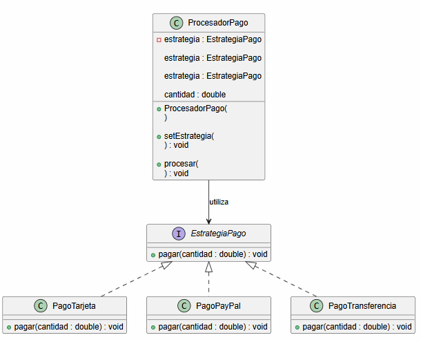
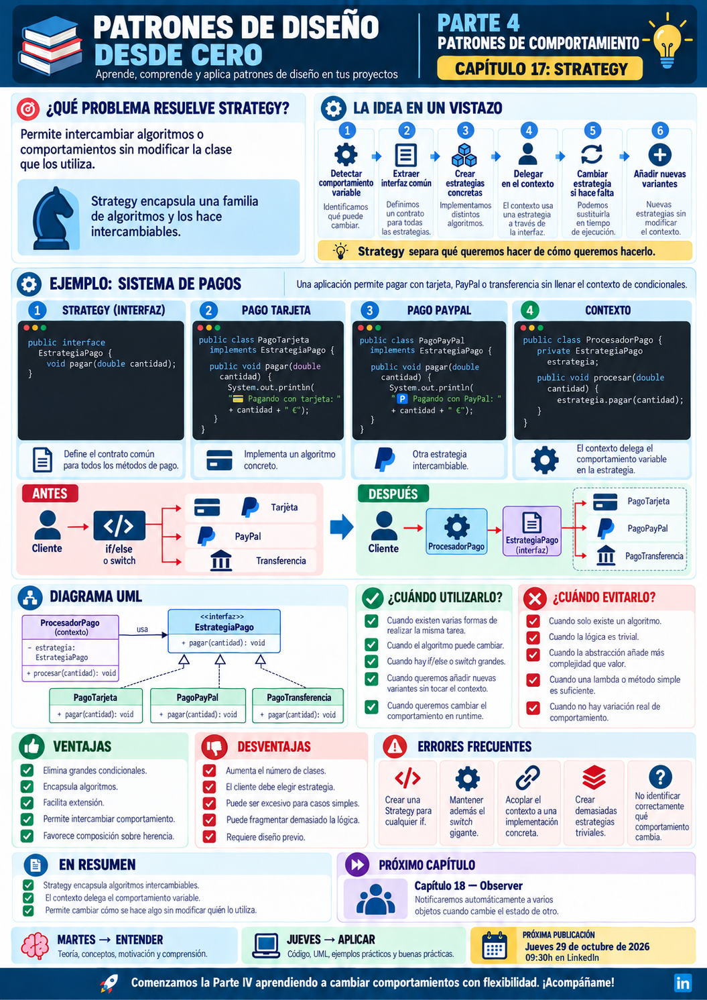

# 📚 Patrones de Diseño desde Cero

> **Aprende a diseñar software mantenible con ejemplos reales.**

# 📖 Capítulo 17 - Strategy

> **📚 Patrones de Diseño desde Cero**  
> **🔄 Parte IV - Patrones de Comportamiento**

---

## 🧠 Introducción

Con **Proxy** cerramos la Parte III dedicada a los **Patrones Estructurales**.

Hasta ahora nos hemos preguntado:

```text
PARTE II - Patrones creacionales
¿Cómo creamos objetos?

PARTE III - Patrones estructurales
¿Cómo organizamos y relacionamos objetos?
```

Ahora comenzamos una nueva etapa.

# 🔄 Patrones de Comportamiento

Los patrones de comportamiento se centran en:

> **cómo colaboran los objetos, cómo distribuyen responsabilidades y cómo hacemos que determinados comportamientos puedan variar sin acoplar todo el sistema.**

Y comenzamos con uno de los patrones más útiles y reconocibles:

# 🎯 Strategy

Imaginemos una aplicación de comercio electrónico.

Nuestro sistema debe permitir pagar mediante:

```text
Tarjeta
PayPal
Transferencia bancaria
```

Podríamos empezar con:

```java
if (metodo.equals("TARJETA")) {
    // pagar con tarjeta
} else if (metodo.equals("PAYPAL")) {
    // pagar con PayPal
} else if (metodo.equals("TRANSFERENCIA")) {
    // pagar mediante transferencia
}
```

Funciona.

Pero...

¿Qué ocurre cuando añadimos:

```text
Bizum
Apple Pay
Google Pay
Criptomonedas
```

?

¿Y si cada método de pago tiene reglas completamente diferentes?

La pregunta será:

> **¿Cómo podemos intercambiar un algoritmo o comportamiento sin modificar continuamente la clase que lo utiliza?**

Aquí aparece **Strategy**.

---

# 🎯 Objetivos de aprendizaje

Al finalizar este capítulo deberías ser capaz de:

- Comprender qué problema intenta resolver Strategy.
- Identificar comportamientos que pueden variar.
- Reconocer grandes bloques `if / else` o `switch` basados en diferentes algoritmos.
- Comprender qué significa encapsular un comportamiento.
- Identificar `Strategy`, `ConcreteStrategy` y `Context`.
- Implementar Strategy en Java.
- Cambiar una estrategia en tiempo de ejecución.
- Comprender cómo Strategy favorece la composición.
- Separar la lógica de negocio de los algoritmos variables.
- Comprender las ventajas y desventajas del patrón.
- Saber cuándo utilizar Strategy y cuándo evitarlo.
- Diferenciar Strategy de State.
- Diferenciar Strategy de Template Method.
- Relacionar Strategy con el principio abierto/cerrado.
- Evitar estrategias demasiado pequeñas o artificiales.

---

# ❌ El problema

Imaginemos una clase encargada de procesar pagos:

```java
public class ProcesadorPago {

    public void pagar(
            String metodo,
            double cantidad) {

        if (
            metodo.equals("TARJETA")
        ) {

            pagarConTarjeta(
                cantidad
            );

        } else if (
            metodo.equals("PAYPAL")
        ) {

            pagarConPayPal(
                cantidad
            );

        } else if (
            metodo.equals(
                "TRANSFERENCIA"
            )
        ) {

            pagarConTransferencia(
                cantidad
            );

        } else {

            throw new IllegalArgumentException(
                "Método de pago no soportado"
            );
        }
    }

    private void pagarConTarjeta(
            double cantidad) {

        System.out.println(
            "💳 Pagando con tarjeta: "
            + cantidad
            + " €"
        );
    }

    private void pagarConPayPal(
            double cantidad) {

        System.out.println(
            "🅿️ Pagando con PayPal: "
            + cantidad
            + " €"
        );
    }

    private void pagarConTransferencia(
            double cantidad) {

        System.out.println(
            "🏦 Pagando mediante transferencia: "
            + cantidad
            + " €"
        );
    }
}
```

Inicialmente parece razonable.

Pero el sistema empieza a crecer.

---

# 📈 El problema crece

Añadimos:

```text
Bizum
Apple Pay
Google Pay
```

Nuestro método podría terminar así:

```java
if (metodo.equals("TARJETA")) {

    // ...

} else if (metodo.equals("PAYPAL")) {

    // ...

} else if (metodo.equals("TRANSFERENCIA")) {

    // ...

} else if (metodo.equals("BIZUM")) {

    // ...

} else if (metodo.equals("APPLE_PAY")) {

    // ...

} else if (metodo.equals("GOOGLE_PAY")) {

    // ...
}
```

Y cada alternativa empieza a tener:

```text
validaciones
comisiones
autenticación
integraciones externas
tratamiento de errores
```

Tenemos una clase que conoce demasiados algoritmos diferentes.

---

# ⚠️ ¿Qué problemas aparecen?

Cada nuevo método de pago puede obligarnos a modificar:

```java
ProcesadorPago
```

La clase acumula responsabilidades.

También aumentan:

```text
condicionales
complejidad
riesgo de errores
dificultad de testing
```

Y aparece un problema de diseño importante:

> **El comportamiento que cambia está mezclado con la clase que lo utiliza.**

---

# 💡 Motivación

Queremos separar:

```text
CONTEXTO
```

de:

```text
ALGORITMO
```

Nuestro procesador debería preocuparse de:

> **realizar un pago**

pero no necesariamente conocer todos los detalles de:

```text
tarjeta
PayPal
transferencia
Bizum
...
```

Podemos extraer cada comportamiento a una clase independiente.

Conceptualmente:

```text
    ProcesadorPago
          │
          ▼
    EstrategiaPago
          ▲
   ┌──────┼─────────┐
   │      │         │
Tarjeta PayPal Transferencia
```

El contexto utiliza una estrategia.

No necesita conocer internamente cómo funciona.

---

# 🎯 La solución

Strategy define una familia de algoritmos:

```text
Estrategia A
Estrategia B
Estrategia C
```

Los encapsula detrás de una interfaz común:

```java
EstrategiaPago
```

Y permite utilizarlos de forma intercambiable.

La estructura conceptual es:

```text
     CLIENTE
        │
        ▼
    CONTEXTO
        │
        ▼
    STRATEGY
        ▲
        │
 ┌──────┼───────┐
 │      │       │
 A      B       C
```

El contexto no necesita saber:

> **cómo se ejecuta el algoritmo.**

Solo necesita saber:

> **qué contrato cumple.**

---

# 🧱 Participantes del patrón

Strategy suele tener tres participantes principales.

## 1️⃣ Strategy

Define la interfaz común para los diferentes algoritmos.

En nuestro ejemplo:

```java
public interface EstrategiaPago {

    void pagar(double cantidad);
}
```

---

## 2️⃣ Concrete Strategy

Implementa un algoritmo concreto.

Por ejemplo:

```text
PagoTarjeta
PagoPayPal
PagoTransferencia
```

---

## 3️⃣ Context

Utiliza una Strategy.

En nuestro caso:

```text
ProcesadorPago
```

El contexto delega:

```java
estrategia.pagar(
    cantidad
);
```

---

# ☕ Implementación en Java

## Strategy - EstrategiaPago.java

```java
public interface EstrategiaPago {

    void pagar(double cantidad);
}
```

---

## 💳 Concrete Strategy - PagoTarjeta.java

```java
public class PagoTarjeta
        implements EstrategiaPago {

    @Override
    public void pagar(
            double cantidad) {

        System.out.println(
            "💳 Pagando "
            + cantidad
            + " € con tarjeta"
        );
    }
}
```

---

## 🅿️ Concrete Strategy - PagoPayPal.java

```java
public class PagoPayPal
        implements EstrategiaPago {

    @Override
    public void pagar(
            double cantidad) {

        System.out.println(
            "🅿️ Pagando "
            + cantidad
            + " € mediante PayPal"
        );
    }
}
```

---

## 🏦 Concrete Strategy - PagoTransferencia.java

```java
public class PagoTransferencia
        implements EstrategiaPago {

    @Override
    public void pagar(
            double cantidad) {

        System.out.println(
            "🏦 Pagando "
            + cantidad
            + " € mediante transferencia"
        );
    }
}
```

---

## 🧠 Context - ProcesadorPago.java

```java
public class ProcesadorPago {

    private EstrategiaPago estrategia;

    public ProcesadorPago(
            EstrategiaPago estrategia) {

        this.estrategia =
                estrategia;
    }

    public void setEstrategia(
            EstrategiaPago estrategia) {

        this.estrategia =
                estrategia;
    }

    public void procesar(
            double cantidad) {

        if (estrategia == null) {

            throw new IllegalStateException(
                "No se ha definido una estrategia"
            );
        }

        estrategia.pagar(
            cantidad
        );
    }
}
```

---

## ▶️ Cliente - Main.java

```java
public class Main {

    public static void main(String[] args) {

        ProcesadorPago procesador =
                new ProcesadorPago(
                    new PagoTarjeta()
                );

        procesador.procesar(
            120.50
        );

        procesador.setEstrategia(
            new PagoPayPal()
        );

        procesador.procesar(
            75.00
        );

        procesador.setEstrategia(
            new PagoTransferencia()
        );

        procesador.procesar(
            250.00
        );
    }
}
```

---

# 📤 Posible salida

```text
💳 Pagando 120.5 € con tarjeta
🅿️ Pagando 75.0 € mediante PayPal
🏦 Pagando 250.0 € mediante transferencia
```

Observa que:

```java
ProcesadorPago
```

no se ha modificado para cambiar de algoritmo.

Únicamente hemos sustituido:

```java
EstrategiaPago
```

---

# 🔎 Explicación paso a paso

## 1️⃣ Identificamos qué cambia

El algoritmo para realizar el pago.

Tenemos:

```text
Tarjeta
PayPal
Transferencia
```

---

## 2️⃣ Definimos una abstracción común

```java
EstrategiaPago
```

declara:

```java
pagar(...)
```

---

## 3️⃣ Encapsulamos cada comportamiento

Cada algoritmo vive en su propia clase:

```text
PagoTarjeta
PagoPayPal
PagoTransferencia
```

---

## 4️⃣ El contexto recibe una Strategy

```java
private EstrategiaPago estrategia;
```

---

## 5️⃣ El contexto delega

En lugar de:

```java
if (...)
```

hacemos:

```java
estrategia.pagar(
    cantidad
);
```

---

## 6️⃣ Podemos cambiar el comportamiento

```java
procesador.setEstrategia(
    new PagoPayPal()
);
```

El comportamiento cambia sin modificar:

```java
ProcesadorPago
```

---

# 📊 UML

La estructura puede representarse mediante:



Conceptualmente:

```text
                 Strategy
                    ▲
          ┌─────────┼──────────┐
          │         │          │
       Tarjeta    PayPal   Transferencia
          ▲         ▲          ▲
          └─────────┼──────────┘
                    │
                 Context
```

---

# 🔑 La idea clave

Strategy separa:

```text
QUÉ QUIERO HACER
```

de:

```text
CÓMO QUIERO HACERLO
```

Por ejemplo:

```text
QUÉ
↓
Pagar
```

Pero:

```text
CÓMO
├── Tarjeta
├── PayPal
└── Transferencia
```

El contexto conoce:

```text
la operación
```

pero delega:

```text
el algoritmo
```

---

# 🔄 Cambiar comportamiento en tiempo de ejecución

Una de las características más interesantes de Strategy es que podemos sustituir una estrategia dinámicamente.

Por ejemplo:

```java
procesador.setEstrategia(
    new PagoTarjeta()
);
```

Después:

```java
procesador.setEstrategia(
    new PagoPayPal()
);
```

El mismo contexto cambia su comportamiento.

Esto puede ser útil cuando:

```text
usuario selecciona una opción
configuración cambia
contexto cambia
reglas de negocio cambian
```

---

# ➕ Añadir una nueva estrategia

Imaginemos que queremos añadir:

```text
Bizum
```

Creamos:

```java
public class PagoBizum
        implements EstrategiaPago {

    @Override
    public void pagar(
            double cantidad) {

        System.out.println(
            "📱 Pagando "
            + cantidad
            + " € mediante Bizum"
        );
    }
}
```

Ahora podemos utilizarla:

```java
procesador.setEstrategia(
    new PagoBizum()
);
```

No necesitamos modificar:

```text
PagoTarjeta
PagoPayPal
PagoTransferencia
ProcesadorPago
```

---

# 🧩 Strategy y Open/Closed Principle

Strategy encaja muy bien con el principio:

> **Abierto para extensión, cerrado para modificación.**

Podemos añadir:

```text
PagoBizum
PagoApplePay
PagoGooglePay
```

implementando:

```java
EstrategiaPago
```

sin tener que modificar continuamente:

```java
ProcesadorPago
```

---

# 🔗 Strategy y composición

Strategy suele sustituir una jerarquía de comportamientos basada en condicionales mediante:

```text
COMPOSICIÓN
```

El contexto contiene:

```java
EstrategiaPago estrategia;
```

Por tanto:

```text
Context HAS-A Strategy
```

en lugar de:

```text
Context IS-A algoritmo concreto
```

Esto favorece:

> **composición sobre herencia.**

---

# 🧠 Strategy y lambdas en Java

Cuando una estrategia es pequeña y la interfaz tiene un único método abstracto, podemos utilizar una interfaz funcional.

Por ejemplo:

```java
@FunctionalInterface
public interface EstrategiaDescuento {

    double aplicar(
        double importe
    );
}
```

Entonces podemos utilizar lambdas:

```java
EstrategiaDescuento descuento =
        importe ->
            importe * 0.90;
```

o:

```java
EstrategiaDescuento sinDescuento =
        importe ->
            importe;
```

Esto permite aplicar la idea de Strategy sin crear necesariamente una clase para cada algoritmo trivial.

---

# ☕ Ejemplo con lambdas

```java
public class CalculadoraPrecio {

    private final EstrategiaDescuento estrategia;

    public CalculadoraPrecio(
            EstrategiaDescuento estrategia) {

        this.estrategia =
                estrategia;
    }

    public double calcular(
            double precio) {

        return estrategia.aplicar(
            precio
        );
    }
}
```

Uso:

```java
CalculadoraPrecio blackFriday =
        new CalculadoraPrecio(
            precio -> precio * 0.70
        );
```

Strategy es una **idea de diseño**.

No obliga siempre a crear una jerarquía grande de clases.

---

# 🏗️ Caso de uso: ordenación

Imaginemos que necesitamos ordenar productos por:

```text
precio
nombre
valoración
fecha
```

Cada criterio puede considerarse una estrategia.

En Java encontramos esta idea con:

```java
Comparator<T>
```

Por ejemplo:

```java
Comparator<Producto> porPrecio =
        Comparator.comparing(
            Producto::getPrecio
        );
```

Podemos cambiar el algoritmo utilizado para ordenar sin modificar:

```text
Producto
```

---

# 🗺️ Caso de uso: rutas

Una aplicación de navegación puede calcular rutas mediante:

```text
Coche
Bicicleta
A pie
Transporte público
```

El contexto:

```text
PlanificadorRuta
```

puede utilizar diferentes:

```text
EstrategiaRuta
```

---

# 🛒 Caso de uso: descuentos

Una tienda puede aplicar:

```text
Sin descuento
Cliente VIP
Black Friday
Cupón
Promoción especial
```

Cada regla puede encapsularse como una Strategy.

---

# 🤖 Caso de uso: comportamiento de entidades

En un videojuego:

```text
AtaqueAgresivo
AtaqueDefensivo
AtaqueDistancia
```

pueden representar diferentes estrategias utilizadas por una entidad.

---

# 🎯 ¿Cuándo utilizar Strategy?

Strategy puede resultar adecuado cuando:

- Tenemos varias formas de realizar la misma operación.
- Los algoritmos pueden cambiar.
- Existen grandes `if / else` o `switch` para seleccionar comportamiento.
- Queremos cambiar el algoritmo en tiempo de ejecución.
- Queremos encapsular diferentes reglas.
- Queremos probar cada algoritmo de forma independiente.
- Queremos evitar acoplar el contexto a implementaciones concretas.
- Esperamos incorporar nuevas variantes.
- Queremos favorecer composición sobre herencia.

---

# 🚫 ¿Cuándo evitarlo?

Probablemente no necesitamos Strategy cuando:

- Solo existe un algoritmo.
- El comportamiento nunca cambia.
- La lógica es extremadamente sencilla.
- La abstracción añade más complejidad que valor.
- Hay demasiadas estrategias minúsculas sin significado real.
- El cliente debe conocer demasiados detalles para seleccionar correctamente la estrategia.
- Un método o lambda sencillo ya resuelve el problema.

---

# ✅ Ventajas

## 🔹 Elimina grandes condicionales

Podemos sustituir:

```text
if / else / switch
```

por polimorfismo.

---

## 🔹 Encapsula algoritmos

Cada comportamiento vive en una unidad separada.

---

## 🔹 Facilita extensión

Añadir una Strategy no obliga necesariamente a modificar el Context.

---

## 🔹 Permite cambiar comportamiento dinámicamente

La estrategia puede seleccionarse durante la ejecución.

---

## 🔹 Facilita pruebas

Podemos probar:

```text
PagoTarjeta
PagoPayPal
PagoTransferencia
```

independientemente.

---

## 🔹 Favorece composición

El Context contiene una Strategy.

---

# ❌ Desventajas

## 🔸 Aumenta el número de clases

Cada algoritmo puede convertirse en una nueva clase.

---

## 🔸 El cliente puede necesitar conocer las estrategias

Alguien debe decidir:

```text
cuál utilizar
```

---

## 🔸 Puede resultar excesivo para algoritmos pequeños

Crear:

```text
Strategy
ConcreteStrategyA
ConcreteStrategyB
```

para dos líneas de código puede ser innecesario.

---

## 🔸 Puede fragmentar demasiado la lógica

Si tenemos decenas de Strategies minúsculas, navegar por el código puede ser incómodo.

---

## 🔸 La elección de Strategy puede convertirse en otro problema

A veces necesitamos otra pieza encargada de decidir qué estrategia utilizar.

---

# ⚠️ Strategy no significa eliminar todos los `if`

Este patrón no existe para declarar:

> **"Los condicionales son malos."**

Un condicional sencillo como:

```java
if (edad >= 18) {
    // ...
}
```

no necesita una Strategy.

La señal aparece cuando tenemos:

```text
diferentes algoritmos
+
cada uno evoluciona
+
cada uno tiene lógica propia
```

---

# ⚠️ Strategy no debe conocer demasiado del Context

Si cada Strategy necesita acceder a:

```text
20 propiedades internas
```

del contexto, quizá el diseño esté demasiado acoplado.

Es preferible proporcionar:

```text
solo los datos necesarios
```

---

# 🚨 Errores frecuentes

## ❌ Crear una Strategy para cualquier método

No toda variación merece una abstracción propia.

---

## ❌ Estrategias que hacen demasiadas cosas

Una Strategy debería representar un comportamiento concreto.

---

## ❌ Mantener además el gran `switch`

Si tenemos Strategy pero seguimos haciendo:

```java
switch (tipo) {
    // ejecutar algoritmo completo aquí
}
```

no hemos separado realmente el comportamiento.

---

## ❌ Acoplar el Context a ConcreteStrategy

Esto:

```java
private PagoTarjeta estrategia;
```

reduce la flexibilidad.

Preferimos:

```java
private EstrategiaPago estrategia;
```

---

## ❌ Introducir demasiadas clases triviales

En Java moderno, una lambda puede ser mejor para estrategias extremadamente simples.

---

## ❌ Elegir estrategias dentro de todas partes del sistema

Conviene centralizar la decisión cuando sea posible.

---

# 🧠 Buenas prácticas

## 1️⃣ Identifica primero qué comportamiento cambia

No empieces creando:

```text
Strategy
ConcreteStrategy
```

sin un problema real.

---

## 2️⃣ Mantén pequeña la interfaz

Una Strategy debería exponer únicamente lo necesario.

---

## 3️⃣ Haz las estrategias independientes

Evita dependencias innecesarias con el Context.

---

## 4️⃣ Utiliza inyección de dependencias

Por ejemplo:

```java
new ProcesadorPago(
    estrategia
);
```

---

## 5️⃣ Considera lambdas

Cuando el comportamiento sea suficientemente sencillo.

---

## 6️⃣ Evita estrategias con estado mutable compartido

Especialmente si se reutilizan entre múltiples contextos.

---

# 🆚 Strategy vs. State

Esta será una comparación muy importante cuando lleguemos al patrón State.

Estructuralmente pueden parecer prácticamente iguales.

Ambos utilizan:

```text
Context
   ↓
Interfaz
   ↓
Implementaciones
```

Pero la intención es diferente.

| Strategy | State |
|---|---|
| Representa diferentes algoritmos | Representa diferentes estados |
| El cliente suele elegir la estrategia | El objeto puede cambiar de estado |
| Busca intercambiar comportamiento | El comportamiento depende del estado interno |
| Las Strategies suelen ser independientes | Los States pueden conocer transiciones |

Podemos resumirlo:

```text
STRATEGY
↓
¿Cómo quiero hacerlo?
```

```text
STATE
↓
¿Cómo debo comportarme ahora?
```

---

# 🆚 Strategy vs. Template Method

Ambos permiten variar algoritmos.

Pero utilizan mecanismos diferentes.

| Strategy | Template Method |
|---|---|
| Utiliza composición | Utiliza herencia |
| Sustituye algoritmos completos | Redefine pasos de un algoritmo |
| Puede cambiar en runtime | Se fija mediante la subclase |
| Algoritmos independientes | Esqueleto común |

Strategy:

```text
Context
   ↓
Strategy
```

Template Method:

```text
ClaseBase
   ▲
Subclase
```

Template Method aparecerá en el Capítulo 21.

---

# 🆚 Strategy vs. Bridge

Ambos utilizan composición.

Pero:

| Strategy | Bridge |
|---|---|
| Separa algoritmos | Separa dos dimensiones estructurales |
| Patrón de comportamiento | Patrón estructural |
| Context + algoritmo | Abstracción + implementación |
| Busca intercambiar comportamiento | Busca evolución independiente |

---

# 🆚 Strategy vs. Factory Method

Factory Method responde:

> **¿Qué objeto concreto debo crear?**

Strategy responde:

> **¿Qué comportamiento debo utilizar?**

Una Factory incluso podría encargarse de crear la Strategy adecuada.

Los patrones pueden colaborar.

---

# 🧠 Principios relacionados

Strategy conecta especialmente con varios principios vistos durante la serie.

## 🧩 Encapsular lo que cambia

Si el algoritmo cambia, lo aislamos.

---

## 🧱 Composición sobre herencia

El Context contiene una Strategy.

---

## 🔗 Bajo acoplamiento

El Context depende de una abstracción.

---

## ➕ Open/Closed Principle

Añadimos nuevas estrategias sin modificar necesariamente el Context.

---

## 🎯 Responsabilidad única

Cada Strategy se centra en un algoritmo concreto.

---

# 📌 Resumen

En este capítulo hemos aprendido que:

- Strategy pertenece a los patrones de comportamiento.
- Permite encapsular algoritmos intercambiables.
- `Strategy` define el contrato común.
- `ConcreteStrategy` implementa cada algoritmo.
- `Context` utiliza una Strategy.
- El Context delega el comportamiento variable.
- Podemos cambiar una Strategy en tiempo de ejecución.
- Strategy puede sustituir grandes condicionales basados en algoritmos.
- Favorece composición sobre herencia.
- Facilita cumplir el principio abierto/cerrado.
- Facilita probar cada algoritmo independientemente.
- Puede aumentar el número de clases.
- Las lambdas pueden simplificar estrategias pequeñas en Java.
- Strategy y State tienen estructuras parecidas, pero intenciones diferentes.
- No todos los condicionales necesitan Strategy.
- Debemos utilizarlo cuando exista una variación real de comportamiento.

La pregunta fundamental de Strategy es:

> **¿Tenemos varias formas de realizar la misma tarea y queremos poder intercambiarlas sin modificar el contexto que las utiliza?**

---

# 🎓 Conclusiones

Strategy inaugura los patrones de comportamiento con una idea extremadamente importante:

> **El comportamiento también puede ser una dependencia.**

Sin Strategy podemos tener:

```text
Context
├── algoritmo A
├── algoritmo B
├── algoritmo C
└── algoritmo D
```

y un gran bloque de condiciones decide cuál ejecutar.

Con Strategy:

```text
     Context
        │
        ▼
     Strategy
        ▲
        │
 ┌──────┼───────┐
 A      B       C
```

Cada algoritmo queda encapsulado.

El Context solamente sabe:

```text
qué operación necesita
```

pero no:

```text
cómo se implementa
```

Esto nos permite sustituir:

```java
new PagoTarjeta()
```

por:

```java
new PagoPayPal()
```

sin cambiar la lógica principal.

Pero, como siempre, existe un coste:

```text
más abstracciones
más clases
más decisiones de configuración
```

Por eso seguimos aplicando nuestra metodología:

```text
PROBLEMA
   ↓
CONTEXTO
   ↓
¿QUÉ COMPORTAMIENTO CAMBIA?
   ↓
¿EXISTEN VARIOS ALGORITMOS?
   ↓
ALTERNATIVAS
   ↓
¿STRATEGY APORTA VALOR?
```

No utilizamos Strategy porque exista un:

```java
if
```

Lo utilizamos cuando existen **comportamientos realmente intercambiables que evolucionan independientemente del contexto**.

> **Strategy convierte una decisión condicional en una familia de comportamientos intercambiables.**

---

# 🖼️ Infografía

Aquí os dejo una infografía sobre este **capítulo 17**.



---

**📚 Patrones de Diseño desde Cero**

*Aprende a diseñar software mantenible con ejemplos reales.*