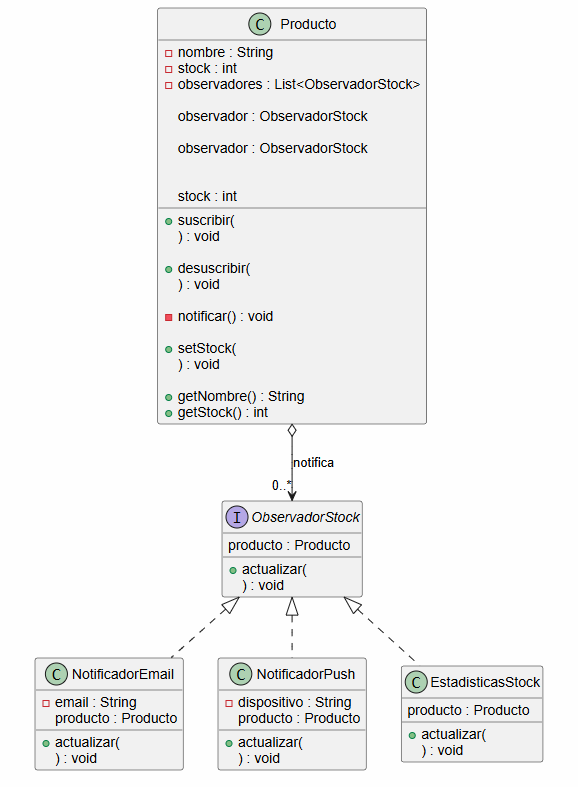
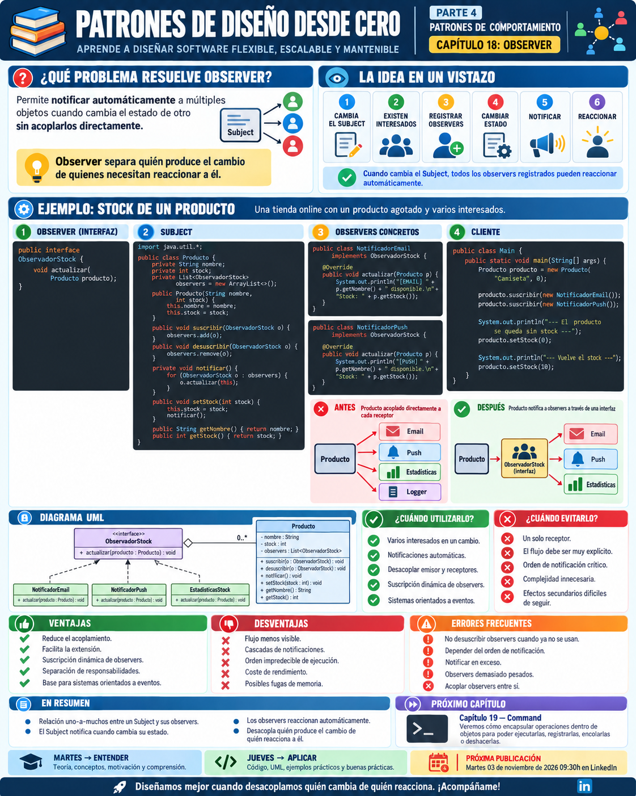

# 📚 Patrones de Diseño desde Cero

> **Aprende a diseñar software mantenible con ejemplos reales.**


# 📖 Capítulo 18 - Observer

> **📚 Patrones de Diseño desde Cero**  
> **🔄 Parte IV - Patrones de Comportamiento**

---

## 🧠 Introducción

Continuamos nuestro recorrido por los **patrones de comportamiento**.

En el capítulo anterior estudiamos **Strategy**:

> **¿Cómo podemos intercambiar algoritmos o comportamientos sin modificar el contexto que los utiliza?**

Ahora cambia completamente el problema.

Imaginemos una tienda online.

Tenemos un producto:

```text
PlayStation 5
```

que actualmente está agotado.

Varios usuarios quieren recibir una notificación cuando vuelva a estar disponible.

Además, cuando cambie el stock quizá también queramos actualizar:

```text
📧 Notificaciones por email
📱 Aplicación móvil
📊 Estadísticas
📝 Logs
```

Una primera solución podría hacer que `Producto` conociera directamente todos esos componentes.

Pero entonces aparecería un fuerte acoplamiento.

La pregunta será:

> **¿Cómo podemos notificar automáticamente a múltiples objetos cuando cambia el estado de otro sin que el emisor dependa directamente de todos ellos?**

Aquí aparece:

# 👀 Observer

Observer define una relación **uno a muchos** entre objetos, de manera que cuando uno cambia de estado, todos los objetos interesados pueden ser notificados automáticamente.

---

# 🎯 Objetivos de aprendizaje

Al finalizar este capítulo deberías ser capaz de:

- Comprender qué problema intenta resolver Observer.
- Identificar relaciones uno-a-muchos.
- Comprender los conceptos `Subject` y `Observer`.
- Implementar Observer en Java.
- Registrar y eliminar observadores dinámicamente.
- Notificar automáticamente cambios de estado.
- Reducir el acoplamiento entre emisor y receptores.
- Comprender las variantes Push y Pull.
- Diferenciar Observer de Publisher/Subscriber.
- Diferenciar Observer de Mediator.
- Comprender las ventajas y desventajas del patrón.
- Identificar problemas de orden y cascadas de notificaciones.
- Evitar fugas de memoria por observadores no eliminados.
- Reconocer cuándo Observer aporta valor y cuándo introduce complejidad innecesaria.

---

# ❌ El problema

Imaginemos una clase:

```java
public class Producto {

    private String nombre;
    private int stock;

    public Producto(
            String nombre,
            int stock) {

        this.nombre = nombre;
        this.stock = stock;
    }

    public void setStock(
            int stock) {

        this.stock = stock;

        // ¿A quién debemos avisar?
    }
}
```

Cuando cambia:

```java
stock
```

queremos realizar diferentes acciones.

Por ejemplo:

```text
Enviar email
Enviar notificación móvil
Actualizar estadísticas
Registrar el cambio
```

Podríamos hacerlo directamente:

```java
public void setStock(
        int stock) {

    this.stock = stock;

    emailService.enviar(...);

    pushService.enviar(...);

    estadisticas.actualizar(...);

    logger.registrar(...);
}
```

Funciona.

Pero ahora `Producto` conoce directamente:

```text
EmailService
PushService
EstadisticasService
Logger
```

---

# ⚠️ Acoplamiento creciente

La estructura empieza a ser:

```text
Producto
   │
   ├── EmailService
   ├── PushService
   ├── EstadisticasService
   └── Logger
```

Y mañana aparece:

```text
SMS
Webhook
Slack
Analytics
```

Tenemos que modificar nuevamente:

```java
Producto
```

La clase responsable de mantener el estado del producto termina conociendo todos los posibles interesados.

El problema es claro:

> **El objeto que cambia está demasiado acoplado a los objetos que reaccionan a ese cambio.**

---

# 💡 Motivación

Queremos que `Producto` sepa únicamente:

> **"Tengo observadores interesados."**

Pero no:

> **"Tengo que enviar un email, un push, actualizar estadísticas y registrar un log."**

Podemos definir una abstracción:

```java
Observer
```

y permitir que cualquier objeto interesado se registre.

Conceptualmente:

```text
                 PRODUCTO
                 Subject
                    │
          ┌─────────┼─────────┐
          │         │         │
          ▼         ▼         ▼
       Email      Push    Estadísticas
      Observer   Observer    Observer
```

Cuando cambia el producto:

```text
Producto
   │
   └── notificarObservadores()
```

Cada observador decide:

```text
cómo reaccionar
```

---

# 👀 La solución

Observer divide el problema en dos responsabilidades.

## Subject

Mantiene:

```text
estado
+
lista de observadores
```

y proporciona operaciones para:

```text
registrar
eliminar
notificar
```

---

## Observer

Define cómo reaccionar ante una notificación.

Cada observador concreto puede implementar una reacción diferente.

---

La relación es:

```text
     Subject
        │
        │ notifica
        ▼
     Observer
        ▲
        │
 ┌──────┼───────┐
 │      │       │
Email Push Estadísticas
```

---

# 🧱 Participantes del patrón

Observer suele tener cuatro participantes principales.

## 1️⃣ Subject

Mantiene la colección de observadores.

Por ejemplo:

```text
Producto
```

---

## 2️⃣ Observer

Define el contrato común.

```java
public interface ObservadorStock {

    void actualizar(
        Producto producto
    );
}
```

---

## 3️⃣ Concrete Subject

Es el objeto cuyo estado observamos.

En nuestro ejemplo:

```java
Producto
```

---

## 4️⃣ Concrete Observer

Son los objetos interesados en los cambios.

Por ejemplo:

```text
NotificadorEmail
NotificadorPush
EstadisticasStock
```

---

# ☕ Implementación en Java

## Observer - ObservadorStock.java

```java
public interface ObservadorStock {

    void actualizar(
            Producto producto);
}
```

---

## 📦 Subject - Producto.java

```java
import java.util.ArrayList;
import java.util.List;

public class Producto {

    private final String nombre;

    private int stock;

    private final List<ObservadorStock>
            observadores =
            new ArrayList<>();

    public Producto(
            String nombre,
            int stock) {

        this.nombre = nombre;
        this.stock = stock;
    }

    public void suscribir(
            ObservadorStock observador) {

        observadores.add(
            observador
        );
    }

    public void desuscribir(
            ObservadorStock observador) {

        observadores.remove(
            observador
        );
    }

    private void notificar() {

        for (
            ObservadorStock observador :
            observadores
        ) {

            observador.actualizar(
                this
            );
        }
    }

    public void setStock(
            int stock) {

        this.stock = stock;

        notificar();
    }

    public String getNombre() {

        return nombre;
    }

    public int getStock() {

        return stock;
    }
}
```

---

## 📧 Concrete Observer - NotificadorEmail.java

```java
public class NotificadorEmail
        implements ObservadorStock {

    private final String email;

    public NotificadorEmail(
            String email) {

        this.email = email;
    }

    @Override
    public void actualizar(
            Producto producto) {

        if (
            producto.getStock() > 0
        ) {

            System.out.println(
                "📧 Email a "
                + email
                + ": "
                + producto.getNombre()
                + " vuelve a estar disponible."
            );
        }
    }
}
```

---

## 📱 Concrete Observer - NotificadorPush.java

```java
public class NotificadorPush
        implements ObservadorStock {

    private final String dispositivo;

    public NotificadorPush(
            String dispositivo) {

        this.dispositivo =
                dispositivo;
    }

    @Override
    public void actualizar(
            Producto producto) {

        if (
            producto.getStock() > 0
        ) {

            System.out.println(
                "📱 Push a "
                + dispositivo
                + ": "
                + producto.getNombre()
                + " disponible."
            );
        }
    }
}
```

---

## 📊 Concrete Observer - EstadisticasStock.java

```java
public class EstadisticasStock
        implements ObservadorStock {

    @Override
    public void actualizar(
            Producto producto) {

        System.out.println(
            "📊 Estadísticas actualizadas. "
            + producto.getNombre()
            + " → stock: "
            + producto.getStock()
        );
    }
}
```

---

## ▶️ Cliente - Main.java

```java
public class Main {

    public static void main(String[] args) {

        Producto consola =
                new Producto(
                    "PlayStation 5",
                    0
                );

        ObservadorStock email =
                new NotificadorEmail(
                    "usuario@email.com"
                );

        ObservadorStock push =
                new NotificadorPush(
                    "iPhone"
                );

        ObservadorStock estadisticas =
                new EstadisticasStock();

        consola.suscribir(
            email
        );

        consola.suscribir(
            push
        );

        consola.suscribir(
            estadisticas
        );

        consola.setStock(
            10
        );
    }
}
```

---

# 📤 Posible salida

```text
📧 Email a usuario@email.com:
PlayStation 5 vuelve a estar disponible.

📱 Push a iPhone:
PlayStation 5 disponible.

📊 Estadísticas actualizadas.
PlayStation 5 → stock: 10
```

`Producto` no necesita saber:

```text
cómo enviar emails
cómo enviar push
cómo actualizar estadísticas
```

Solo sabe:

> **que existen observadores interesados.**

---

# 🔎 Explicación paso a paso

## 1️⃣ Definimos Observer

```java
ObservadorStock
```

declara:

```java
actualizar(...)
```

---

## 2️⃣ El Subject mantiene observadores

```java
List<ObservadorStock>
```

---

## 3️⃣ Los observadores se registran

```java
producto.suscribir(
    observador
);
```

---

## 4️⃣ El estado cambia

```java
producto.setStock(
    10
);
```

---

## 5️⃣ El Subject notifica

```java
notificar();
```

---

## 6️⃣ Cada Observer reacciona

```text
Email
Push
Estadísticas
```

ejecutan comportamientos diferentes.

---

## 7️⃣ El Subject permanece desacoplado

`Producto` depende de:

```java
ObservadorStock
```

y no de:

```text
NotificadorEmail
NotificadorPush
EstadisticasStock
```

---

# 📊 UML

Podemos representar el patrón mediante:



Conceptualmente:

```text
                   Subject
                      │
                      │ notifica
           ┌──────────┼──────────┐
           ▼          ▼          ▼
       Observer   Observer   Observer
           │          │          │
         Email      Push    Estadísticas
```

---

# 🔑 La idea clave

Observer separa:

```text
QUIÉN CAMBIA
```

de:

```text
QUIÉN REACCIONA
```

El Subject sabe:

```text
"mi estado ha cambiado"
```

pero no necesita conocer:

```text
qué hará cada interesado
```

Cada Observer decide su reacción.

---

# 🔄 Suscripción dinámica

Una ventaja importante es que podemos añadir o eliminar observadores durante la ejecución.

Por ejemplo:

```java
producto.suscribir(
    email
);
```

Después:

```java
producto.desuscribir(
    email
);
```

El Subject no necesita modificarse.

---

# 📣 Relación uno-a-muchos

Observer representa normalmente:

```text
1 Subject
    │
    ▼
N Observers
```

Por ejemplo:

```text
Producto
 ├── Usuario A
 ├── Usuario B
 ├── App móvil
 ├── Analytics
 └── Logger
```

Cuando cambia el Subject:

> **todos los observadores registrados pueden recibir la notificación.**

---

# 📤 Push Model

En nuestro ejemplo enviamos el propio objeto:

```java
observador.actualizar(
    this
);
```

El Subject proporciona información al Observer.

Otra posibilidad sería enviar directamente:

```java
actualizar(
    nombre,
    stock
);
```

Esto se conoce conceptualmente como:

> **Push Model**

El Subject empuja los datos necesarios al Observer.

---

# 📥 Pull Model

Otra posibilidad es enviar únicamente una referencia al Subject.

Después el Observer consulta:

```java
producto.getStock();
producto.getNombre();
```

Es decir:

```text
Subject
   │
   │ avisa
   ▼
Observer
   │
   │ consulta
   ▼
Subject
```

Esto se conoce como:

> **Pull Model**

---

# 🆚 Push vs. Pull

| Push | Pull |
|---|---|
| Subject envía datos | Observer consulta datos |
| Puede enviar solo lo necesario | Más flexible para el Observer |
| Acopla al formato del evento | Puede requerir más consultas |
| Menos acceso posterior | Observer decide qué necesita |

No existe una opción universalmente mejor.

Depende del contexto.

---

# 📨 Observer y eventos

En aplicaciones reales es habitual trabajar con objetos evento.

Por ejemplo:

```java
public record StockActualizadoEvent(
        String producto,
        int stockAnterior,
        int stockNuevo) {
}
```

Entonces:

```java
public interface ObservadorStock {

    void actualizar(
        StockActualizadoEvent evento
    );
}
```

Esto puede ser preferible a pasar directamente el Subject completo.

---

# 🎯 Notificar solo cuando realmente cambia

Nuestro primer ejemplo ejecutaba:

```java
notificar();
```

cada vez que llamábamos:

```java
setStock(...)
```

Pero podemos mejorar el diseño.

```java
public void setStock(
        int nuevoStock) {

    if (
        this.stock == nuevoStock
    ) {

        return;
    }

    this.stock =
            nuevoStock;

    notificar();
}
```

Ahora notificamos únicamente cuando existe un cambio real.

---

# 🔔 Eventos específicos

También podemos evitar que todos los observadores reciban todos los cambios.

Por ejemplo:

```text
STOCK_ACTUALIZADO
PRODUCTO_AGOTADO
PRODUCTO_DISPONIBLE
PRECIO_MODIFICADO
```

Cada observador podría estar interesado únicamente en determinados eventos.

Cuando el sistema necesita este nivel de flexibilidad, podemos evolucionar hacia un sistema de eventos más completo.

---

# 🏗️ Caso de uso: interfaces gráficas

Observer aparece constantemente en interfaces.

Por ejemplo:

```text
Botón
  │
  └── click
        │
        ├── Observer A
        ├── Observer B
        └── Observer C
```

Los listeners de eventos son conceptualmente muy cercanos a Observer.

---

# 📰 Caso de uso: suscripciones

Una publicación puede tener:

```text
100.000 suscriptores
```

Cuando aparece contenido nuevo:

```text
Publisher
   ↓
Subscribers
```

Todos los interesados pueden recibir una actualización.

---

# 📈 Caso de uso: mercado financiero

Un activo cambia de precio:

```text
Acción
  │
  ├── Panel gráfico
  ├── Sistema de alertas
  ├── Estrategia automática
  └── Logger
```

Cada componente reacciona independientemente.

---

# 🧾 Caso de uso: dominio

Imaginemos:

```text
Pedido
```

que cambia a:

```text
PAGADO
```

Podemos necesitar:

```text
emitir factura
enviar email
reservar transporte
actualizar estadísticas
```

Observer puede desacoplar el cambio de estado de algunas de esas reacciones.

---

# 🎯 ¿Cuándo utilizar Observer?

Observer puede resultar adecuado cuando:

- Un cambio debe provocar múltiples reacciones.
- No queremos acoplar el Subject a todos los receptores.
- El número de interesados puede variar.
- Los observadores pueden registrarse dinámicamente.
- Necesitamos una relación uno-a-muchos.
- Queremos implementar mecanismos de eventos.
- Diferentes componentes deben reaccionar independientemente.
- El Subject no debería conocer los detalles de cada reacción.

---

# 🚫 ¿Cuándo evitarlo?

Probablemente no necesitamos Observer cuando:

- Solo existe un receptor.
- La comunicación directa es sencilla y estable.
- El flujo debe ser completamente explícito.
- El orden de las operaciones es crítico.
- Las notificaciones generan demasiadas dependencias implícitas.
- Resulta difícil saber qué efectos provoca un cambio.
- La consistencia debe garantizarse de manera estrictamente transaccional.
- El patrón añade más indirección que valor.

---

# ✅ Ventajas

## 🔹 Reduce el acoplamiento

El Subject depende de:

```java
Observer
```

y no de implementaciones concretas.

---

## 🔹 Facilita añadir nuevos receptores

Podemos crear:

```text
SMSObserver
SlackObserver
AnalyticsObserver
```

sin modificar necesariamente el Subject.

---

## 🔹 Permite suscripción dinámica

Podemos registrar y eliminar Observers durante la ejecución.

---

## 🔹 Favorece separación de responsabilidades

El Subject mantiene su estado.

Los Observers reaccionan.

---

## 🔹 Facilita arquitecturas orientadas a eventos

Es una base conceptual muy importante para comprender sistemas de eventos.

---

# ❌ Desventajas

## 🔸 El flujo puede ser difícil de seguir

Esto:

```java
producto.setStock(10);
```

puede provocar:

```text
email
push
estadísticas
logs
otros eventos
```

sin que resulte evidente desde esa línea.

---

## 🔸 El orden puede ser impredecible

Si múltiples Observers dependen entre sí, pueden aparecer problemas.

---

## 🔸 Puede generar cascadas

Un Observer puede modificar otro Subject.

Eso puede producir:

```text
Evento A
  ↓
Evento B
  ↓
Evento C
  ↓
Evento D
```

---

## 🔸 Puede provocar problemas de rendimiento

Si existen muchos Observers o realizan tareas costosas.

---

## 🔸 Puede provocar fugas de memoria

Si un Observer debería desaparecer pero continúa registrado.

---

# ⚠️ Observer no significa llamar manualmente a varias clases

Esto:

```java
email.actualizar();
push.actualizar();
logger.actualizar();
```

dentro del cliente no implementa realmente la intención del patrón.

La idea es que:

```text
los interesados se registran
+
el Subject notifica automáticamente
```

---

# ⚠️ Cuidado con efectos secundarios ocultos

Si:

```java
producto.setStock(10);
```

termina realizando:

```text
20 operaciones de red
10 escrituras en BD
5 emails
```

el comportamiento puede resultar difícil de comprender.

Observer debe utilizarse con criterio.

---

# 🚨 Errores frecuentes

## ❌ No permitir desuscripción

Registrar observadores sin poder eliminarlos puede generar problemas de memoria y ciclo de vida.

---

## ❌ Introducir dependencias entre Observers

El Observer A no debería necesitar que B haya terminado previamente salvo que exista un diseño explícito para ello.

---

## ❌ Depender del orden de notificación

La colección puede cambiar y el orden puede no ser estable.

---

## ❌ Notificar demasiadas veces

Un cambio puede generar cientos de eventos innecesarios.

---

## ❌ Ejecutar operaciones demasiado pesadas síncronamente

Un Observer lento puede bloquear al Subject.

---

## ❌ Crear eventos demasiado genéricos

Por ejemplo:

```text
CAMBIO
```

puede proporcionar muy poca información.

---

## ❌ Mantener observadores muertos

Un Observer que ya no se usa debería desuscribirse.

---

# 🧠 Buenas prácticas

## 1️⃣ Mantén pequeño el contrato Observer

Por ejemplo:

```java
void actualizar(
    Evento evento
);
```

---

## 2️⃣ Utiliza eventos específicos

Mejor:

```text
StockActualizadoEvent
```

que:

```text
AlgoHaCambiadoEvent
```

---

## 3️⃣ Permite desuscripción

Siempre que el ciclo de vida lo requiera.

---

## 4️⃣ No dependas del orden

Los Observers deberían ser preferiblemente independientes.

---

## 5️⃣ Controla excepciones

Un Observer defectuoso no debería necesariamente impedir que los demás reciban la notificación.

Por ejemplo:

```java
for (
    ObservadorStock observador :
    observadores
) {

    try {

        observador.actualizar(
            this
        );

    } catch (Exception e) {

        // Registrar error
    }
}
```

La estrategia adecuada dependerá del dominio.

---

## 6️⃣ Considera asincronía cuando sea necesario

Si un Observer realiza operaciones costosas como:

```text
email
HTTP
procesamiento pesado
```

puede ser conveniente procesarlo de forma asíncrona.

---

# ⚡ Observer síncrono vs. asíncrono

Nuestro ejemplo es síncrono:

```text
Subject
  ↓
Observer 1
  ↓
Observer 2
  ↓
Observer 3
```

El método no termina hasta que todos han terminado.

Una variante asíncrona podría ejecutar:

```text
Subject
  ↓
Evento
  ↓
Cola / Executor
  ↓
Observers
```

Esto introduce otras cuestiones:

```text
concurrencia
orden
reintentos
consistencia eventual
errores
```

que van más allá del patrón básico.

---

# 🆚 Observer vs. Publisher/Subscriber

Estos conceptos están estrechamente relacionados, pero no son exactamente lo mismo.

## Observer

Normalmente:

```text
Subject
   │
   └── conoce una colección de Observers
```

Existe una relación directa mediante referencias.

---

## Publisher/Subscriber

Normalmente existe un intermediario:

```text
Publisher
    │
    ▼
Event Bus / Broker
    │
    ▼
Subscriber
```

El Publisher puede no conocer directamente a los Subscribers.

---

| Observer | Publisher/Subscriber |
|---|---|
| Subject conoce Observers | Publisher puede no conocer Subscribers |
| Normalmente en el mismo proceso | Puede distribuirse |
| Relación directa | Puede utilizar broker |
| Más sencillo | Más desacoplado |
| Patrón GoF | Estilo arquitectónico más amplio |

---

# 🆚 Observer vs. Strategy

| Strategy | Observer |
|---|---|
| Encapsula un comportamiento | Notifica cambios |
| Context utiliza una estrategia | Subject mantiene múltiples observers |
| Normalmente uno a uno | Normalmente uno a muchos |
| Se selecciona un algoritmo | Se notifican interesados |
| Cambia cómo hacemos algo | Reacciona a algo que ha ocurrido |

Podemos resumir:

```text
STRATEGY
↓
¿CÓMO LO HAGO?
```

```text
OBSERVER
↓
¿QUIÉN DEBE ENTERARSE?
```

---

# 🆚 Observer vs. Mediator

Ambos pueden reducir dependencias directas.

Pero su intención es diferente.

| Observer | Mediator |
|---|---|
| Difunde cambios | Coordina comunicación |
| Uno a muchos | Muchos a través de un mediador |
| Subject → Observers | Componentes → Mediator |
| Reactivo | Coordinador |

Mediator aparecerá en el **Capítulo 23**.

---

# 🆚 Observer vs. Chain of Responsibility

| Observer | Chain of Responsibility |
|---|---|
| Todos los interesados pueden recibir el evento | La petición pasa por una cadena |
| Difusión | Delegación secuencial |
| Uno a muchos | Uno tras otro |
| Los observers suelen ser independientes | Un handler puede detener la cadena |

---

# 🧠 Principios relacionados

Observer conecta especialmente con varios principios.

## 🔗 Bajo acoplamiento

El Subject depende de una abstracción.

---

## 🎯 Responsabilidad única

El Subject mantiene estado.

Los Observers reaccionan.

---

## ➕ Open/Closed Principle

Podemos añadir nuevos Observers sin modificar necesariamente el Subject.

---

## 🧩 Programar hacia abstracciones

Trabajamos con:

```java
ObservadorStock
```

en lugar de clases concretas.

---

## 📣 Comunicación orientada a eventos

Los componentes reaccionan ante cambios en lugar de estar permanentemente consultando.

---

# 📌 Resumen

En este capítulo hemos aprendido que:

- Observer pertenece a los patrones de comportamiento.
- Define normalmente una relación uno-a-muchos.
- `Subject` mantiene una colección de Observers.
- Los Observers pueden suscribirse y desuscribirse.
- Cuando cambia el Subject puede notificar automáticamente.
- El Subject no necesita conocer las implementaciones concretas de los Observers.
- Cada Observer decide cómo reaccionar.
- Podemos utilizar modelos Push o Pull.
- Los eventos específicos pueden mejorar el diseño.
- Observer facilita arquitecturas reactivas y orientadas a eventos.
- El flujo puede hacerse menos explícito.
- Debemos vigilar el orden, las cascadas y las excepciones.
- Los Observers deberían desuscribirse cuando su ciclo de vida termina.
- Observer y Publisher/Subscriber están relacionados, pero no son idénticos.
- Observer y Strategy resuelven problemas diferentes.
- No toda comunicación entre objetos necesita Observer.

La pregunta fundamental de Observer es:

> **¿Un cambio en un objeto debe provocar automáticamente reacciones en varios objetos que no queremos acoplar directamente al primero?**

---

# 🎓 Conclusiones

Observer introduce una de las ideas más importantes de los sistemas orientados a eventos:

> **Un objeto puede anunciar que algo ha ocurrido sin conocer todos los detalles de quién está interesado.**

Sin Observer podemos terminar con:

```text
Producto
├── Email
├── Push
├── SMS
├── Analytics
├── Logger
└── ...
```

Con Observer:

```text
      Producto
         │
         ▼
      Observer
         ▲
 ┌───────┼────────┐
 │       │        │
Email   Push  Analytics
```

El Subject conoce:

```text
una abstracción
```

y los interesados pueden incorporarse dinámicamente.

Pero este desacoplamiento tiene un coste.

Un simple:

```java
producto.setStock(10);
```

puede desencadenar muchas operaciones que no son visibles desde la llamada original.

Por eso seguimos aplicando nuestra metodología:

```text
PROBLEMA
   ↓
CONTEXTO
   ↓
¿HAY VARIOS INTERESADOS?
   ↓
¿DEBEN REACCIONAR
AUTOMÁTICAMENTE?
   ↓
¿QUEREMOS EVITAR
ACOPLAMIENTO DIRECTO?
   ↓
ALTERNATIVAS
   ↓
¿OBSERVER APORTA VALOR?
```

No utilizamos Observer simplemente porque queramos llamar a varias clases.

Lo utilizamos cuando existe una relación real de:

```text
UN OBJETO CAMBIA
        ↓
VARIOS OBJETOS
DEBEN ENTERARSE
```

sin querer que el primero conozca todos sus detalles.

> **Observer separa quién produce el cambio de quienes necesitan reaccionar a él.**

---

# 🖼️ Infografía

Aquí os dejo una infografía sobre este **capítulo 18**.



---

**📚 Patrones de Diseño desde Cero**

*Aprende a diseñar software mantenible con ejemplos reales.*