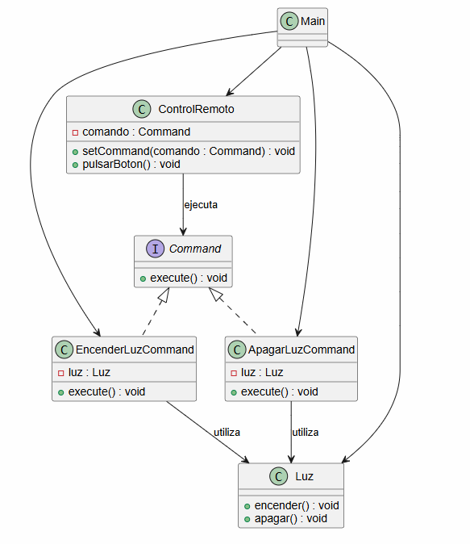
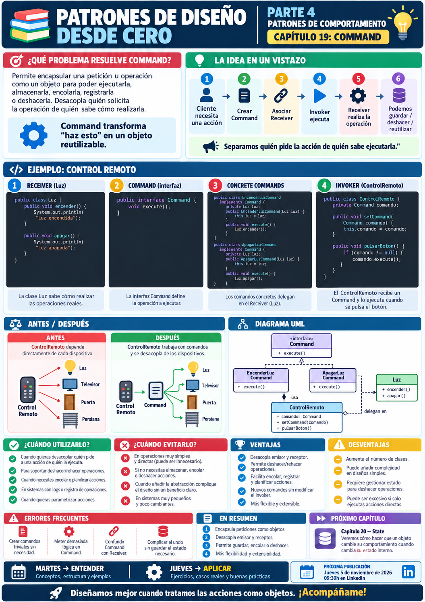

# 📚 Patrones de Diseño desde Cero

> **Aprende a diseñar software mantenible con ejemplos reales.**


# 📖 Capítulo 19 - Command

> **📚 Patrones de Diseño desde Cero**  
> **🔄 Parte IV - Patrones de Comportamiento**

---

## 🧠 Introducción

Continuamos nuestro recorrido por los **patrones de comportamiento**.

Hasta ahora hemos estudiado:

### 🎯 Strategy

> **¿Cómo podemos intercambiar algoritmos o comportamientos sin modificar el contexto que los utiliza?**

### 👀 Observer

> **¿Cómo podemos notificar automáticamente a varios objetos cuando cambia el estado de otro?**

Ahora vamos a enfrentarnos a un problema diferente.

Imaginemos un control remoto.

Tenemos botones como:

```text
Encender luz
Apagar luz
Encender televisión
Abrir puerta
Subir persiana
```

Una primera solución podría consistir en hacer que cada botón conozca directamente qué objeto debe utilizar.

Por ejemplo:

```java
public class BotonEncenderLuz {

    private Luz luz;

    public void pulsar() {

        luz.encender();
    }
}
```

Funciona.

Pero pronto aparecen nuevos requisitos:

```text
deshacer operaciones
guardar historial
encolar acciones
programarlas
registrarlas
repetirlas
combinar varias operaciones
```

Entonces surge una pregunta:

> **¿Y si pudiéramos representar cada operación como un objeto?**

Aquí aparece:

# 🎮 Command

Command encapsula una petición u operación dentro de un objeto.

De esta forma podemos:

```text
ejecutarla
almacenarla
encolarla
registrarla
deshacerla
repetirla
```

sin que quien solicita la operación necesite conocer cómo se realiza realmente.

---

# 🎯 Objetivos de aprendizaje

Al finalizar este capítulo deberías ser capaz de:

- Comprender qué problema intenta resolver Command.
- Entender qué significa encapsular una petición como objeto.
- Identificar los participantes `Command`, `ConcreteCommand`, `Receiver`, `Invoker` y `Client`.
- Implementar Command en Java.
- Separar quién solicita una operación de quién la ejecuta.
- Implementar operaciones `execute()`.
- Implementar mecanismos sencillos de `undo()`.
- Crear historiales de comandos.
- Encolar o programar comandos.
- Crear Macro Commands.
- Comprender cómo Command favorece el desacoplamiento.
- Diferenciar Command de Strategy.
- Diferenciar Command de Chain of Responsibility.
- Comprender sus ventajas y desventajas.
- Saber cuándo utilizarlo y cuándo evitarlo.

---

# ❌ El problema

Imaginemos un sistema domótico.

Tenemos una clase:

```java
public class Luz {

    public void encender() {

        System.out.println(
            "💡 Luz encendida"
        );
    }

    public void apagar() {

        System.out.println(
            "🌑 Luz apagada"
        );
    }
}
```

Y queremos crear un control remoto.

Podríamos hacer:

```java
public class ControlRemoto {

    private Luz luz;

    public ControlRemoto(
            Luz luz) {

        this.luz = luz;
    }

    public void pulsarEncender() {

        luz.encender();
    }

    public void pulsarApagar() {

        luz.apagar();
    }
}
```

Funciona.

Pero ahora queremos controlar también:

```text
Televisor
Persiana
Puerta
Aire acondicionado
Equipo de música
```

Nuestro `ControlRemoto` empezaría a conocer directamente:

```text
Luz
Televisor
Persiana
Puerta
AireAcondicionado
EquipoMusica
```

Y tendría métodos como:

```text
encenderLuz()
apagarLuz()
encenderTelevision()
apagarTelevision()
subirPersiana()
bajarPersiana()
abrirPuerta()
...
```

El acoplamiento crece rápidamente.

---

# ⚠️ El problema real

El control remoto no debería saber:

> **cómo se enciende una luz**

ni:

> **cómo se abre una puerta**

ni:

> **cómo se enciende un televisor**

Solo debería saber:

> **"Tengo una operación que puedo ejecutar."**

Queremos separar:

```text
QUIÉN SOLICITA LA OPERACIÓN
```

de:

```text
QUIÉN SABE REALIZARLA
```

---

# 💡 Motivación

En lugar de conectar directamente:

```text
ControlRemoto
      │
      ▼
     Luz
```

podemos insertar un objeto intermedio:

```text
ControlRemoto
      │
      ▼
    Command
      │
      ▼
     Luz
```

El control remoto ejecuta:

```java
comando.execute();
```

sin saber qué ocurre internamente.

El comando conoce:

```text
qué Receiver utilizar
+
qué operación ejecutar
```

---

# 🎮 La solución

Command convierte una operación en un objeto.

Conceptualmente:

```text
CLIENT
   │
   ▼
COMMAND
   │
   ▼
RECEIVER
```

Y aparece otro participante:

```text
INVOKER
```

que simplemente solicita la ejecución.

La estructura completa sería:

```text
Client
   │
   ├── crea Receiver
   ├── crea Command
   │
   ▼
Invoker
   │
   │ execute()
   ▼
Command
   │
   ▼
Receiver
```

---

# 🧱 Participantes del patrón

Command suele tener cinco participantes principales.

## 1️⃣ Command

Define la interfaz común para todas las operaciones.

Por ejemplo:

```java
public interface Command {

    void execute();
}
```

---

## 2️⃣ Concrete Command

Implementa una operación concreta.

Por ejemplo:

```text
EncenderLuzCommand
ApagarLuzCommand
```

---

## 3️⃣ Receiver

Es el objeto que realmente sabe realizar el trabajo.

En nuestro ejemplo:

```text
Luz
```

---

## 4️⃣ Invoker

Solicita la ejecución del comando.

Por ejemplo:

```text
ControlRemoto
```

---

## 5️⃣ Client

Configura todo:

```text
crea Receiver
crea Commands
configura Invoker
```

---

# ☕ Implementación en Java

## Command - Command.java

```java
public interface Command {

    void execute();
}
```

---

# 💡 Receiver - Luz.java

```java
public class Luz {

    public void encender() {

        System.out.println(
            "💡 Luz encendida"
        );
    }

    public void apagar() {

        System.out.println(
            "🌑 Luz apagada"
        );
    }
}
```

---

# ▶️ Concrete Command - EncenderLuzCommand.java

```java
public class EncenderLuzCommand
        implements Command {

    private final Luz luz;

    public EncenderLuzCommand(
            Luz luz) {

        this.luz = luz;
    }

    @Override
    public void execute() {

        luz.encender();
    }
}
```

---

# ⏹️ Concrete Command - ApagarLuzCommand.java

```java
public class ApagarLuzCommand
        implements Command {

    private final Luz luz;

    public ApagarLuzCommand(
            Luz luz) {

        this.luz = luz;
    }

    @Override
    public void execute() {

        luz.apagar();
    }
}
```

---

# 🎛️ Invoker - ControlRemoto.java

```java
public class ControlRemoto {

    private Command comando;

    public void setCommand(
            Command comando) {

        this.comando =
                comando;
    }

    public void pulsarBoton() {

        if (comando == null) {

            throw new IllegalStateException(
                "No existe ningún comando configurado"
            );
        }

        comando.execute();
    }
}
```

---

# ▶️ Cliente - Main.java

```java
public class Main {

    public static void main(String[] args) {

        Luz luz =
                new Luz();

        Command encender =
                new EncenderLuzCommand(
                    luz
                );

        Command apagar =
                new ApagarLuzCommand(
                    luz
                );

        ControlRemoto control =
                new ControlRemoto();

        control.setCommand(
            encender
        );

        control.pulsarBoton();

        control.setCommand(
            apagar
        );

        control.pulsarBoton();
    }
}
```

---

# 📤 Posible salida

```text
💡 Luz encendida
🌑 Luz apagada
```

El `ControlRemoto` nunca llama directamente a:

```java
luz.encender();
```

ni:

```java
luz.apagar();
```

Únicamente conoce:

```java
Command
```

---

# 🔎 Explicación paso a paso

## 1️⃣ Definimos Command

```java
Command
```

declara:

```java
execute();
```

---

## 2️⃣ Creamos el Receiver

```java
Luz
```

contiene la lógica real.

---

## 3️⃣ Creamos Concrete Commands

```text
EncenderLuzCommand
ApagarLuzCommand
```

Cada uno sabe:

```text
qué Receiver utilizar
+
qué método invocar
```

---

## 4️⃣ El Invoker recibe un Command

```java
private Command comando;
```

No conoce:

```text
Luz
Televisor
Puerta
```

Solo conoce:

```text
Command
```

---

## 5️⃣ Ejecuta

```java
comando.execute();
```

---

## 6️⃣ El Command delega

Por ejemplo:

```java
luz.encender();
```

---

# 📊 UML

Podemos representar el patrón así:



Conceptualmente:

```text
                 Command
                    ▲
             ┌──────┴───────┐
             │              │
       EncenderCommand   ApagarCommand
             │              │
             └──────┬───────┘
                    ▼
                   Luz
                Receiver

ControlRemoto
   Invoker
      │
      ▼
   Command
```

---

# 🔑 La idea clave

Command separa:

```text
QUIÉN PIDE
```

de:

```text
QUIÉN HACE
```

El Invoker dice:

```java
command.execute();
```

pero no necesita conocer:

```text
quién ejecuta
cómo se ejecuta
qué método concreto se llama
```

---

# 🧠 Una petición se convierte en un objeto

Esta es probablemente la idea más importante del patrón.

Normalmente pensamos en una operación como:

```java
luz.encender();
```

Command la convierte en:

```java
Command comando =
    new EncenderLuzCommand(
        luz
    );
```

Ahora la operación es:

> **un objeto de primera clase.**

Y eso significa que podemos:

```text
guardarla
pasarla como parámetro
encolarla
registrarla
repetirla
deshacerla
```

---

# ↩️ Añadiendo Undo

Command resulta especialmente útil cuando queremos implementar:

```text
DESHACER
```

Podemos ampliar la interfaz:

```java
public interface Command {

    void execute();

    void undo();
}
```

---

# 💡 EncenderLuzCommand con Undo

```java
public class EncenderLuzCommand
        implements Command {

    private final Luz luz;

    public EncenderLuzCommand(
            Luz luz) {

        this.luz = luz;
    }

    @Override
    public void execute() {

        luz.encender();
    }

    @Override
    public void undo() {

        luz.apagar();
    }
}
```

---

# 🌑 ApagarLuzCommand con Undo

```java
public class ApagarLuzCommand
        implements Command {

    private final Luz luz;

    public ApagarLuzCommand(
            Luz luz) {

        this.luz = luz;
    }

    @Override
    public void execute() {

        luz.apagar();
    }

    @Override
    public void undo() {

        luz.encender();
    }
}
```

---

# 🎛️ Invoker con Undo

```java
public class ControlRemoto {

    private Command comando;

    private Command ultimoComando;

    public void setCommand(
            Command comando) {

        this.comando =
                comando;
    }

    public void pulsarBoton() {

        comando.execute();

        ultimoComando =
                comando;
    }

    public void pulsarDeshacer() {

        if (
            ultimoComando != null
        ) {

            ultimoComando.undo();
        }
    }
}
```

Ahora:

```java
control.pulsarBoton();
```

puede ejecutar:

```text
encender luz
```

Y después:

```java
control.pulsarDeshacer();
```

puede revertirla.

---

# 📜 Historial de comandos

En lugar de guardar solo:

```text
último comando
```

podemos mantener una pila:

```java
Deque<Command> historial =
        new ArrayDeque<>();
```

Cada vez que ejecutamos:

```java
Command comando
```

hacemos:

```java
comando.execute();

historial.push(
    comando
);
```

Para deshacer:

```java
Command comando =
        historial.pop();

comando.undo();
```

Esto nos permite implementar:

```text
Undo
Undo
Undo
Undo
```

---

# 🔁 Redo

También podemos mantener:

```text
historialUndo
historialRedo
```

Cuando hacemos:

```text
undo
```

movemos el comando de una pila a otra.

Conceptualmente:

```text
EXECUTE
   ↓
UNDO STACK


UNDO
   ↓
REDO STACK


REDO
   ↓
UNDO STACK
```

Este mecanismo es habitual en:

```text
editores de texto
editores gráficos
IDE
aplicaciones CAD
```

---

# 📦 Comandos con datos

Un Command puede guardar también los parámetros necesarios para ejecutar la operación.

Por ejemplo:

```java
public class TransferirCommand
        implements Command {

    private final Cuenta origen;
    private final Cuenta destino;

    private final double cantidad;

    public TransferirCommand(
            Cuenta origen,
            Cuenta destino,
            double cantidad) {

        this.origen = origen;
        this.destino = destino;
        this.cantidad = cantidad;
    }

    @Override
    public void execute() {

        origen.retirar(
            cantidad
        );

        destino.ingresar(
            cantidad
        );
    }
}
```

El comando encapsula:

```text
operación
+
datos
+
receiver
```

---

# ⏱️ Comandos programados

Como los comandos son objetos, podemos guardarlos para ejecutarlos posteriormente.

Por ejemplo:

```java
List<Command> tareas =
        new ArrayList<>();
```

Añadimos:

```java
tareas.add(
    command
);
```

Y después:

```java
for (
    Command command :
    tareas
) {

    command.execute();
}
```

Esto permite implementar:

```text
colas
planificadores
jobs
tareas programadas
```

---

# 📬 Command Queue

Podemos tener:

```text
Producer
   │
   ▼
Command Queue
   │
   ▼
Worker
```

El productor crea Commands.

El Worker ejecuta:

```java
command.execute();
```

sin necesitar conocer qué tipo concreto de tarea representa cada comando.

---

# 🧩 Macro Command

También podemos crear un Command compuesto por otros comandos.

Por ejemplo:

```java
public class MacroCommand
        implements Command {

    private final List<Command>
            comandos;

    public MacroCommand(
            List<Command> comandos) {

        this.comandos =
                comandos;
    }

    @Override
    public void execute() {

        for (
            Command comando :
            comandos
        ) {

            comando.execute();
        }
    }
}
```

Ahora podemos crear:

```text
Modo Cine
```

que ejecute:

```text
apagar luces
bajar persianas
encender televisión
encender equipo de sonido
```

como una única operación.

---

# 🎬 Ejemplo de Macro Command

```java
Command modoCine =
        new MacroCommand(
            List.of(
                apagarLuces,
                bajarPersianas,
                encenderTelevision
            )
        );
```

Después:

```java
modoCine.execute();
```

Ejecuta todas las operaciones.

---

# 🏗️ Caso de uso: interfaz gráfica

Imaginemos un editor de texto.

Los botones:

```text
Copiar
Pegar
Guardar
Deshacer
Imprimir
```

pueden estar asociados a Commands.

Por ejemplo:

```text
Botón
  ↓
GuardarCommand
  ↓
Documento
```

Esto permite reutilizar el mismo Command desde:

```text
botón
menú
atajo de teclado
toolbar
```

---

# ⌨️ Caso de uso: atajos

Podemos asociar:

```text
CTRL + S
```

a:

```java
GuardarCommand
```

y el botón:

```text
Guardar
```

a exactamente el mismo Command.

El origen de la petición cambia.

La operación no.

---

# 🧾 Caso de uso: auditoría

Como cada operación es un objeto, podemos registrar:

```text
quién ejecutó
qué comando
cuándo
con qué parámetros
resultado
```

Esto puede resultar útil en determinados sistemas empresariales.

---

# 🎮 Caso de uso: videojuegos

Un sistema de entrada puede convertir:

```text
Tecla W
Botón A
Joystick
```

en comandos:

```text
MoverCommand
SaltarCommand
AtacarCommand
```

Esto permite cambiar el mapeo de controles con facilidad.

---

# 🎯 ¿Cuándo utilizar Command?

Command puede resultar adecuado cuando:

- Queremos desacoplar quien solicita una operación de quien la ejecuta.
- Necesitamos representar operaciones como objetos.
- Queremos implementar Undo/Redo.
- Necesitamos guardar historial.
- Queremos encolar operaciones.
- Queremos programarlas.
- Queremos registrar operaciones.
- Necesitamos Macro Commands.
- Queremos reutilizar una operación desde diferentes interfaces.
- Necesitamos parametrizar objetos mediante acciones.

---

# 🚫 ¿Cuándo evitarlo?

Probablemente no necesitamos Command cuando:

- La operación es extremadamente simple.
- No necesitamos desacoplamiento adicional.
- No habrá Undo.
- No necesitamos historial.
- No necesitamos encolado.
- El Invoker puede llamar directamente al Receiver sin problema.
- Crear una clase por operación añade más complejidad que valor.

Por ejemplo:

```java
calculadora.sumar(
    2,
    3
);
```

probablemente no necesita:

```text
SumarCommand
```

si no existe ningún requisito adicional.

---

# ✅ Ventajas

## 🔹 Desacopla Invoker y Receiver

El Invoker depende de:

```java
Command
```

---

## 🔹 Convierte operaciones en objetos

Podemos manipularlas como cualquier otro dato.

---

## 🔹 Facilita Undo/Redo

El Command puede guardar el estado necesario.

---

## 🔹 Permite historial

Podemos almacenar comandos ejecutados.

---

## 🔹 Permite colas

Los comandos pueden ejecutarse posteriormente.

---

## 🔹 Permite Macro Commands

Podemos combinar múltiples operaciones.

---

## 🔹 Facilita extensión

Añadir nuevos comandos no obliga necesariamente a modificar el Invoker.

---

# ❌ Desventajas

## 🔸 Aumenta el número de clases

Podemos terminar con:

```text
AbrirCommand
CerrarCommand
GuardarCommand
CopiarCommand
PegarCommand
EliminarCommand
...
```

---

## 🔸 Puede ser excesivo

Para operaciones muy simples puede resultar innecesario.

---

## 🔸 Undo puede ser complejo

No todas las operaciones son fácilmente reversibles.

---

## 🔸 Puede requerir almacenar estado

Para revertir una operación quizá necesitamos guardar:

```text
estado anterior
parámetros
datos modificados
```

---

## 🔸 Puede aumentar la indirección

El flujo pasa por:

```text
Invoker
↓
Command
↓
Receiver
```

---

# ⚠️ Command no significa simplemente crear una clase por método

Crear:

```text
EncenderCommand
ApagarCommand
```

no aporta automáticamente valor.

La intención debe ser:

> **representar operaciones como objetos porque necesitamos manipular esas operaciones.**

Por ejemplo:

```text
almacenarlas
encolarlas
deshacerlas
reutilizarlas
programarlas
```

---

# ⚠️ El Receiver sigue teniendo la lógica real

Un error sería mover todo el comportamiento del Receiver al Command.

Por ejemplo:

```text
Luz
```

debería seguir sabiendo:

```text
cómo encenderse
cómo apagarse
```

El Command simplemente decide:

> **qué operación solicitar.**

---

# 🚨 Errores frecuentes

## ❌ Crear comandos para operaciones triviales

Puede generar ruido arquitectónico.

---

## ❌ Meter lógica de negocio excesiva en Command

Command debería encapsular una petición.

No convertirse en el nuevo dominio.

---

## ❌ Acoplar el Invoker a comandos concretos

Preferimos:

```java
Command
```

en lugar de:

```java
EncenderLuzCommand
```

como dependencia fija.

---

## ❌ Implementar Undo sin almacenar estado suficiente

No todas las operaciones pueden invertirse simplemente ejecutando otra operación.

---

## ❌ Confundir Command con Receiver

El Command solicita.

El Receiver hace.

---

## ❌ Crear una clase gigantesca de comandos

Evita:

```text
ComandosSistema
```

con decenas de métodos.

Cada Command debería representar una acción clara.

---

# 🧠 Buenas prácticas

## 1️⃣ Mantén pequeña la interfaz Command

Normalmente:

```java
execute();
```

y opcionalmente:

```java
undo();
```

pueden ser suficientes.

---

## 2️⃣ Mantén la lógica de dominio en el Receiver

El Command coordina la petición.

---

## 3️⃣ Guarda solo el estado necesario

Especialmente para Undo.

---

## 4️⃣ Haz los Commands inmutables cuando sea posible

Por ejemplo:

```java
private final Luz luz;
```

---

## 5️⃣ Utiliza Macro Commands con moderación

Pueden resultar muy útiles, pero una macro enorme puede ser difícil de mantener.

---

## 6️⃣ Considera lambdas para Commands simples

Si:

```java
Command
```

es una interfaz funcional:

```java
@FunctionalInterface
public interface Command {

    void execute();
}
```

podemos utilizar:

```java
Command encender =
        () -> luz.encender();
```

Esto puede evitar clases triviales.

---

# ☕ Command y lambdas

En Java podemos simplificar:

```java
Command command =
        new EncenderLuzCommand(
            luz
        );
```

a:

```java
Command command =
        luz::encender;
```

si solamente necesitamos:

```java
execute();
```

Esto conserva la idea principal:

> **la operación puede tratarse como un valor.**

---

# 🆚 Command vs. Strategy

Command y Strategy pueden parecer similares porque ambos encapsulan comportamiento.

Pero su intención es diferente.

| Command | Strategy |
|---|---|
| Encapsula una petición | Encapsula un algoritmo |
| Representa algo que debe ejecutarse | Representa cómo hacer algo |
| Puede almacenarse | Suele seleccionarse |
| Puede tener Undo | Normalmente no |
| Puede encolarse | Normalmente no |
| Puede guardar parámetros | Define una forma de resolver una tarea |

Podemos resumir:

```text
COMMAND
↓
¿QUÉ ACCIÓN QUIERO EJECUTAR?
```

```text
STRATEGY
↓
¿CÓMO QUIERO REALIZARLA?
```

---

# 🆚 Command vs. Chain of Responsibility

| Command | Chain of Responsibility |
|---|---|
| Encapsula una petición | Pasa una petición por handlers |
| La operación es un objeto | Los receptores forman una cadena |
| Puede ejecutarse después | Se procesa recorriendo la cadena |
| Puede guardarse | La cadena decide quién la trata |

Command puede incluso ser la petición que una Chain procesa.

---

# 🆚 Command vs. Observer

| Command | Observer |
|---|---|
| Solicita una acción | Notifica un cambio |
| Normalmente uno ejecuta | Muchos pueden reaccionar |
| Invoker → Command | Subject → Observers |
| Petición explícita | Reacción ante evento |

---

# 🆚 Command vs. Memento

Ambos aparecen frecuentemente al implementar Undo.

Pero resuelven problemas distintos.

### Command

Representa:

```text
la operación
```

### Memento

Puede almacenar:

```text
el estado anterior
```

Podrían trabajar juntos:

```text
Command
   +
Memento
   =
Undo complejo
```

Memento aparecerá más adelante en la serie.

---

# 🧠 Principios relacionados

Command conecta especialmente con varios principios de diseño.

## 🔗 Bajo acoplamiento

El Invoker depende de:

```java
Command
```

y no del Receiver concreto.

---

## 🎯 Responsabilidad única

El Invoker solicita.

El Command representa la acción.

El Receiver ejecuta la lógica real.

---

## 🧱 Programar hacia abstracciones

Trabajamos mediante:

```java
Command
```

---

## ➕ Open/Closed Principle

Podemos añadir nuevos comandos sin modificar necesariamente el Invoker.

---

## 📦 Encapsulación

La petición y sus parámetros quedan encapsulados.

---

# 📌 Resumen

En este capítulo hemos aprendido que:

- Command pertenece a los patrones de comportamiento.
- Convierte una petición en un objeto.
- `Command` define la operación común.
- `ConcreteCommand` representa una acción concreta.
- `Receiver` contiene la lógica real.
- `Invoker` solicita la ejecución.
- El cliente configura los participantes.
- Command desacopla quién solicita de quién ejecuta.
- Las operaciones pueden almacenarse como objetos.
- Podemos implementar Undo/Redo.
- Podemos mantener historiales.
- Podemos crear colas de comandos.
- Podemos programar su ejecución.
- Podemos crear Macro Commands.
- Las lambdas pueden simplificar comandos sencillos en Java.
- Command y Strategy encapsulan comportamiento, pero con intenciones diferentes.
- No toda llamada a un método necesita convertirse en Command.

La pregunta fundamental de Command es:

> **¿Necesitamos tratar una operación como un objeto para poder manipularla independientemente de quien la ejecuta?**

---

# 🎓 Conclusiones

Command introduce una idea muy potente:

> **Las acciones también pueden convertirse en objetos.**

Sin Command tenemos:

```text
ControlRemoto
      │
      ▼
     Luz
```

El Invoker conoce directamente al Receiver.

Con Command:

```text
ControlRemoto
      │
      ▼
    Command
      │
      ▼
     Luz
```

Ahora el control remoto solamente conoce:

```java
execute();
```

Esto parece añadir una capa.

Y efectivamente la añade.

Pero esa capa nos permite hacer algo que antes era difícil:

```text
guardar acciones
encolarlas
repetirlas
deshacerlas
registrarlas
programarlas
combinarlas
```

Ese es el verdadero valor de Command.

Pero, como siempre, existe un coste:

```text
más clases
más objetos
más indirección
```

Por eso seguimos nuestra metodología:

```text
PROBLEMA
   ↓
CONTEXTO
   ↓
¿NECESITAMOS REPRESENTAR
LA OPERACIÓN COMO OBJETO?
   ↓
¿NECESITAMOS UNDO,
HISTORIAL O COLAS?
   ↓
ALTERNATIVAS
   ↓
¿COMMAND APORTA VALOR?
```

No utilizamos Command porque una clase tenga métodos.

Lo utilizamos cuando necesitamos **separar la petición de su ejecución y tratar esa petición como una entidad propia**.

> **Command transforma “haz esto” en un objeto que podemos guardar, mover, ejecutar y deshacer.**

---

# 🖼️ Infografía

Aquí os dejo una infografía sobre este **capítulo 19**.



---

**📚 Patrones de Diseño desde Cero**

*Aprende a diseñar software mantenible con ejemplos reales.*