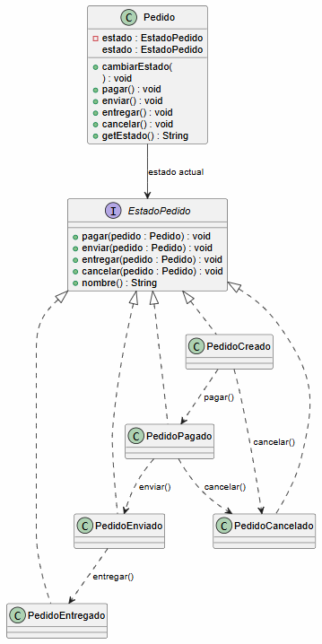
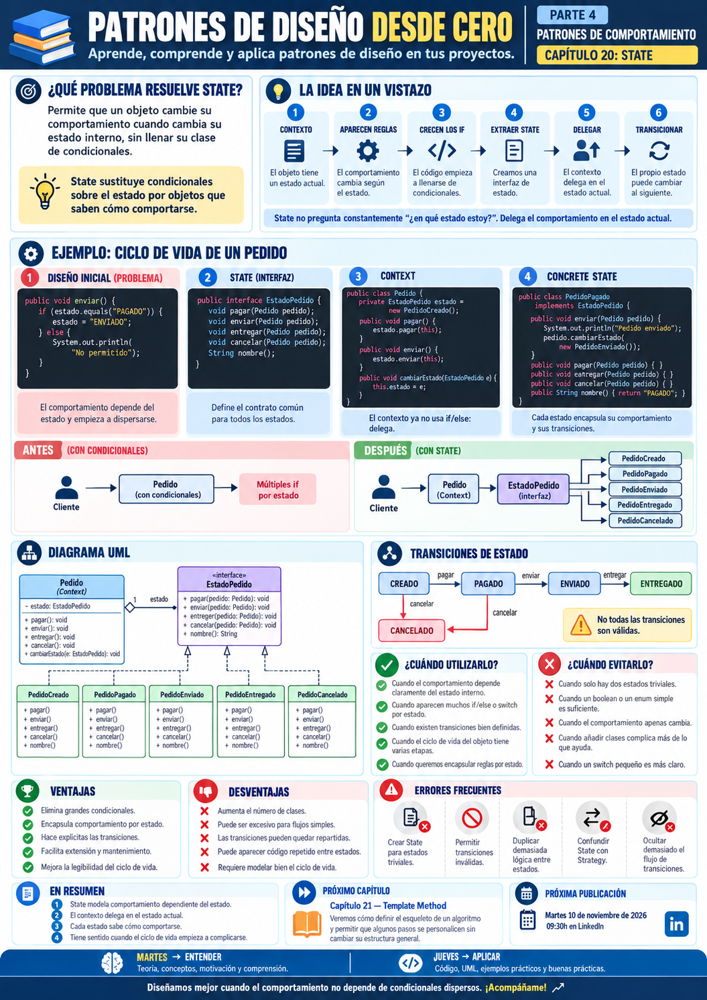

# 📚 Patrones de Diseño desde Cero

> **Aprende a diseñar software mantenible con ejemplos reales.**

# 📖 Capítulo 20 - State

> **📚 Patrones de Diseño desde Cero**  
> **🔄 Parte IV - Patrones de Comportamiento**

---

## 🧠 Introducción

Continuamos nuestro recorrido por los **patrones de comportamiento**.

Hasta ahora hemos estudiado:

### 🎯 Strategy

> **¿Cómo podemos intercambiar algoritmos o comportamientos sin modificar el contexto que los utiliza?**

### 👀 Observer

> **¿Cómo podemos notificar automáticamente a varios objetos cuando cambia el estado de otro?**

### 🎮 Command

> **¿Cómo podemos encapsular una operación dentro de un objeto para poder ejecutarla, almacenarla, encolarla o deshacerla?**

Ahora nos encontramos con otro problema.

Imaginemos un pedido de una tienda online.

Un pedido puede pasar por diferentes estados:

```text
CREADO
PAGADO
ENVIADO
ENTREGADO
CANCELADO
```

Y las operaciones permitidas cambian según el estado actual.

Por ejemplo:

```text
CREADO
↓
se puede pagar o cancelar
```

```text
PAGADO
↓
se puede enviar o cancelar
```

```text
ENVIADO
↓
se puede entregar
```

```text
ENTREGADO
↓
ya no se puede cancelar
```

Una primera solución podría utilizar:

```java
if
```

o:

```java
switch
```

para comprobar continuamente el estado.

Pero cuanto más crece el flujo, más compleja se vuelve la clase.

La pregunta será:

> **¿Cómo podemos hacer que un objeto cambie su comportamiento cuando cambia su estado interno sin llenar su código de condicionales?**

Aquí aparece:

# 🔁 State

State permite representar cada estado mediante un objeto independiente.

El contexto delega su comportamiento en el objeto que representa su estado actual.

---

# 🎯 Objetivos de aprendizaje

Al finalizar este capítulo deberías ser capaz de:

- Comprender qué problema intenta resolver State.
- Identificar comportamientos que dependen del estado interno.
- Detectar grandes `if / else` o `switch` basados en estados.
- Comprender la diferencia entre Context y State.
- Identificar `State`, `ConcreteState` y `Context`.
- Implementar State en Java.
- Encapsular las transiciones entre estados.
- Comprender cuándo el propio State puede cambiar el estado del Context.
- Diferenciar State de Strategy.
- Diferenciar State de State Machine.
- Comprender sus ventajas y desventajas.
- Identificar transiciones inválidas.
- Evitar estados con demasiadas responsabilidades.
- Saber cuándo utilizar State y cuándo una solución más sencilla es suficiente.

---

# ❌ El problema

Imaginemos una clase:

```java
public class Pedido {

    private String estado;

    public Pedido() {

        this.estado = "CREADO";
    }

    public void pagar() {

        if (
            estado.equals("CREADO")
        ) {

            System.out.println(
                "💳 Pedido pagado"
            );

            estado = "PAGADO";

        } else {

            System.out.println(
                "❌ No se puede pagar "
                + "desde el estado "
                + estado
            );
        }
    }

    public void enviar() {

        if (
            estado.equals("PAGADO")
        ) {

            System.out.println(
                "🚚 Pedido enviado"
            );

            estado = "ENVIADO";

        } else {

            System.out.println(
                "❌ No se puede enviar "
                + "desde el estado "
                + estado
            );
        }
    }

    public void entregar() {

        if (
            estado.equals("ENVIADO")
        ) {

            System.out.println(
                "📦 Pedido entregado"
            );

            estado = "ENTREGADO";

        } else {

            System.out.println(
                "❌ No se puede entregar "
                + "desde el estado "
                + estado
            );
        }
    }

    public void cancelar() {

        if (
            estado.equals("CREADO")
            || estado.equals("PAGADO")
        ) {

            System.out.println(
                "🚫 Pedido cancelado"
            );

            estado = "CANCELADO";

        } else {

            System.out.println(
                "❌ No se puede cancelar "
                + "desde el estado "
                + estado
            );
        }
    }
}
```

Funciona.

Pero empiezan a aparecer problemas.

---

# 📈 El problema crece

Añadimos nuevos estados:

```text
PREPARANDO
DEVUELTO
REEMBOLSADO
INCIDENCIA
```

Y nuevas operaciones:

```text
preparar()
devolver()
reembolsar()
reabrir()
```

Ahora cada método debe comprobar:

```text
qué estados permiten la operación
qué transición debe producirse
qué comportamiento corresponde
```

La clase empieza a llenarse de:

```text
if
else
switch
```

basados en:

```text
estado actual
```

---

# ⚠️ ¿Qué problemas aparecen?

Tenemos una clase que conoce:

```text
todos los estados
+
todas las transiciones
+
todos los comportamientos
```

Esto provoca:

```text
alta complejidad
dificultad de extensión
riesgo de transiciones inválidas
métodos cada vez más largos
```

El problema real es:

> **El comportamiento dependiente del estado está concentrado dentro del Context.**

---

# 💡 Motivación

Queremos extraer cada estado a un objeto independiente.

En lugar de:

```text
Pedido
├── if CREADO
├── if PAGADO
├── if ENVIADO
├── if ENTREGADO
└── if CANCELADO
```

podemos tener:

```text
Pedido
   │
   ▼
EstadoPedido
   ▲
   │
 ┌─┼───────────────┐
 │ │               │
Creado Pagado   Enviado
```

Cada estado sabe:

```text
qué operaciones permite
+
cómo reacciona
+
a qué estado puede pasar
```

---

# 🔁 La solución

State separa el comportamiento en clases independientes.

Conceptualmente:

```text
      Context
         │
         ▼
       State
         ▲
         │
 ┌───────┼─────────┐
 │       │         │
 A       B         C
```

El Context mantiene:

```java
State estado;
```

Y delega:

```java
estado.operacion(
    this
);
```

El objeto cambia de comportamiento cuando cambia:

```text
el objeto State actual
```

---

# 🧱 Participantes del patrón

State suele tener tres participantes principales.

## 1️⃣ State

Define la interfaz común para los estados.

Por ejemplo:

```java
public interface EstadoPedido {

    void pagar(Pedido pedido);

    void enviar(Pedido pedido);

    void entregar(Pedido pedido);

    void cancelar(Pedido pedido);
}
```

---

## 2️⃣ Concrete State

Representa cada estado concreto.

Por ejemplo:

```text
PedidoCreado
PedidoPagado
PedidoEnviado
PedidoEntregado
PedidoCancelado
```

---

## 3️⃣ Context

Es el objeto cuyo comportamiento cambia.

En nuestro ejemplo:

```text
Pedido
```

Mantiene una referencia al estado actual.

---

# ☕ Implementación en Java

## State - EstadoPedido.java

```java
public interface EstadoPedido {

    void pagar(
        Pedido pedido
    );

    void enviar(
        Pedido pedido
    );

    void entregar(
        Pedido pedido
    );

    void cancelar(
        Pedido pedido
    );

    String nombre();
}
```

---

## 📦 Context - Pedido.java

```java
public class Pedido {

    private EstadoPedido estado;

    public Pedido() {

        this.estado =
                new PedidoCreado();
    }

    public void cambiarEstado(
            EstadoPedido estado) {

        this.estado =
                estado;
    }

    public void pagar() {

        estado.pagar(
            this
        );
    }

    public void enviar() {

        estado.enviar(
            this
        );
    }

    public void entregar() {

        estado.entregar(
            this
        );
    }

    public void cancelar() {

        estado.cancelar(
            this
        );
    }

    public String getEstado() {

        return estado.nombre();
    }
}
```

Observa que `Pedido` ya no contiene:

```text
if estado == ...
```

Simplemente delega.

---

## 🆕 Concrete State - PedidoCreado.java

```java
public class PedidoCreado
        implements EstadoPedido {

    @Override
    public void pagar(
            Pedido pedido) {

        System.out.println(
            "💳 Pedido pagado"
        );

        pedido.cambiarEstado(
            new PedidoPagado()
        );
    }

    @Override
    public void enviar(
            Pedido pedido) {

        System.out.println(
            "❌ Primero debemos pagar "
            + "el pedido"
        );
    }

    @Override
    public void entregar(
            Pedido pedido) {

        System.out.println(
            "❌ El pedido todavía "
            + "no ha sido enviado"
        );
    }

    @Override
    public void cancelar(
            Pedido pedido) {

        System.out.println(
            "🚫 Pedido cancelado"
        );

        pedido.cambiarEstado(
            new PedidoCancelado()
        );
    }

    @Override
    public String nombre() {

        return "CREADO";
    }
}
```

---

## 💳 Concrete State - PedidoPagado.java

```java
public class PedidoPagado
        implements EstadoPedido {

    @Override
    public void pagar(
            Pedido pedido) {

        System.out.println(
            "❌ El pedido ya está pagado"
        );
    }

    @Override
    public void enviar(
            Pedido pedido) {

        System.out.println(
            "🚚 Pedido enviado"
        );

        pedido.cambiarEstado(
            new PedidoEnviado()
        );
    }

    @Override
    public void entregar(
            Pedido pedido) {

        System.out.println(
            "❌ El pedido todavía "
            + "no ha sido enviado"
        );
    }

    @Override
    public void cancelar(
            Pedido pedido) {

        System.out.println(
            "🚫 Pedido cancelado"
        );

        pedido.cambiarEstado(
            new PedidoCancelado()
        );
    }

    @Override
    public String nombre() {

        return "PAGADO";
    }
}
```

---

## 🚚 Concrete State - PedidoEnviado.java

```java
public class PedidoEnviado
        implements EstadoPedido {

    @Override
    public void pagar(
            Pedido pedido) {

        System.out.println(
            "❌ El pedido ya está pagado"
        );
    }

    @Override
    public void enviar(
            Pedido pedido) {

        System.out.println(
            "❌ El pedido ya ha sido enviado"
        );
    }

    @Override
    public void entregar(
            Pedido pedido) {

        System.out.println(
            "📦 Pedido entregado"
        );

        pedido.cambiarEstado(
            new PedidoEntregado()
        );
    }

    @Override
    public void cancelar(
            Pedido pedido) {

        System.out.println(
            "❌ Un pedido enviado "
            + "ya no puede cancelarse"
        );
    }

    @Override
    public String nombre() {

        return "ENVIADO";
    }
}
```

---

## ✅ Concrete State - PedidoEntregado.java

```java
public class PedidoEntregado
        implements EstadoPedido {

    @Override
    public void pagar(
            Pedido pedido) {

        operacionNoPermitida();
    }

    @Override
    public void enviar(
            Pedido pedido) {

        operacionNoPermitida();
    }

    @Override
    public void entregar(
            Pedido pedido) {

        System.out.println(
            "❌ El pedido ya está entregado"
        );
    }

    @Override
    public void cancelar(
            Pedido pedido) {

        System.out.println(
            "❌ Un pedido entregado "
            + "no puede cancelarse"
        );
    }

    private void operacionNoPermitida() {

        System.out.println(
            "❌ Operación no permitida "
            + "sobre un pedido entregado"
        );
    }

    @Override
    public String nombre() {

        return "ENTREGADO";
    }
}
```

---

## 🚫 Concrete State - PedidoCancelado.java

```java
public class PedidoCancelado
        implements EstadoPedido {

    @Override
    public void pagar(
            Pedido pedido) {

        operacionNoPermitida();
    }

    @Override
    public void enviar(
            Pedido pedido) {

        operacionNoPermitida();
    }

    @Override
    public void entregar(
            Pedido pedido) {

        operacionNoPermitida();
    }

    @Override
    public void cancelar(
            Pedido pedido) {

        System.out.println(
            "❌ El pedido ya está cancelado"
        );
    }

    private void operacionNoPermitida() {

        System.out.println(
            "❌ Operación no permitida "
            + "sobre un pedido cancelado"
        );
    }

    @Override
    public String nombre() {

        return "CANCELADO";
    }
}
```

---

## ▶️ Cliente - Main.java

```java
public class Main {

    public static void main(String[] args) {

        Pedido pedido =
                new Pedido();

        System.out.println(
            pedido.getEstado()
        );

        pedido.pagar();

        System.out.println(
            pedido.getEstado()
        );

        pedido.enviar();

        System.out.println(
            pedido.getEstado()
        );

        pedido.entregar();

        System.out.println(
            pedido.getEstado()
        );

        pedido.cancelar();
    }
}
```

---

# 📤 Posible salida

```text
CREADO

💳 Pedido pagado

PAGADO

🚚 Pedido enviado

ENVIADO

📦 Pedido entregado

ENTREGADO

❌ Un pedido entregado no puede cancelarse
```

El mismo objeto:

```java
pedido
```

se comporta de forma diferente según su estado interno.

---

# 🔎 Explicación paso a paso

## 1️⃣ El Context empieza en un estado

```java
new PedidoCreado();
```

---

## 2️⃣ El cliente solicita una operación

```java
pedido.pagar();
```

---

## 3️⃣ El Context delega

```java
estado.pagar(
    this
);
```

---

## 4️⃣ El State ejecuta el comportamiento

`PedidoCreado` permite pagar.

---

## 5️⃣ Se produce una transición

```java
pedido.cambiarEstado(
    new PedidoPagado()
);
```

---

## 6️⃣ El Context sigue siendo el mismo

```java
pedido
```

no cambia de identidad.

Lo que cambia es:

```text
su State interno
```

---

## 7️⃣ Cambia su comportamiento

Ahora:

```java
pedido.enviar();
```

se delega en:

```text
PedidoPagado
```

---

# 📊 UML

Podemos representar el patrón así:



Conceptualmente:

```text
             EstadoPedido
                  ▲
       ┌──────────┼───────────┐
       │          │           │
    Creado      Pagado     Enviado
                              │
                              ▼
                          Entregado

Pedido
  │
  ▼
Estado actual
```

---

# 🔑 La idea clave

State separa:

```text
ESTADO
```

de:

```text
COMPORTAMIENTO ASOCIADO
```

En lugar de escribir:

```java
if (
    estado == PAGADO
) {

    // comportamiento
}
```

hacemos:

```java
estado.operacion(
    this
);
```

El polimorfismo decide qué comportamiento ejecutar.

---

# 🔄 El objeto parece cambiar de clase

Desde el punto de vista del cliente:

```java
pedido.pagar();
pedido.enviar();
pedido.entregar();
```

siempre utilizamos:

```java
Pedido
```

Pero internamente el comportamiento procede de:

```text
PedidoCreado
PedidoPagado
PedidoEnviado
PedidoEntregado
```

Por eso suele decirse que State permite que:

> **un objeto parezca cambiar de clase cuando cambia su estado interno.**

---

# 🔁 Las transiciones

Una parte fundamental del patrón son las transiciones.

Nuestro ejemplo tiene:

```text
CREADO
  │
  ├── pagar()
  ▼
PAGADO
  │
  ├── enviar()
  ▼
ENVIADO
  │
  ├── entregar()
  ▼
ENTREGADO
```

También:

```text
CREADO ───────► CANCELADO
PAGADO ───────► CANCELADO
```

Pero no permitimos:

```text
ENTREGADO ────► CANCELADO
```

---

# 🧠 ¿Quién controla las transiciones?

Existen varias posibilidades.

## Opción 1 - El propio State

Como en nuestro ejemplo:

```java
pedido.cambiarEstado(
    new PedidoPagado()
);
```

Ventaja:

```text
comportamiento y transición
quedan juntos
```

---

## Opción 2 - El Context

El State podría devolver un resultado y el Context decidir la transición.

Esto centraliza:

```text
las transiciones
```

pero devuelve parte de la lógica al Context.

---

## Opción 3 - Un coordinador externo

En sistemas más complejos puede existir:

```text
State Machine
Workflow Engine
Process Manager
```

que controle las transiciones.

No existe una única estrategia válida.

Depende del contexto.

---

# 🗺️ State vs. State Machine

State y máquina de estados están relacionados, pero no son exactamente lo mismo.

El patrón State es:

> **una forma orientada a objetos de organizar comportamiento dependiente del estado.**

Una State Machine se centra en:

```text
estados
+
eventos
+
transiciones
```

Puede implementarse mediante:

```text
State
switch
tabla de transiciones
framework
workflow engine
```

State es una posible implementación.

---

# 🏗️ Caso de uso: reproductor multimedia

Imaginemos:

```text
Detenido
Reproduciendo
Pausado
```

El botón:

```text
play()
```

puede comportarse de manera diferente según el estado.

Por ejemplo:

```text
Detenido + play
→ Reproduciendo

Pausado + play
→ Reproduciendo

Reproduciendo + play
→ quizá no hacer nada
```

---

# 🚪 Caso de uso: puerta

Una puerta puede estar:

```text
Abierta
Cerrada
Bloqueada
```

Operaciones:

```text
abrir
cerrar
bloquear
desbloquear
```

Cada estado permite determinadas transiciones.

---

# 📄 Caso de uso: documentos

Un documento puede estar:

```text
Borrador
En revisión
Aprobado
Publicado
Archivado
```

Las acciones disponibles dependen del estado actual.

---

# 🎮 Caso de uso: videojuegos

Un personaje puede estar:

```text
Normal
Saltando
Atacando
Aturdido
Muerto
```

El mismo input puede provocar comportamientos diferentes según el estado.

---

# 🎯 ¿Cuándo utilizar State?

State puede resultar adecuado cuando:

- El comportamiento depende claramente del estado interno.
- Existen varios estados bien definidos.
- Tenemos muchos `if / else` o `switch` basados en estado.
- Las transiciones tienen reglas propias.
- Los estados evolucionan independientemente.
- Queremos encapsular comportamiento por estado.
- Esperamos incorporar nuevos estados.
- El flujo se parece a una máquina de estados.
- Queremos evitar una clase Context gigantesca.

---

# 🚫 ¿Cuándo evitarlo?

Probablemente no necesitamos State cuando:

- Solo existen dos estados triviales.
- El comportamiento apenas cambia.
- Un `boolean` es suficiente.
- Las transiciones son extremadamente simples.
- La cantidad de clases añade más complejidad que valor.
- Los estados no tienen comportamiento propio.
- Un enum con un pequeño `switch` es más claro.

Por ejemplo:

```java
boolean activo;
```

con:

```java
if (activo) {
    // ...
}
```

puede ser perfectamente suficiente.

---

# ✅ Ventajas

## 🔹 Elimina grandes condicionales

Reduce:

```text
if estado...
switch estado...
```

---

## 🔹 Encapsula comportamiento

Cada estado contiene su lógica.

---

## 🔹 Centraliza reglas por estado

Por ejemplo:

```text
qué operaciones están permitidas
```

---

## 🔹 Facilita extensión

Podemos añadir nuevos estados sin modificar necesariamente todos los existentes.

---

## 🔹 Hace explícitas las transiciones

La estructura refleja mejor el ciclo de vida.

---

## 🔹 Facilita pruebas

Podemos probar cada State independientemente.

---

# ❌ Desventajas

## 🔸 Aumenta el número de clases

Cada estado puede convertirse en una clase.

---

## 🔸 Puede ser excesivo para flujos sencillos

No todo enum merece State.

---

## 🔸 Las transiciones pueden quedar distribuidas

Si cada State decide a dónde pasar, necesitamos navegar por varias clases para entender todo el flujo.

---

## 🔸 Puede existir lógica duplicada

Varios estados pueden rechazar las mismas operaciones de forma similar.

---

## 🔸 Puede complicar la persistencia

Si guardamos:

```text
Pedido
```

en base de datos, debemos representar correctamente:

```text
su estado actual
```

y reconstruir el State correspondiente.

---

# ⚠️ State no significa convertir cada enum en una clase

Esto:

```java
enum Estado {
    ACTIVO,
    INACTIVO
}
```

no necesita automáticamente:

```text
EstadoActivo
EstadoInactivo
```

State tiene sentido cuando:

> **el estado modifica significativamente el comportamiento.**

---

# ⚠️ State no elimina necesariamente todos los condicionales

Puede seguir existiendo lógica condicional dentro de un estado.

El objetivo es evitar:

> **que el Context centralice todos los comportamientos dependientes de todos los estados.**

---

# 🚨 Errores frecuentes

## ❌ Crear State para estados triviales

Puede generar demasiadas clases sin beneficio.

---

## ❌ Permitir transiciones inválidas

Debemos definir claramente qué cambios son legales.

---

## ❌ Meter lógica general del Context dentro de los States

Los States deben centrarse en:

```text
comportamiento dependiente del estado
```

---

## ❌ Hacer que todos los States conozcan todos los detalles del Context

Esto aumenta el acoplamiento.

---

## ❌ Duplicar código entre estados

Si muchos States comparten lógica, puede ser necesario extraer comportamiento común.

---

## ❌ Ocultar demasiado las transiciones

Debe ser posible comprender el ciclo de vida del objeto.

---

# 🧠 Buenas prácticas

## 1️⃣ Define claramente los estados

Evita estados ambiguos como:

```text
PROCESANDO_2
CASI_TERMINADO
OTRO
```

---

## 2️⃣ Documenta las transiciones

Por ejemplo:

```text
CREADO
 ├── pagar → PAGADO
 └── cancelar → CANCELADO
```

---

## 3️⃣ Mantén pequeño el contrato State

Incluye solo las operaciones relevantes.

---

## 4️⃣ Evita compartir estado mutable innecesariamente

Los objetos State pueden ser incluso:

```text
inmutables
+
reutilizables
```

si no mantienen datos específicos.

---

## 5️⃣ Considera reutilizar instancias

Si:

```text
PedidoCreado
PedidoPagado
...
```

no tienen estado interno, podrían reutilizarse.

---

## 6️⃣ Separa transiciones complejas

Si el flujo empieza a ser muy grande, quizá necesites:

```text
State Machine
Workflow
Process Manager
```

en lugar de aumentar indefinidamente los Concrete States.

---

# ♻️ Estados reutilizables

Si un State no guarda información particular:

```java
public class PedidoPagado
        implements EstadoPedido {
}
```

podemos evitar crear:

```java
new PedidoPagado()
```

continuamente.

Por ejemplo:

```java
public enum EstadosPedido {

    CREADO(
        new PedidoCreado()
    ),

    PAGADO(
        new PedidoPagado()
    );

    // ...
}
```

O mediante instancias compartidas.

La decisión depende de si el State es realmente inmutable.

---

# 🆚 State vs. Strategy

Esta es la comparación más importante.

Estructuralmente pueden ser casi idénticos.

Ambos tienen:

```text
Context
   ↓
Interfaz
   ↓
Implementaciones
```

Pero su intención es diferente.

| State | Strategy |
|---|---|
| Representa un estado | Representa un algoritmo |
| El comportamiento depende del estado interno | El comportamiento se selecciona |
| El State puede provocar transiciones | La Strategy normalmente no |
| El objeto cambia de State | El cliente/contexto elige Strategy |
| Modela ciclo de vida | Modela alternativas |

Podemos resumirlo:

```text
STRATEGY
↓
¿Cómo quiero hacerlo?
```

```text
STATE
↓
¿Cómo debo comportarme ahora?
```

---

# 🆚 State vs. Command

| State | Command |
|---|---|
| Representa estado | Representa acción |
| Cambia comportamiento | Encapsula petición |
| Context delega según estado | Invoker ejecuta un Command |
| Tiene transiciones | Puede tener Undo |
| Describe ciclo de vida | Describe operaciones |

---

# 🆚 State vs. Observer

| State | Observer |
|---|---|
| Cambia comportamiento interno | Notifica cambios |
| Normalmente un State activo | Múltiples Observers |
| El Context delega | El Subject publica |
| Estado → comportamiento | Cambio → reacción |

Ambos podrían colaborar.

Por ejemplo:

```text
Pedido cambia de estado
        ↓
Observer notifica el cambio
```

---

# 🆚 State vs. enum + switch

No debemos asumir que State siempre es mejor.

## Enum + switch

Puede ser adecuado cuando:

```text
pocos estados
+
poca lógica
+
flujo estable
```

Por ejemplo:

```java
switch (estado) {

    case ACTIVO -> ...
    case INACTIVO -> ...
}
```

---

## State

Empieza a tener sentido cuando:

```text
muchos estados
+
muchos comportamientos
+
transiciones complejas
+
evolución frecuente
```

La pregunta no es:

> **"¿Puedo utilizar State?"**

Sino:

> **"¿La complejidad del comportamiento por estado justifica separar cada estado?"**

---

# 🧠 Principios relacionados

State conecta especialmente con varios principios.

## 🧩 Encapsular lo que cambia

El comportamiento dependiente del estado queda separado.

---

## 🎯 Responsabilidad única

Cada State se ocupa de un conjunto concreto de reglas.

---

## ➕ Open/Closed Principle

Podemos incorporar nuevos estados con menos cambios sobre el Context.

---

## 🧱 Programar hacia abstracciones

El Context utiliza:

```java
EstadoPedido
```

---

## 🔄 Polimorfismo

El comportamiento cambia según el objeto State actual.

---

# 📌 Resumen

En este capítulo hemos aprendido que:

- State pertenece a los patrones de comportamiento.
- Permite que un objeto cambie su comportamiento según su estado interno.
- `State` define el contrato común.
- `ConcreteState` encapsula el comportamiento de un estado.
- `Context` mantiene el estado actual.
- El Context delega sus operaciones en el State.
- Los States pueden gestionar transiciones.
- State ayuda a reducir grandes condicionales basados en estado.
- Hace más explícitas las reglas de cada estado.
- Facilita modelar ciclos de vida.
- Puede aumentar mucho el número de clases.
- No todo enum necesita convertirse en State.
- Un switch sencillo puede ser mejor para flujos pequeños.
- State y Strategy pueden tener estructuras similares, pero tienen intenciones distintas.
- State responde al estado interno; Strategy selecciona un algoritmo.

La pregunta fundamental de State es:

> **¿Nuestro objeto cambia significativamente de comportamiento según su estado interno y esa lógica está empezando a llenar el Context de condicionales?**

---

# 🎓 Conclusiones

State introduce una idea muy poderosa:

> **El estado también puede convertirse en un objeto.**

Sin State podemos tener:

```text
Pedido
├── if CREADO
├── if PAGADO
├── if ENVIADO
├── if ENTREGADO
└── if CANCELADO
```

Con State:

```text
          Pedido
            │
            ▼
        EstadoPedido
            ▲
            │
 ┌───────────────────────┐
 │       │       │       │
Creado Pagado Enviado Entregado
```

El Context deja de preguntar constantemente:

> **"¿En qué estado estoy?"**

y simplemente delega:

```java
estado.operacion(
    this
);
```

Cada estado conoce su propio comportamiento.

Y puede conocer también las transiciones válidas.

Pero esa claridad tiene un coste:

```text
más clases
más objetos
transiciones distribuidas
```

Por eso seguimos aplicando nuestra metodología:

```text
PROBLEMA
   ↓
CONTEXTO
   ↓
¿EL COMPORTAMIENTO
DEPENDE DEL ESTADO?
   ↓
¿LOS CONDICIONALES
ESTÁN CRECIENDO?
   ↓
¿EXISTEN TRANSICIONES
SIGNIFICATIVAS?
   ↓
ALTERNATIVAS
   ↓
¿STATE APORTA VALOR?
```

No utilizamos State simplemente porque tengamos:

```java
enum Estado
```

Lo utilizamos cuando **cada estado representa realmente un comportamiento distinto y esas diferencias empiezan a complicar el Context**.

> **State sustituye preguntas constantes sobre el estado por objetos que saben cómo comportarse en cada momento.**

---

# 🖼️ Infografía

Aquí os dejo una infografía sobre este **capítulo 20**.



---

**📚 Patrones de Diseño desde Cero**

*Aprende a diseñar software mantenible con ejemplos reales.*