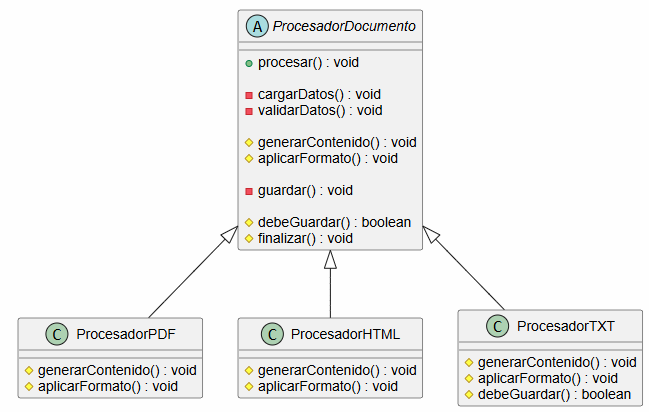
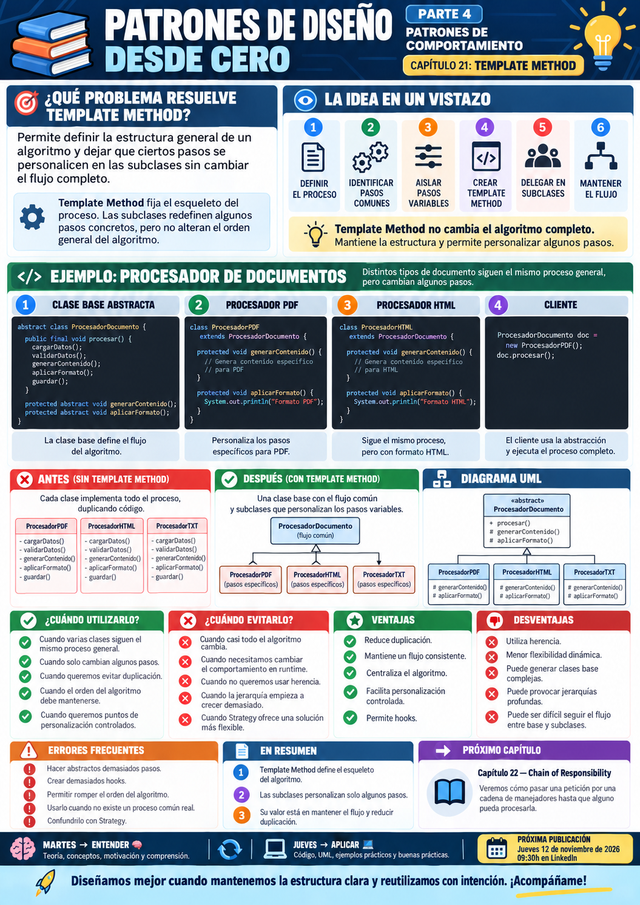

# 📚 Patrones de Diseño desde Cero

> **Aprende a diseñar software mantenible con ejemplos reales.**

# 📖 Capítulo 21 - Template Method

> **📚 Patrones de Diseño desde Cero**  
> **🔄 Parte IV - Patrones de Comportamiento**

---

## 🧠 Introducción

Continuamos nuestro recorrido por los **patrones de comportamiento**.

Hasta ahora hemos estudiado:

### 🎯 Strategy

> **¿Cómo podemos intercambiar algoritmos o comportamientos sin modificar el contexto que los utiliza?**

### 👀 Observer

> **¿Cómo podemos notificar automáticamente a varios objetos cuando cambia el estado de otro?**

### 🎮 Command

> **¿Cómo podemos encapsular una operación dentro de un objeto para poder ejecutarla, almacenarla, encolarla o deshacerla?**

### 🔁 State

> **¿Cómo podemos hacer que un objeto cambie su comportamiento cuando cambia su estado interno?**

Ahora nos encontramos con un problema diferente.

Imaginemos que tenemos diferentes procesos para generar documentos:

```text
PDF
HTML
TXT
```

Todos siguen aproximadamente los mismos pasos:

```text
1. Cargar datos
2. Validar datos
3. Generar contenido
4. Aplicar formato
5. Guardar documento
```

Sin embargo, algunos pasos cambian dependiendo del tipo de documento.

Por ejemplo:

```text
PDF
↓
Aplicar formato PDF
```

```text
HTML
↓
Generar etiquetas HTML
```

```text
TXT
↓
No necesita formato especial
```

Podríamos duplicar todo el proceso en varias clases.

Pero entonces repetiríamos gran parte del código.

La pregunta será:

> **¿Cómo podemos definir el esqueleto de un algoritmo una sola vez y permitir que algunas partes se personalicen?**

Aquí aparece:

# 🧩 Template Method

Template Method define el **esqueleto de un algoritmo** en una clase base y permite que las subclases redefinan determinados pasos sin modificar la estructura general.

---

# 🎯 Objetivos de aprendizaje

Al finalizar este capítulo deberías ser capaz de:

- Comprender qué problema intenta resolver Template Method.
- Identificar procesos que comparten una estructura común.
- Diferenciar pasos fijos y pasos variables.
- Comprender qué es un Template Method.
- Implementar Template Method en Java.
- Utilizar métodos abstractos para pasos obligatorios.
- Utilizar hooks para pasos opcionales.
- Mantener el orden general del algoritmo.
- Reducir duplicación entre algoritmos similares.
- Comprender la inversión de control presente en el patrón.
- Diferenciar Template Method de Strategy.
- Diferenciar Template Method de Factory Method.
- Reconocer cuándo la herencia aporta valor y cuándo no.
- Identificar riesgos derivados de jerarquías demasiado complejas.

---

# ❌ El problema

Imaginemos que tenemos que generar documentos PDF.

Podríamos escribir:

```java
public class GeneradorPDF {

    public void generar() {

        cargarDatos();

        validarDatos();

        generarContenido();

        aplicarFormatoPDF();

        guardar();
    }

    private void cargarDatos() {
        // ...
    }

    private void validarDatos() {
        // ...
    }

    private void generarContenido() {
        // ...
    }

    private void aplicarFormatoPDF() {
        // ...
    }

    private void guardar() {
        // ...
    }
}
```

Después necesitamos generar HTML:

```java
public class GeneradorHTML {

    public void generar() {

        cargarDatos();

        validarDatos();

        generarContenido();

        aplicarFormatoHTML();

        guardar();
    }

    // ...
}
```

Y posteriormente:

```text
TXT
Markdown
XML
```

Empieza a aparecer duplicación.

---

# 📈 El problema crece

Tenemos varios procesos con esta estructura:

```text
CARGAR
   ↓
VALIDAR
   ↓
GENERAR
   ↓
FORMATEAR
   ↓
GUARDAR
```

La mayoría de pasos son comunes.

Pero determinados pasos cambian.

Por ejemplo:

```text
PDF  → aplicarFormatoPDF()
HTML → aplicarFormatoHTML()
TXT  → sin formato especial
```

Si copiamos el proceso completo en cada clase tendremos:

```text
código duplicado
+
riesgo de inconsistencias
+
más mantenimiento
```

---

# ⚠️ El problema real

No tenemos algoritmos completamente distintos.

Tenemos:

> **un mismo algoritmo general con algunos pasos variables.**

Queremos mantener:

```text
orden
estructura
pasos comunes
```

en un único lugar.

Y permitir que las subclases personalicen:

```text
solo lo que cambia
```

---

# 💡 Motivación

Podemos mover la estructura general a una clase base:

```text
ProcesadorDocumento
```

Y definir:

```java
public final void procesar() {

    cargarDatos();

    validarDatos();

    generarContenido();

    aplicarFormato();

    guardar();
}
```

Algunos métodos pueden estar completamente implementados.

Otros pueden declararse:

```java
abstract
```

para que las subclases decidan cómo ejecutarlos.

---

# 🧩 La solución

Template Method define:

```text
ALGORITMO GENERAL
```

en una clase base.

Por ejemplo:

```text
Procesar documento
       │
       ├── cargar
       ├── validar
       ├── generar
       ├── formatear ← variable
       └── guardar
```

Las subclases personalizan determinados pasos:

```text
ProcesadorPDF
ProcesadorHTML
ProcesadorTXT
```

pero no cambian la estructura general.

---

# 🧱 Participantes del patrón

Template Method suele tener dos participantes principales.

## 1️⃣ Abstract Class

Define:

- el Template Method;
- los pasos comunes;
- los pasos abstractos;
- opcionalmente hooks.

En nuestro ejemplo:

```text
ProcesadorDocumento
```

---

## 2️⃣ Concrete Class

Implementa los pasos variables.

Por ejemplo:

```text
ProcesadorPDF
ProcesadorHTML
```

---

# ☕ Implementación en Java

## Abstract Class - ProcesadorDocumento.java

```java
public abstract class ProcesadorDocumento {

    public final void procesar() {

        cargarDatos();

        validarDatos();

        generarContenido();

        aplicarFormato();

        if (debeGuardar()) {

            guardar();
        }

        finalizar();
    }

    private void cargarDatos() {

        System.out.println(
            "📥 Cargando datos"
        );
    }

    private void validarDatos() {

        System.out.println(
            "✅ Validando datos"
        );
    }

    protected abstract void generarContenido();

    protected abstract void aplicarFormato();

    private void guardar() {

        System.out.println(
            "💾 Guardando documento"
        );
    }

    protected boolean debeGuardar() {

        return true;
    }

    protected void finalizar() {

        System.out.println(
            "🏁 Proceso finalizado"
        );
    }
}
```

---

# 📄 Concrete Class - ProcesadorPDF.java

```java
public class ProcesadorPDF
        extends ProcesadorDocumento {

    @Override
    protected void generarContenido() {

        System.out.println(
            "📄 Generando contenido PDF"
        );
    }

    @Override
    protected void aplicarFormato() {

        System.out.println(
            "🎨 Aplicando formato PDF"
        );
    }
}
```

---

# 🌐 Concrete Class - ProcesadorHTML.java

```java
public class ProcesadorHTML
        extends ProcesadorDocumento {

    @Override
    protected void generarContenido() {

        System.out.println(
            "🌐 Generando contenido HTML"
        );
    }

    @Override
    protected void aplicarFormato() {

        System.out.println(
            "🏷️ Generando etiquetas HTML"
        );
    }
}
```

---

# 📝 Concrete Class - ProcesadorTXT.java

```java
public class ProcesadorTXT
        extends ProcesadorDocumento {

    @Override
    protected void generarContenido() {

        System.out.println(
            "📝 Generando texto plano"
        );
    }

    @Override
    protected void aplicarFormato() {

        System.out.println(
            "➖ Sin formato especial"
        );
    }

    @Override
    protected boolean debeGuardar() {

        return false;
    }
}
```

---

# ▶️ Cliente - Main.java

```java
public class Main {

    public static void main(String[] args) {

        ProcesadorDocumento pdf =
                new ProcesadorPDF();

        pdf.procesar();

        System.out.println();

        ProcesadorDocumento html =
                new ProcesadorHTML();

        html.procesar();

        System.out.println();

        ProcesadorDocumento txt =
                new ProcesadorTXT();

        txt.procesar();
    }
}
```

---

# 📤 Posible salida

```text
📥 Cargando datos
✅ Validando datos
📄 Generando contenido PDF
🎨 Aplicando formato PDF
💾 Guardando documento
🏁 Proceso finalizado

📥 Cargando datos
✅ Validando datos
🌐 Generando contenido HTML
🏷️ Generando etiquetas HTML
💾 Guardando documento
🏁 Proceso finalizado

📥 Cargando datos
✅ Validando datos
📝 Generando texto plano
➖ Sin formato especial
🏁 Proceso finalizado
```

El flujo general permanece constante.

Lo que cambia son determinados pasos.

---

# 🔎 Explicación paso a paso

## 1️⃣ Definimos el algoritmo general

```java
public final void procesar()
```

es nuestro:

> **Template Method**

Define el orden del proceso.

---

## 2️⃣ Implementamos los pasos comunes

Por ejemplo:

```java
cargarDatos();
validarDatos();
guardar();
```

No necesitamos repetirlos en todas las subclases.

---

## 3️⃣ Declaramos pasos variables

```java
protected abstract void generarContenido();

protected abstract void aplicarFormato();
```

Cada subclase debe implementarlos.

---

## 4️⃣ Las subclases personalizan

Por ejemplo:

```text
ProcesadorPDF
```

implementa:

```text
generación PDF
+
formato PDF
```

---

## 5️⃣ El orden permanece intacto

Las subclases no controlan:

```text
qué paso va primero
qué paso va después
```

Eso lo controla el Template Method.

---

## 6️⃣ Podemos añadir hooks

Por ejemplo:

```java
protected boolean debeGuardar() {

    return true;
}
```

Una subclase puede modificarlo.

Pero no está obligada a hacerlo.

---

# 📊 UML

Podemos representar el patrón así:



Conceptualmente:

```text
          ProcesadorDocumento
          ───────────────────
             procesar()
                │
      ┌─────────┼─────────────┐
      │         │             │
     PDF       HTML          TXT
      │         │             │
 personaliza personaliza  personaliza
 algunos     algunos       algunos
 pasos       pasos         pasos
```

---

# 🔑 La idea clave

Template Method separa:

```text
ESTRUCTURA DEL ALGORITMO
```

de:

```text
IMPLEMENTACIÓN DE ALGUNOS PASOS
```

La clase base decide:

```text
qué pasos existen
+
en qué orden se ejecutan
```

Las subclases deciden:

```text
cómo implementar determinados pasos
```

---

# 🧠 El Template Method

El corazón del patrón es normalmente un método parecido a:

```java
public final void procesar() {

    paso1();

    paso2();

    paso3();

    paso4();
}
```

Este método representa:

> **el esqueleto del algoritmo.**

---

# 🔒 ¿Por qué `final`?

En nuestro ejemplo:

```java
public final void procesar()
```

impide que una subclase cambie completamente el algoritmo.

Por ejemplo, evitamos:

```text
guardar antes de validar
```

o:

```text
formatear antes de generar contenido
```

si ese orden forma parte de las reglas del proceso.

Por eso el Template Method suele declararse:

```java
final
```

cuando queremos proteger la estructura.

---

# 🧩 Tipos de pasos

Dentro de Template Method podemos encontrar distintos tipos de métodos.

---

## 1️⃣ Pasos concretos

La clase base los implementa completamente.

Por ejemplo:

```java
private void validarDatos() {
    // ...
}
```

Todas las subclases comparten el comportamiento.

---

## 2️⃣ Pasos abstractos

Las subclases deben implementarlos.

Por ejemplo:

```java
protected abstract void aplicarFormato();
```

---

## 3️⃣ Hooks

Son métodos opcionales con una implementación por defecto.

Por ejemplo:

```java
protected boolean debeGuardar() {

    return true;
}
```

Una subclase puede redefinirlos.

---

# 🪝 Hooks

Los hooks permiten introducir puntos de personalización opcionales.

Por ejemplo:

```java
protected void antesDeGuardar() {
}
```

El Template Method podría hacer:

```java
public final void procesar() {

    cargarDatos();

    validarDatos();

    generarContenido();

    aplicarFormato();

    antesDeGuardar();

    guardar();
}
```

Una subclase puede ignorarlo.

O sobrescribirlo:

```java
@Override
protected void antesDeGuardar() {

    System.out.println(
        "🔐 Firmando documento"
    );
}
```

---

# 🔁 Inversión de control

Template Method utiliza una idea muy importante:

> **Hollywood Principle**

Una forma habitual de expresarlo es:

> **“No nos llames, nosotros te llamaremos.”**

El flujo no lo controla la subclase.

Lo controla la clase base.

La clase base llama a:

```java
generarContenido();
```

y Java ejecuta la implementación de la subclase correspondiente.

Conceptualmente:

```text
Clase base
   │
   │ llama
   ▼
Método redefinido
en subclase
```

---

# 🏗️ Caso de uso: importación de datos

Imaginemos distintos importadores:

```text
CSV
JSON
XML
```

Todos siguen:

```text
abrir archivo
    ↓
leer datos
    ↓
parsear
    ↓
validar
    ↓
guardar
```

Podemos dejar:

```text
abrir
validar
guardar
```

en la clase base.

Y personalizar:

```text
parsear CSV
parsear JSON
parsear XML
```

---

# 🧪 Caso de uso: tests

Los frameworks de testing utilizan conceptos similares.

Un proceso puede seguir:

```text
setup
 ↓
test
 ↓
teardown
```

La estructura general está definida.

El desarrollador implementa:

```text
qué debe hacer el test
```

---

# 🎮 Caso de uso: videojuegos

Podemos tener diferentes tipos de enemigos.

El proceso de turno podría ser:

```text
analizar entorno
    ↓
elegir objetivo
    ↓
  mover
    ↓
  atacar
```

Algunos pasos pueden variar según:

```text
arquero
guerrero
mago
```

---

# ☕ Caso de uso: preparación de bebidas

Ejemplo clásico:

```text
 hervir agua
      ↓
preparar ingrediente
      ↓
    servir
      ↓
 añadir extras
```

El té y el café siguen un proceso parecido.

Pero cambian algunos pasos.

---

# 🎯 ¿Cuándo utilizar Template Method?

Template Method puede resultar adecuado cuando:

- Varias clases siguen prácticamente el mismo algoritmo.
- Existen pasos comunes.
- Solo algunas partes del proceso cambian.
- Queremos evitar duplicación.
- El orden de los pasos debe mantenerse.
- Queremos controlar la estructura desde una clase base.
- Algunas etapas deben ser obligatorias.
- Otras etapas pueden ser opcionales mediante hooks.
- El proceso tiene una estructura estable.

---

# 🚫 ¿Cuándo evitarlo?

Probablemente no necesitamos Template Method cuando:

- Los algoritmos son completamente diferentes.
- Casi todos los pasos cambian.
- El orden cambia constantemente.
- Necesitamos cambiar el comportamiento en runtime.
- No queremos utilizar herencia.
- La jerarquía crece demasiado.
- Una composición mediante Strategy sería más flexible.
- Tenemos únicamente una implementación.

---

# ✅ Ventajas

## 🔹 Reduce duplicación

Los pasos comunes viven en la clase base.

---

## 🔹 Mantiene una estructura consistente

Todas las implementaciones siguen el mismo proceso.

---

## 🔹 Centraliza el algoritmo

La estructura general está definida en un único lugar.

---

## 🔹 Permite personalización controlada

Las subclases modifican únicamente determinados pasos.

---

## 🔹 Facilita mantenimiento

Cambiar un paso común puede afectar automáticamente a todas las implementaciones.

---

## 🔹 Soporta hooks

Podemos proporcionar extensiones opcionales.

---

# ❌ Desventajas

## 🔸 Utiliza herencia

Las subclases quedan acopladas a la clase base.

---

## 🔸 Puede limitar flexibilidad

El orden del algoritmo está fijado.

---

## 🔸 Puede provocar clases base complejas

Si añadimos demasiados pasos y hooks.

---

## 🔸 Puede generar jerarquías profundas

Si seguimos extendiendo subclases.

---

## 🔸 Puede resultar difícil entender qué método se ejecuta

El flujo puede saltar entre:

```text
clase base
subclase
clase base
subclase
```

---

## 🔸 Puede violar Liskov si se usa mal

Una subclase no debería romper las expectativas establecidas por el algoritmo base.

---

# ⚠️ Template Method no significa crear una clase abstracta para todo

La existencia de:

```java
abstract class Algo
```

no implica automáticamente Template Method.

La intención debe ser:

> **definir un algoritmo estable con determinados puntos de personalización.**

---

# ⚠️ No conviertas cada paso en abstracto

Imaginemos:

```java
abstract paso1();
abstract paso2();
abstract paso3();
abstract paso4();
abstract paso5();
abstract paso6();
```

Si absolutamente todo cambia, quizá no existe realmente:

> **un algoritmo común.**

En ese caso Template Method puede no ser la mejor solución.

---

# 🚨 Errores frecuentes

## ❌ Duplicar el Template Method

Las subclases no deberían copiar el algoritmo principal.

---

## ❌ Permitir redefinir la estructura sin necesidad

Si el orden es importante, considera:

```java
final
```

---

## ❌ Crear demasiados hooks

Una clase base con:

```text
20 hooks
```

puede ser una señal de diseño excesivamente complejo.

---

## ❌ Subclases que necesitan romper el flujo

Si constantemente quieren omitir o reordenar pasos, quizá Template Method no encaja.

---

## ❌ Acoplar demasiado la clase base

Una clase base gigantesca puede convertirse en un punto difícil de mantener.

---

## ❌ Confundir Template Method con Strategy

Ambos permiten variar comportamiento, pero utilizan mecanismos diferentes.

---

# 🧠 Buenas prácticas

## 1️⃣ Mantén pequeño el Template Method

Debe expresar claramente:

```text
el flujo general
```

---

## 2️⃣ Protege la estructura

Si no debe cambiar:

```java
final
```

puede ser apropiado.

---

## 3️⃣ Separa pasos obligatorios de opcionales

Por ejemplo:

```text
abstract method
```

para obligatorios.

```text
hook
```

para opcionales.

---

## 4️⃣ Usa niveles de visibilidad adecuados

Normalmente los pasos variables pueden ser:

```java
protected
```

y el Template Method:

```java
public
```

---

## 5️⃣ Evita demasiados niveles de herencia

Preferimos:

```text
Base
 ↓
Concrete
```

antes que:

```text
Base
 ↓
Intermedia
 ↓
Intermedia2
 ↓
Concrete
```

---

## 6️⃣ Si necesitas mucha flexibilidad, considera Strategy

Template Method fija la estructura mediante herencia.

Strategy permite cambiar comportamiento mediante composición.

---

# 🆚 Template Method vs. Strategy

Esta es la comparación fundamental.

Ambos permiten variar algoritmos.

Pero utilizan mecanismos diferentes.

| Template Method | Strategy |
|---|---|
| Utiliza herencia | Utiliza composición |
| Define un esqueleto común | Encapsula algoritmos completos |
| Cambia pasos concretos | Cambia el comportamiento completo |
| Normalmente se decide en compilación | Puede cambiar en runtime |
| Clase base controla el flujo | Context delega en Strategy |

Podemos resumirlo:

```text
TEMPLATE METHOD
↓
MISMO PROCESO
ALGUNOS PASOS CAMBIAN
```

```text
STRATEGY
↓
MISMA NECESIDAD
ALGORITMO COMPLETO CAMBIA
```

---

# 🆚 Template Method vs. Factory Method

Ambos patrones pueden aparecer juntos.

Template Method define:

```text
el proceso
```

Factory Method puede permitir personalizar:

```text
qué objeto crear
```

Por ejemplo:

```java
public final void procesar() {

    Documento documento =
            crearDocumento();

    documento.generar();
}
```

Donde:

```java
protected abstract Documento crearDocumento();
```

sería un Factory Method dentro de un Template Method.

Los patrones no son excluyentes.

---

# 🆚 Template Method vs. State

| Template Method | State |
|---|---|
| Define estructura de algoritmo | Cambia comportamiento según estado |
| Utiliza herencia | Utiliza composición |
| Flujo fijo | Flujo depende del estado |
| Variación por subclase | Variación por State actual |
| No modela transiciones | Puede modelar transiciones |

---

# 🆚 Template Method vs. Command

| Template Method | Command |
|---|---|
| Define estructura de un proceso | Encapsula una acción |
| Controla pasos | Representa petición |
| Herencia | Composición |
| No busca historial | Puede almacenarse |
| No suele tener undo | Puede soportar undo |

---

# 🧠 Principios relacionados

Template Method conecta especialmente con varios principios de diseño.

## ♻️ Don't Repeat Yourself

Los pasos comunes se implementan una sola vez.

---

## 🧩 Encapsular lo que cambia

Los pasos variables quedan aislados.

---

## 🎯 Responsabilidad única

La clase base controla el flujo.

Las subclases implementan detalles específicos.

---

## ➕ Open/Closed Principle

Podemos añadir nuevas variantes creando nuevas subclases.

---

## 🔄 Inversión de control

La clase base decide cuándo llamar al código especializado.

---

# 📌 Resumen

En este capítulo hemos aprendido que:

- Template Method pertenece a los patrones de comportamiento.
- Define el esqueleto de un algoritmo.
- La clase base controla el orden de ejecución.
- Los pasos comunes pueden implementarse una sola vez.
- Los pasos variables pueden declararse abstractos.
- Los hooks permiten personalización opcional.
- Las subclases redefinen partes del algoritmo sin cambiar su estructura general.
- El Template Method puede declararse `final`.
- Reduce duplicación entre procesos similares.
- Utiliza herencia.
- Está relacionado con inversión de control.
- Puede generar clases base complejas si abusamos de hooks.
- Template Method y Strategy permiten variación, pero con mecanismos diferentes.
- Template Method mantiene un flujo común; Strategy intercambia algoritmos completos.
- No debemos utilizarlo cuando casi todo el proceso cambia.

La pregunta fundamental de Template Method es:

> **¿Tenemos varios procesos que siguen la misma estructura general pero difieren únicamente en algunos pasos?**

---

# 🎓 Conclusiones

Template Method introduce una idea muy elegante:

> **La estructura del algoritmo puede permanecer estable mientras algunos pasos cambian.**

Sin Template Method podemos tener:

```text
ProcesadorPDF
├── cargar
├── validar
├── generar
├── formatear
└── guardar

ProcesadorHTML
├── cargar
├── validar
├── generar
├── formatear
└── guardar
```

con gran parte del código duplicado.

Con Template Method:

```text
ProcesadorDocumento
        │
        ├── cargar
        ├── validar
        ├── generar *
        ├── formatear *
        └── guardar
```

donde:

```text
*
↓
pasos personalizables
```

Las subclases únicamente implementan aquello que realmente cambia.

Pero esta simplificación tiene un coste:

```text
herencia
acoplamiento con la clase base
menor flexibilidad dinámica
```

Por eso seguimos aplicando nuestra metodología:

```text
PROBLEMA
   ↓
CONTEXTO
   ↓
¿EXISTE UN PROCESO COMÚN?
   ↓
¿SOLO CAMBIAN
ALGUNOS PASOS?
   ↓
¿EL ORDEN DEBE
MANTENERSE?
   ↓
ALTERNATIVAS
   ↓
¿TEMPLATE METHOD
APORTA VALOR?
```

No utilizamos Template Method simplemente porque tengamos:

```java
abstract class
```

Lo utilizamos cuando existe **un algoritmo común cuya estructura queremos proteger y cuyos puntos variables queremos controlar**.

> **Template Method fija el camino y deja que las subclases decidan cómo recorrer algunos de sus pasos.**

---

# 🖼️ Infografía

Aquí os dejo una infografía sobre este **capítulo 21**.



---

**📚 Patrones de Diseño desde Cero**

*Aprende a diseñar software mantenible con ejemplos reales.*