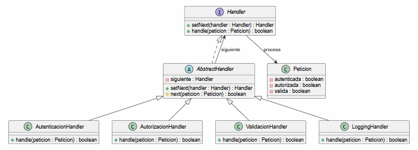
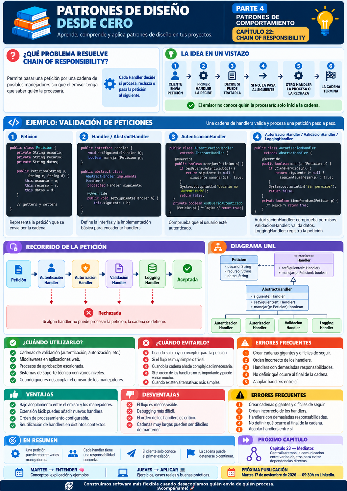

# 📚 Patrones de Diseño desde Cero

> **Aprende a diseñar software mantenible con ejemplos reales.**

# 📖 Capítulo 22 - Chain of Responsibility

> **📚 Patrones de Diseño desde Cero**  
> **🔄 Parte IV - Patrones de Comportamiento**

---

## 🧠 Introducción

Continuamos nuestro recorrido por los **patrones de comportamiento**.

Hasta ahora hemos estudiado:

### 🎯 Strategy

> **¿Cómo podemos intercambiar algoritmos o comportamientos sin modificar el contexto que los utiliza?**

### 👀 Observer

> **¿Cómo podemos notificar automáticamente a varios objetos cuando cambia el estado de otro?**

### 🎮 Command

> **¿Cómo podemos encapsular una operación dentro de un objeto?**

### 🔁 State

> **¿Cómo podemos cambiar el comportamiento de un objeto cuando cambia su estado interno?**

### 🧩 Template Method

> **¿Cómo podemos definir la estructura general de un algoritmo y permitir que algunos pasos se personalicen?**

Ahora nos encontramos con otro problema.

Imaginemos una petición que entra en nuestra aplicación.

Antes de procesarla debemos comprobar:

```text
Autenticación
      ↓
Autorización
      ↓
  Validación
      ↓
   Logging
      ↓
Procesamiento
```

Una solución podría consistir en crear una clase que conozca todos estos pasos.

Pero entonces aparece una pregunta:

> **¿Qué ocurre si mañana necesitamos cambiar el orden?**

¿Y si añadimos:

```text
Rate limiting
Antivirus
Auditoría
Control antifraude
```

¿Y si algunos pasos pueden detener el proceso?

La pregunta será:

> **¿Cómo podemos pasar una petición por una cadena de manejadores sin acoplar al emisor con todos ellos?**

Aquí aparece:

# ⛓️ Chain of Responsibility

Chain of Responsibility permite enviar una petición a través de una **cadena de manejadores**, donde cada uno decide:

```text
procesarla
rechazarla
o pasarla al siguiente
```

---

# 🎯 Objetivos de aprendizaje

Al finalizar este capítulo deberías ser capaz de:

- Comprender qué problema intenta resolver Chain of Responsibility.
- Identificar cadenas de validaciones o procesamiento.
- Comprender los conceptos `Handler`, `ConcreteHandler` y `Client`.
- Implementar Chain of Responsibility en Java.
- Encadenar manejadores dinámicamente.
- Permitir que un Handler detenga la cadena.
- Permitir que una petición continúe al siguiente Handler.
- Reducir el acoplamiento entre emisor y receptor.
- Comprender cómo modificar el orden de procesamiento.
- Reconocer cuándo usar una cadena completa o procesamiento exclusivo.
- Diferenciar Chain of Responsibility de Command.
- Diferenciar Chain of Responsibility de Decorator.
- Diferenciar Chain of Responsibility de Middleware.
- Comprender sus ventajas y desventajas.
- Evitar cadenas demasiado largas o difíciles de depurar.

---

# ❌ El problema

Imaginemos que queremos procesar una petición HTTP.

Antes de permitir el acceso necesitamos comprobar:

```text
1. Usuario autenticado
2. Usuario autorizado
3. Datos válidos
```

Podríamos crear algo así:

```java
public class ProcesadorPeticion {

    public void procesar(
            Peticion peticion) {

        if (
            !peticion.estaAutenticada()
        ) {

            throw new RuntimeException(
                "Usuario no autenticado"
            );
        }

        if (
            !peticion.tienePermiso()
        ) {

            throw new RuntimeException(
                "Usuario no autorizado"
            );
        }

        if (
            !peticion.esValida()
        ) {

            throw new RuntimeException(
                "Petición inválida"
            );
        }

        System.out.println(
            "✅ Petición procesada"
        );
    }
}
```

Inicialmente funciona.

Pero el flujo empieza a crecer.

---

# 📈 El problema crece

Añadimos nuevas comprobaciones:

```text
Rate limiting
      ↓
Autenticación
      ↓
 Autorización
      ↓
 Validación
      ↓
  Antivirus
      ↓
  Auditoría
      ↓
   Logging
      ↓
Procesamiento
```

Ahora nuestra clase central debe conocer:

```text
todas las comprobaciones
+
el orden
+
qué hacer cuando falla cada una
```

Además, quizá distintas partes de la aplicación necesiten cadenas diferentes.

Por ejemplo:

```text
API pública
↓
RateLimit → Validación → Logging
```

Mientras que:

```text
Panel administración
↓
Autenticación → Autorización → Auditoría
```

---

# ⚠️ El problema real

La clase cliente está demasiado acoplada a:

```text
qué manejadores existen
+
en qué orden se ejecutan
+
cuál debe ejecutarse después
```

Queremos separar:

```text
QUIÉN ENVÍA LA PETICIÓN
```

de:

```text
QUIÉN PUEDE PROCESARLA
```

---

# 💡 Motivación

En lugar de escribir:

```java
autenticar();
autorizar();
validar();
registrar();
```

podemos construir:

```text
AutenticacionHandler
        ↓
AutorizacionHandler
        ↓
ValidacionHandler
        ↓
LoggingHandler
```

Cada Handler conoce únicamente:

```text
su responsabilidad
+
el siguiente Handler
```

El cliente solo necesita enviar la petición al primero.

---

# ⛓️ La solución

Conceptualmente:

```text
Cliente
   │
   ▼
Handler A
   │
   ▼
Handler B
   │
   ▼
Handler C
   │
   ▼
Handler D
```

Cada manejador puede decidir:

```text
procesar
    ↓
continuar
```

o:

```text
rechazar
    ↓
detener
```

El cliente no necesita conocer quién terminará procesando la petición.

---

# 🧱 Participantes del patrón

Chain of Responsibility suele tener tres participantes principales.

## 1️⃣ Handler

Define el contrato común.

Por ejemplo:

```java
public interface Handler {

    Handler setNext(
        Handler handler
    );

    boolean handle(
        Peticion peticion
    );
}
```

---

## 2️⃣ Concrete Handler

Implementa una responsabilidad concreta.

Por ejemplo:

```text
AutenticacionHandler
AutorizacionHandler
ValidacionHandler
LoggingHandler
```

---

## 3️⃣ Client

Construye la cadena y envía la petición al primer Handler.

---

# ☕ Implementación en Java

## Peticion.java

```java
public class Peticion {

    private final boolean autenticada;

    private final boolean autorizada;

    private final boolean valida;

    public Peticion(
            boolean autenticada,
            boolean autorizada,
            boolean valida) {

        this.autenticada =
                autenticada;

        this.autorizada =
                autorizada;

        this.valida =
                valida;
    }

    public boolean estaAutenticada() {

        return autenticada;
    }

    public boolean estaAutorizada() {

        return autorizada;
    }

    public boolean esValida() {

        return valida;
    }
}
```

---

# 🔗 Handler - Handler.java

```java
public interface Handler {

    Handler setNext(
        Handler handler
    );

    boolean handle(
        Peticion peticion
    );
}
```

---

# 🧱 Handler base - AbstractHandler.java

```java
public abstract class AbstractHandler
        implements Handler {

    private Handler siguiente;

    @Override
    public Handler setNext(
            Handler handler) {

        this.siguiente =
                handler;

        return handler;
    }

    protected boolean next(
            Peticion peticion) {

        if (
            siguiente == null
        ) {

            return true;
        }

        return siguiente.handle(
            peticion
        );
    }
}
```

La clase base encapsula la lógica para:

```text
pasar la petición
al siguiente Handler
```

---

# 🔐 Concrete Handler - AutenticacionHandler.java

```java
public class AutenticacionHandler
        extends AbstractHandler {

    @Override
    public boolean handle(
            Peticion peticion) {

        if (
            !peticion.estaAutenticada()
        ) {

            System.out.println(
                "❌ Usuario no autenticado"
            );

            return false;
        }

        System.out.println(
            "✅ Autenticación correcta"
        );

        return next(
            peticion
        );
    }
}
```

---

# 🛡️ Concrete Handler - AutorizacionHandler.java

```java
public class AutorizacionHandler
        extends AbstractHandler {

    @Override
    public boolean handle(
            Peticion peticion) {

        if (
            !peticion.estaAutorizada()
        ) {

            System.out.println(
                "❌ Usuario no autorizado"
            );

            return false;
        }

        System.out.println(
            "✅ Autorización correcta"
        );

        return next(
            peticion
        );
    }
}
```

---

# ✅ Concrete Handler - ValidacionHandler.java

```java
public class ValidacionHandler
        extends AbstractHandler {

    @Override
    public boolean handle(
            Peticion peticion) {

        if (
            !peticion.esValida()
        ) {

            System.out.println(
                "❌ Petición inválida"
            );

            return false;
        }

        System.out.println(
            "✅ Petición válida"
        );

        return next(
            peticion
        );
    }
}
```

---

# 📝 Concrete Handler - LoggingHandler.java

```java
public class LoggingHandler
        extends AbstractHandler {

    @Override
    public boolean handle(
            Peticion peticion) {

        System.out.println(
            "📝 Registrando petición"
        );

        return next(
            peticion
        );
    }
}
```

---

# ▶️ Cliente - Main.java

```java
public class Main {

    public static void main(String[] args) {

        Handler autenticacion =
                new AutenticacionHandler();

        Handler autorizacion =
                new AutorizacionHandler();

        Handler validacion =
                new ValidacionHandler();

        Handler logging =
                new LoggingHandler();

        autenticacion
            .setNext(autorizacion)
            .setNext(validacion)
            .setNext(logging);

        Peticion peticion =
                new Peticion(
                    true,
                    true,
                    true
                );

        boolean resultado =
                autenticacion.handle(
                    peticion
                );

        System.out.println(
            resultado
                ? "✅ Petición aceptada"
                : "❌ Petición rechazada"
        );
    }
}
```

---

# 📤 Posible salida

```text
✅ Autenticación correcta
✅ Autorización correcta
✅ Petición válida
📝 Registrando petición
✅ Petición aceptada
```

Si cambiamos:

```java
new Peticion(
    true,
    false,
    true
);
```

obtendremos:

```text
✅ Autenticación correcta
❌ Usuario no autorizado
❌ Petición rechazada
```

La cadena se detiene.

---

# 🔎 Explicación paso a paso

## 1️⃣ Creamos una petición

```java
Peticion peticion
```

contiene la información necesaria.

---

## 2️⃣ Creamos los Handlers

```text
AutenticacionHandler
AutorizacionHandler
ValidacionHandler
LoggingHandler
```

---

## 3️⃣ Formamos la cadena

```java
autenticacion
    .setNext(autorizacion)
    .setNext(validacion)
    .setNext(logging);
```

---

## 4️⃣ Enviamos la petición al primero

```java
autenticacion.handle(
    peticion
);
```

---

## 5️⃣ Cada Handler procesa su responsabilidad

Por ejemplo:

```text
Autenticación
```

solo comprueba autenticación.

---

## 6️⃣ Decide continuar

Si todo es correcto:

```java
return next(
    peticion
);
```

---

## 7️⃣ Puede detener la cadena

Si falla:

```java
return false;
```

La petición no sigue avanzando.

---

# 📊 UML

Podemos representar el patrón así:



Conceptualmente:

```text
            Handler
               ▲
     ┌─────────┼──────────┐
     │         │          │
Autenticación Autorización Validación
     │
     ▼
siguiente Handler
```

---

# 🔑 La idea clave

Chain of Responsibility separa:

```text
QUIÉN ENVÍA
```

de:

```text
QUIÉN PROCESA
```

El cliente solamente conoce:

```text
el primer Handler
```

La cadena decide:

```text
qué ocurre después
```

---

# ⛓️ El comportamiento de la cadena

Existen dos variantes habituales.

---

## 1️⃣ Un Handler procesa y detiene

Conceptualmente:

```text
Petición
   ↓
Handler A
   ↓ no puede
Handler B
   ↓ puede
FIN
```

Esto puede utilizarse cuando buscamos:

> **un único receptor capaz de procesar la petición.**

---

## 2️⃣ Todos pueden procesar y continuar

Conceptualmente:

```text
Petición
   ↓
Autenticación
   ↓
Autorización
   ↓
Validación
   ↓
Logging
```

Cada Handler realiza parte del proceso.

Nuestro ejemplo utiliza esta variante.

---

# 🧠 ¿Quién decide detener la cadena?

Cada Handler.

Por ejemplo:

```java
if (
    !peticion.estaAutenticada()
) {

    return false;
}
```

Si la comprobación pasa:

```java
return next(
    peticion
);
```

Esta decisión queda encapsulada en cada manejador.

---

# 🔄 Cambiar el orden

Una ventaja importante es que podemos modificar:

```text
el orden de procesamiento
```

sin modificar los Handlers.

Por ejemplo:

```java
autenticacion
    .setNext(validacion)
    .setNext(autorizacion)
    .setNext(logging);
```

Ahora el flujo será:

```text
Autenticación
      ↓
  Validación
      ↓
 Autorización
      ↓
   Logging
```

---

# ➕ Añadir un Handler

Imaginemos que necesitamos:

```text
Rate Limit
```

Podemos crear:

```java
public class RateLimitHandler
        extends AbstractHandler {

    @Override
    public boolean handle(
            Peticion peticion) {

        System.out.println(
            "🚦 Comprobando límite"
        );

        return next(
            peticion
        );
    }
}
```

Y añadirlo:

```java
rateLimit
    .setNext(autenticacion)
    .setNext(autorizacion)
    .setNext(validacion);
```

No necesitamos modificar los Handlers existentes.

---

# 🧩 Construcción fluida de cadenas

Nuestro:

```java
setNext()
```

devuelve el Handler recibido.

Esto permite:

```java
handlerA
    .setNext(handlerB)
    .setNext(handlerC)
    .setNext(handlerD);
```

Una forma muy cómoda de construir la cadena.

---

# 🌐 Caso de uso: middleware web

Uno de los ejemplos más cercanos a Chain of Responsibility aparece en middleware.

Una petición puede atravesar:

```text
Request
   ↓
CORS
   ↓
Authentication
   ↓
Authorization
   ↓
Validation
   ↓
Logging
   ↓
Controller
```

Cada middleware puede:

```text
procesar
modificar
rechazar
continuar
```

---

# 🧪 Caso de uso: validación

Imaginemos un formulario.

Podemos tener:

```text
CampoObligatorioHandler
        ↓
FormatoEmailHandler
        ↓
LongitudHandler
        ↓
DominioPermitidoHandler
```

Cada validación decide si continuar.

---

# 💶 Caso de uso: aprobación de gastos

Imaginemos una solicitud de gasto.

```text
Supervisor
   ↓
Responsable
   ↓
Director
   ↓
Dirección General
```

Dependiendo del importe:

```text
100 €
1000 €
10.000 €
100.000 €
```

un nivel diferente puede aprobarla.

Aquí la cadena puede detenerse cuando:

> **alguien tiene autoridad suficiente.**

---

# 🎫 Caso de uso: soporte técnico

Una incidencia puede pasar por:

```text
Nivel 1
   ↓
Nivel 2
   ↓
Nivel 3
   ↓
Especialista
```

Si un nivel puede resolverla:

```text
la procesa
```

Si no:

```text
la escala
```

---

# 🛡️ Caso de uso: seguridad

Una petición puede pasar por:

```text
Rate Limit
   ↓
Autenticación
   ↓
Autorización
   ↓
Antifraude
   ↓
Auditoría
```

Cada Handler tiene una responsabilidad concreta.

---

# 🎯 ¿Cuándo utilizar Chain of Responsibility?

Puede resultar adecuado cuando:

- Existen varios posibles manejadores.
- No queremos acoplar el emisor a un receptor concreto.
- El orden de procesamiento puede cambiar.
- Queremos añadir o eliminar etapas fácilmente.
- Varias validaciones forman un pipeline.
- Cualquier Handler puede detener el procesamiento.
- Diferentes configuraciones requieren cadenas distintas.
- La petición puede ser procesada por uno o varios elementos.
- Queremos separar responsabilidades pequeñas.

---

# 🚫 ¿Cuándo evitarlo?

Probablemente no necesitamos Chain of Responsibility cuando:

- Siempre existe un único receptor conocido.
- La secuencia es fija y trivial.
- La cadena tiene solo un paso.
- El orden es extremadamente difícil de controlar.
- Necesitamos garantías estrictas de que todos los pasos se ejecuten.
- El flujo se vuelve demasiado implícito.
- Una llamada directa es más clara.
- La cadena añade más complejidad que valor.

---

# ✅ Ventajas

## 🔹 Reduce el acoplamiento

El cliente no necesita conocer todos los Handlers.

---

## 🔹 Separa responsabilidades

Cada Handler realiza una tarea concreta.

---

## 🔹 Facilita extensión

Podemos añadir nuevos manejadores.

---

## 🔹 Permite cambiar el orden

La cadena puede configurarse dinámicamente.

---

## 🔹 Facilita reutilización

Un mismo Handler puede participar en diferentes cadenas.

---

## 🔹 Permite detener procesamiento

Un Handler puede decidir:

```text
no continuar
```

---

# ❌ Desventajas

## 🔸 El flujo puede ser difícil de seguir

Una petición puede recorrer muchas clases.

---

## 🔸 Puede no existir ningún receptor final

En algunas variantes nadie puede procesar la petición.

---

## 🔸 El orden puede ser crítico

Cambiar:

```text
A → B
```

por:

```text
B → A
```

puede alterar completamente el resultado.

---

## 🔸 Puede generar cadenas demasiado largas

Una pipeline con decenas de Handlers puede resultar compleja.

---

## 🔸 Puede dificultar debugging

Debemos saber:

```text
por dónde pasó
dónde se detuvo
qué Handler modificó la petición
```

---

# ⚠️ Chain of Responsibility no significa ejecutar siempre todo

El patrón permite que:

```text
un Handler detenga la cadena
```

o:

```text
todos procesen
```

El comportamiento depende del problema.

---

# ⚠️ Chain of Responsibility no es simplemente una lista

Esto:

```java
List<Validator>
```

no implica automáticamente Chain of Responsibility.

La intención debe ser:

> **desacoplar al emisor de los posibles receptores y permitir que la petición avance por una cadena.**

---

# 🚨 Errores frecuentes

## ❌ Crear cadenas gigantes

Una cadena con demasiados pasos puede ocultar el flujo.

---

## ❌ No controlar el orden

Algunas validaciones deben ejecutarse antes que otras.

---

## ❌ Handlers con demasiadas responsabilidades

Cada Handler debería tener una función clara.

---

## ❌ Modificar demasiado la petición

Si cada Handler cambia profundamente los datos, entender el resultado puede ser difícil.

---

## ❌ No definir qué ocurre al final

Debemos saber qué sucede cuando:

```text
ningún Handler procesa
```

o cuando:

```text
todos terminan correctamente
```

---

## ❌ Acoplar Handlers entre sí

Un Handler debería conocer:

```text
la interfaz Handler
```

no una clase concreta específica.

---

# 🧠 Buenas prácticas

## 1️⃣ Mantén cada Handler pequeño

Una responsabilidad clara.

---

## 2️⃣ Haz visible el orden

La configuración de la cadena debería ser fácil de localizar.

---

## 3️⃣ Define claramente las reglas de parada

Por ejemplo:

```text
error → detener

éxito → continuar
```

---

## 4️⃣ Evita estado compartido innecesario

Los Handlers deberían ser independientes cuando sea posible.

---

## 5️⃣ Registra el recorrido si es complejo

Puede ser útil añadir:

```text
logging
tracing
métricas
```

para depurar cadenas largas.

---

## 6️⃣ Construye cadenas mediante configuración

Si las combinaciones varían, puede ser útil construirlas mediante:

```text
Factory
Builder
Dependency Injection
```

---

# 🆚 Chain of Responsibility vs. Command

Ambos trabajan con peticiones.

Pero su intención es distinta.

| Chain of Responsibility | Command |
|---|---|
| Pasa la petición por varios handlers | Encapsula la petición como objeto |
| Busca quién o quiénes la procesan | Representa qué debe ejecutarse |
| Puede detener la cadena | Puede almacenarse |
| Estructura secuencial | Objeto ejecutable |
| Receptor no necesariamente conocido | Receiver suele estar encapsulado |

Podemos resumir:

```text
COMMAND
↓
¿QUÉ QUIERO EJECUTAR?
```

```text
CHAIN OF RESPONSIBILITY
↓
¿QUIÉN DEBE PROCESARLO?
```

---

# 🆚 Chain of Responsibility vs. Decorator

Estructuralmente pueden parecer similares.

Ambos pueden formar cadenas.

Pero:

| Chain of Responsibility | Decorator |
|---|---|
| Puede detener la cadena | Normalmente delega siempre |
| Procesa una petición | Añade comportamiento |
| Los Handlers pueden ser diferentes | Los Decorators comparten interfaz con el componente |
| Busca destinatario/procesamiento | Busca extensión |

Conceptualmente:

```text
CHAIN

Request
 ↓
A
 ↓
B
 ↓
C
```

Mientras que:

```text
DECORATOR

Decorator A
 ↓
Decorator B
 ↓
Component
```

---

# 🆚 Chain of Responsibility vs. Observer

| Chain of Responsibility | Observer |
|---|---|
| Petición viaja secuencialmente | Evento se distribuye |
| Puede detenerse | Muchos pueden recibir |
| Uno tras otro | Uno a muchos |
| Orden puede importar mucho | Observers deberían ser independientes |

---

# 🆚 Chain of Responsibility vs. Middleware

Middleware es un concepto arquitectónico más amplio.

Muchas implementaciones de middleware utilizan una estructura muy cercana a:

> **Chain of Responsibility**

Por ejemplo:

```text
HTTP Request
   ↓
Middleware A
   ↓
Middleware B
   ↓
Middleware C
   ↓
Controller
```

Pero no todo middleware tiene que implementarse exactamente mediante el patrón GoF.

---

# 🆚 Chain of Responsibility vs. Template Method

| Chain of Responsibility | Template Method |
|---|---|
| Cadena dinámica de objetos | Algoritmo definido en clase base |
| Usa composición | Usa herencia |
| Orden configurable | Orden normalmente fijo |
| Handlers independientes | Pasos forman un único algoritmo |
| Puede detener el flujo | El Template controla el flujo |

---

# 🧠 Principios relacionados

Chain of Responsibility conecta con varios principios de diseño.

## 🔗 Bajo acoplamiento

El emisor no conoce receptores concretos.

---

## 🎯 Responsabilidad única

Cada Handler puede encargarse de una única validación o tarea.

---

## ➕ Open/Closed Principle

Podemos introducir nuevos Handlers sin modificar los existentes.

---

## 🧱 Programar hacia abstracciones

Trabajamos mediante:

```java
Handler
```

---

## 🧩 Composición

Construimos cadenas combinando objetos.

---

# 📌 Resumen

En este capítulo hemos aprendido que:

- Chain of Responsibility pertenece a los patrones de comportamiento.
- Una petición puede recorrer una cadena de Handlers.
- Cada Handler encapsula una responsabilidad.
- Un Handler conoce normalmente al siguiente.
- La cadena puede continuar o detenerse.
- El cliente no necesita conocer todos los receptores.
- Podemos cambiar el orden dinámicamente.
- Podemos añadir nuevos Handlers sin modificar necesariamente los existentes.
- Existen cadenas donde todos procesan y otras donde solo uno procesa.
- El orden puede afectar significativamente al resultado.
- Las cadenas largas pueden dificultar el debugging.
- Chain of Responsibility y Command resuelven problemas diferentes.
- Chain se centra en quién procesa.
- Command se centra en representar la acción.
- El patrón está muy relacionado conceptualmente con pipelines y middleware.
- No debemos utilizarlo cuando una llamada directa es más sencilla.

La pregunta fundamental de Chain of Responsibility es:

> **¿Tenemos una petición que puede ser procesada por varios manejadores y queremos evitar que el emisor conozca directamente toda la cadena?**

---

# 🎓 Conclusiones

Chain of Responsibility introduce una idea muy poderosa:

> **Una petición no tiene por qué conocer quién terminará procesándola.**

Sin el patrón podemos tener:

```text
Cliente
├── autenticar()
├── autorizar()
├── validar()
├── registrar()
└── procesar()
```

El cliente conoce todo el flujo.

Con Chain of Responsibility:

```text
Cliente
   ↓
Handler
   ↓
Handler
   ↓
Handler
   ↓
Handler
```

Cada eslabón conoce únicamente:

```text
su responsabilidad
+
el siguiente eslabón
```

Esto hace que la cadena sea:

```text
configurable
extensible
reutilizable
```

Pero también introduce:

```text
más objetos
más indirección
un flujo menos visible
```

Por eso seguimos aplicando nuestra metodología:

```text
PROBLEMA
   ↓
CONTEXTO
   ↓
¿HAY VARIOS
MANEJADORES?
   ↓
¿EL EMISOR DEBE
DESCONOCERLOS?
   ↓
¿EL ORDEN PUEDE
CAMBIAR?
   ↓
ALTERNATIVAS
   ↓
¿CHAIN OF RESPONSIBILITY
APORTA VALOR?
```

No utilizamos Chain of Responsibility simplemente porque tengamos varias comprobaciones.

Lo utilizamos cuando queremos que **una petición avance por una secuencia desacoplada de manejadores que pueden procesarla, modificarla, rechazarla o pasarla al siguiente**.

> **Chain of Responsibility transforma un bloque rígido de procesamiento en una cadena de responsabilidades independientes.**

---

# 🖼️ Infografía

Aquí os dejo una infografía sobre este **capítulo 22**.



---

**📚 Patrones de Diseño desde Cero**

*Aprende a diseñar software mantenible con ejemplos reales.*