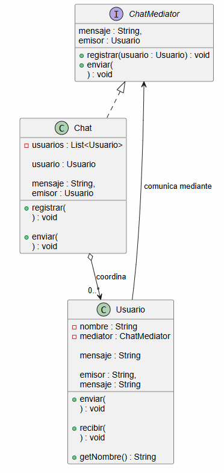
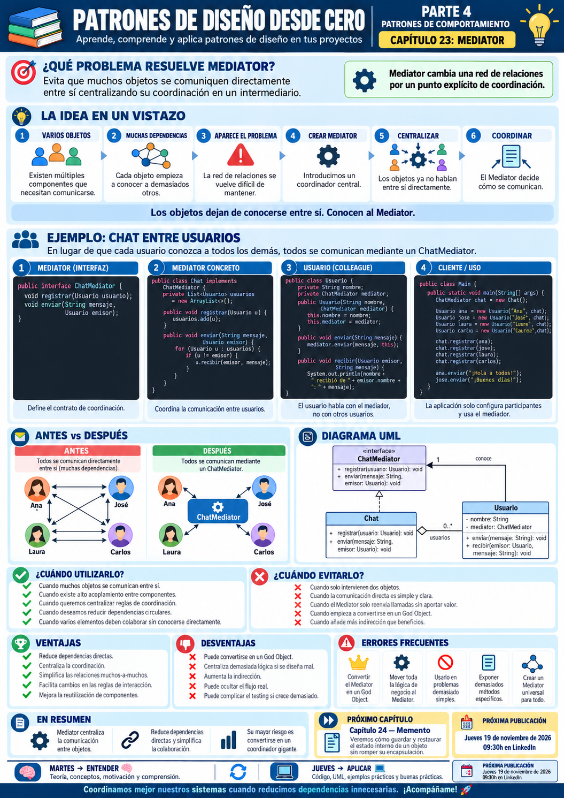

# 📚 Patrones de Diseño desde Cero

> **Aprende a diseñar software mantenible con ejemplos reales.**

# 📖 Capítulo 23 - Mediator

> **📚 Patrones de Diseño desde Cero**  
> **🔄 Parte IV - Patrones de Comportamiento**

---

## 🧠 Introducción

Continuamos nuestro recorrido por los **patrones de comportamiento**.

Hasta ahora hemos estudiado:

### 🎯 Strategy

> **¿Cómo podemos intercambiar algoritmos o comportamientos?**

### 👀 Observer

> **¿Cómo podemos notificar automáticamente cambios a varios objetos?**

### 🎮 Command

> **¿Cómo podemos encapsular una petición dentro de un objeto?**

### 🔁 State

> **¿Cómo podemos cambiar el comportamiento de un objeto según su estado interno?**

### 🧩 Template Method

> **¿Cómo podemos definir la estructura de un algoritmo y personalizar algunos pasos?**

### ⛓️ Chain of Responsibility

> **¿Cómo podemos pasar una petición por una cadena de manejadores?**

Ahora nos encontramos con otro tipo de problema.

Imaginemos una aplicación de chat.

Tenemos varios usuarios:

```text
Ana
José
Laura
Carlos
```

Si cada usuario debe poder comunicarse directamente con todos los demás, podríamos terminar con relaciones como:

```text
Ana ↔ José
Ana ↔ Laura
Ana ↔ Carlos

José ↔ Laura
José ↔ Carlos

Laura ↔ Carlos
```

A medida que añadimos más objetos, el número de relaciones crece rápidamente.

Y no solo ocurre en chats.

También puede suceder con:

```text
formularios
componentes de interfaz
sistemas de reservas
torres de control
workflows
módulos empresariales
```

La pregunta será:

> **¿Cómo podemos centralizar la comunicación entre varios objetos para evitar que todos dependan directamente unos de otros?**

Aquí aparece:

# 🤝 Mediator

Mediator introduce un objeto encargado de **coordinar la comunicación entre varios componentes**.

En lugar de:

```text
Objeto A ↔ Objeto B ↔ Objeto C ↔ Objeto D
```

podemos tener:

```text
Objeto A ─┐
Objeto B ─┤
Objeto C ─┼──► Mediator
Objeto D ─┘
```

Los objetos dejan de comunicarse directamente.

Hablan con el mediador.

---

# 🎯 Objetivos de aprendizaje

Al finalizar este capítulo deberías ser capaz de:

- Comprender qué problema intenta resolver Mediator.
- Identificar redes de dependencias muchos-a-muchos.
- Comprender los conceptos `Mediator`, `ConcreteMediator` y `Colleague`.
- Implementar Mediator en Java.
- Centralizar comunicación entre componentes.
- Reducir dependencias directas.
- Modificar reglas de coordinación sin cambiar todos los participantes.
- Comprender cómo Mediator puede simplificar componentes.
- Reconocer el riesgo de crear un God Object.
- Diferenciar Mediator de Observer.
- Diferenciar Mediator de Facade.
- Diferenciar Mediator de Chain of Responsibility.
- Comprender sus ventajas y desventajas.
- Reconocer cuándo una comunicación directa es más sencilla.

---

# ❌ El problema

Imaginemos una clase:

```java
public class Usuario {

    private String nombre;

    private List<Usuario> contactos;

    public void enviar(String mensaje) {

        for (Usuario usuario : contactos) {

            usuario.recibir(nombre, mensaje);
        }
    }

    public void recibir(String emisor, String mensaje) {

        System.out.println(emisor + ": " + mensaje);
    }
}
```

Cada usuario necesita conocer:

```text
todos sus contactos
```

Si añadimos:

```text
moderación
usuarios bloqueados
salas
historial
notificaciones
permisos
```

las reglas empiezan a distribuirse entre múltiples objetos.

---

# 📈 El problema crece

Supongamos que tenemos:

```text
Usuario A
Usuario B
Usuario C
Usuario D
```

y todos necesitan interactuar.

Conceptualmente:

```text
A ───── B
│ \   / │
│  \ /  │
│  / \  │
│ /   \ │
C ───── D
```

Cada componente conoce a varios de los demás.

A medida que aumenta:

```text
el número de participantes
```

también aumenta:

```text
el número de dependencias
```

---

# ⚠️ ¿Qué problemas aparecen?

Podemos terminar con:

```text
alto acoplamiento
reglas distribuidas
dependencias circulares
cambios difíciles
testing complejo
```

Si cambiamos una regla de comunicación, quizá tengamos que modificar múltiples clases.

El problema real es:

> **Los componentes están demasiado acoplados entre sí.**

---

# 💡 Motivación

Queremos transformar:

```text
A ↔ B
A ↔ C
A ↔ D
B ↔ C
B ↔ D
C ↔ D
```

en:

```text
A ─┐
B ─┤
C ─┼──► Mediator
D ─┘
```

Ahora cada componente solamente conoce:

```text
Mediator
```

El Mediator conoce:

```text
cómo coordinar
la interacción
```

---

# 🤝 La solución

Mediator centraliza la comunicación.

Conceptualmente:

```text
Colleague A
      │
      ▼
   Mediator
      ▲
      │
Colleague B
```

Pero normalmente tendremos múltiples participantes:

```text
           Mediator
          /   |   \
         /    |    \
        A     B     C
               \
                D
```

Cuando:

```text
A quiere comunicarse con B
```

no llama directamente a B.

Hace:

```text
A
↓
Mediator
↓
B
```

---

# 🧱 Participantes del patrón

Mediator suele incluir tres participantes principales.

## 1️⃣ Mediator

Define la interfaz de comunicación.

Por ejemplo:

```java
public interface ChatMediator {

    void enviar(String mensaje, Usuario emisor);

    void registrar(Usuario usuario);
}
```

---

## 2️⃣ Concrete Mediator

Implementa las reglas de coordinación.

En nuestro ejemplo:

```text
Chat
```

---

## 3️⃣ Colleague

Representa los objetos que se comunican mediante el Mediator.

En nuestro ejemplo:

```text
Usuario
```

---

# ☕ Implementación en Java

## Mediator - ChatMediator.java

```java
public interface ChatMediator {

    void registrar(Usuario usuario);

    void enviar(String mensaje, Usuario emisor);
}
```

---

# 🤝 Concrete Mediator - Chat.java

```java
import java.util.ArrayList;
import java.util.List;

public class Chat implements ChatMediator {

    private final List<Usuario> usuarios = new ArrayList<>();

    @Override
    public void registrar(Usuario usuario) {

        usuarios.add(usuario);
    }

    @Override
    public void enviar(String mensaje, Usuario emisor) {

        for (Usuario usuario : usuarios) {

            if (usuario != emisor) {

                usuario.recibir(emisor.getNombre(), mensaje);
            }
        }
    }
}
```

---

# 👤 Colleague - Usuario.java

```java
public class Usuario {

    private final String nombre;

    private final ChatMediator mediator;

    public Usuario(String nombre, ChatMediator mediator) {

        this.nombre = nombre;

        this.mediator = mediator;
    }

    public void enviar(String mensaje) {

        System.out.println("📤 " + nombre + " envía: " + mensaje);

        mediator.enviar(mensaje, this);
    }

    public void recibir(String emisor, String mensaje) {

        System.out.println("📥 " + nombre + " recibe de " + emisor + ": " + mensaje);
    }

    public String getNombre() {

        return nombre;
    }
}
```

---

# ▶️ Cliente - Main.java

```java
public class Main {

    public static void main(String[] args) {

        ChatMediator chat = new Chat();

        Usuario ana = new Usuario("Ana", chat);

        Usuario jose = new Usuario("José", chat);

        Usuario laura = new Usuario("Laura", chat);

        chat.registrar(ana);

        chat.registrar(jose);

        chat.registrar(laura);

        ana.enviar("Hola a todos");

        jose.enviar("¡Hola Ana!");
    }
}
```

---

# 📤 Posible salida

```text
📤 Ana envía: Hola a todos

📥 José recibe de Ana:
Hola a todos

📥 Laura recibe de Ana:
Hola a todos

📤 José envía:
¡Hola Ana!

📥 Ana recibe de José:
¡Hola Ana!

📥 Laura recibe de José:
¡Hola Ana!
```

Los usuarios no conocen directamente:

```text
Ana
José
Laura
```

entre ellos.

Solo conocen:

```text
ChatMediator
```

---

# 🔎 Explicación paso a paso

## 1️⃣ Creamos el Mediator

```java
ChatMediator chat
```

será el coordinador.

---

## 2️⃣ Los participantes reciben el Mediator

```java
new Usuario("Ana", chat);
```

---

## 3️⃣ Registramos los participantes

```java
chat.registrar(ana);
```

---

## 4️⃣ Un usuario quiere comunicarse

```java
ana.enviar("Hola");
```

---

## 5️⃣ No llama directamente a otros usuarios

En lugar de:

```text
Ana → José
Ana → Laura
```

hace:

```text
Ana
 ↓
ChatMediator
```

---

## 6️⃣ El Mediator decide los receptores

```java
mediator.enviar(mensaje, this);
```

---

## 7️⃣ Los destinatarios reciben el mensaje

El Chat coordina:

```text
qué usuarios reciben
```

la comunicación.

---

# 📊 UML

Podemos representar el patrón así:



Conceptualmente:

```text
           ChatMediator
             /  |  \
            /   |   \
           /    |    \
      Usuario Usuario Usuario
```

---

# 🔑 La idea clave

Mediator separa:

```text
QUIÉN PARTICIPA
```

de:

```text
CÓMO SE COORDINA
```

Los participantes saben:

```text
quiero enviar algo
```

El Mediator sabe:

```text
quién debe recibirlo
qué reglas aplicar
qué hacer después
```

---

# 🔄 Antes y después

## ❌ Sin Mediator

```text
 A ↔ B
↕ ╲ ╱ ↕
 C ↔ D
```

Cada objeto conoce directamente a otros.

---

## ✅ Con Mediator

```text
A ─┐
B ─┤
C ─┼──► Mediator
D ─┘
```

Las relaciones se concentran.

---

# 🧮 Crecimiento de dependencias

Imaginemos:

```text
5 componentes
```

Si todos se relacionan directamente:

```text
A ↔ B
A ↔ C
A ↔ D
A ↔ E
...
```

el número de relaciones puede crecer rápidamente.

Con Mediator:

```text
cada componente
↓
una relación principal
↓
Mediator
```

Esto puede simplificar considerablemente el diseño.

---

# 🧠 El Mediator conoce las reglas

Supongamos que queremos añadir:

```text
usuarios bloqueados
```

Podemos centralizar la regla:

```java
if (usuarioHaBloqueado(receptor, emisor)) {
    continue;
}
```

Los objetos `Usuario` no necesitan conocer esta lógica.

---

# 🔐 Caso de uso: permisos

Podemos decidir:

```text
ADMIN
↓
puede enviar a todos

USUARIO
↓
solo puede enviar a su grupo
```

El Mediator aplica las reglas.

---

# 💬 Caso de uso: mensajes privados

Podríamos ampliar:

```java
void enviarPrivado(
    String mensaje,
    Usuario origen,
    Usuario destino
);
```

El Mediator sigue controlando:

```text
cómo se establece la comunicación
```

---

# 🖥️ Caso de uso: interfaces gráficas

Mediator resulta especialmente útil cuando varios componentes de UI interactúan.

Imaginemos:

```text
Checkbox
TextField
Button
List
```

Si:

```text
Checkbox
```

cambia, quizá debemos:

```text
activar botón
desactivar campo
actualizar lista
```

Sin Mediator:

```text
cada componente
conoce a los demás
```

Con Mediator:

```text
Componente
   ↓
FormMediator
   ↓
otros componentes
```

---

# ✈️ Caso clásico: torre de control

Uno de los ejemplos clásicos de Mediator es:

```text
   aviones
      +
torre de control
```

Sin Mediator:

```text
Avión A
```

debería coordinarse directamente con:

```text
Avión B
Avión C
Avión D
...
```

Con Mediator:

```text
Avión
  ↓
Torre de control
  ↓
Aviones
```

La torre centraliza:

```text
despegues
aterrizajes
prioridades
pistas
```

---

# 🏢 Caso de uso: sistemas empresariales

Podemos tener:

```text
Pedido
Pago
Inventario
Envío
Notificación
```

Si todos se comunican directamente podemos obtener:

```text
una red de dependencias
```

Un coordinador puede centralizar determinadas interacciones.

Pero debemos tener cuidado:

> **No todo flujo empresarial necesita Mediator.**

A veces otros patrones arquitectónicos son más adecuados.

---

# 🎯 ¿Cuándo utilizar Mediator?

Mediator puede resultar adecuado cuando:

- Muchos objetos se comunican entre sí.
- Existe una red compleja de dependencias.
- Aparecen dependencias circulares.
- Queremos centralizar reglas de coordinación.
- Los componentes deberían ser más independientes.
- La forma de comunicación cambia.
- Queremos reutilizar componentes en otros contextos.
- Queremos evitar relaciones muchos-a-muchos.
- Los objetos tienen demasiadas referencias mutuas.

---

# 🚫 ¿Cuándo evitarlo?

Probablemente no necesitamos Mediator cuando:

- Solo existen dos objetos.
- La comunicación directa es sencilla.
- No hay una red real de dependencias.
- El Mediator se limitaría a reenviar llamadas.
- Las reglas de coordinación son triviales.
- Introduce más indirección que valor.
- El Mediator empieza a convertirse en un God Object.
- La lógica debería pertenecer realmente al dominio.

---

# ✅ Ventajas

## 🔹 Reduce dependencias directas

Los componentes dependen del Mediator.

---

## 🔹 Simplifica relaciones muchos-a-muchos

Transforma una red compleja en una estructura más centralizada.

---

## 🔹 Centraliza coordinación

Las reglas de interacción pueden estar en un único lugar.

---

## 🔹 Facilita reutilización

Los componentes pueden utilizarse con diferentes Mediators.

---

## 🔹 Reduce dependencias circulares

Los objetos dejan de referenciarse mutuamente.

---

## 🔹 Facilita cambios de coordinación

Podemos cambiar el comportamiento del Mediator sin modificar todos los participantes.

---

# ❌ Desventajas

## 🔸 Puede convertirse en un God Object

Este es el principal riesgo.

Si el Mediator conoce:

```text
todo
+
todos
+
todas las reglas
```

podemos crear una clase gigantesca.

---

## 🔸 Centraliza demasiada lógica

Simplificamos los participantes, pero podemos complicar el Mediator.

---

## 🔸 Puede ocultar el flujo

Una llamada:

```java
usuario.enviar(...)
```

puede desencadenar múltiples acciones.

---

## 🔸 Aumenta la indirección

La comunicación deja de ser:

```text
A → B
```

y pasa a:

```text
A → Mediator → B
```

---

## 🔸 Puede dificultar testing si crece demasiado

Un Mediator muy grande puede tener demasiadas dependencias.

---

# ⚠️ Mediator no significa mover toda la lógica a una clase

Un error frecuente sería crear:

```text
ApplicationMediator
```

que haga:

```text
usuarios
pagos
pedidos
inventario
facturación
emails
informes
...
```

Eso sería simplemente:

> **un God Object con otro nombre.**

---

# ⚠️ Mediator coordina, no necesariamente ejecuta

Idealmente el Mediator decide:

```text
quién debe hacer qué
```

Los componentes siguen realizando:

```text
su trabajo específico
```

Por ejemplo:

```text
Chat
↓
decide quién recibe
```

pero:

```text
Usuario
↓
sabe cómo recibir
```

---

# 🚨 Errores frecuentes

## ❌ Convertir Mediator en God Object

El problema más habitual.

---

## ❌ Mover toda la lógica de negocio al Mediator

Debe coordinar, no absorber todo.

---

## ❌ Usarlo con dos componentes simples

Puede añadir una capa innecesaria.

---

## ❌ Crear dependencias bidireccionales innecesarias

Los componentes deberían trabajar principalmente mediante:

```text
Mediator
```

---

## ❌ Exponer demasiados métodos específicos

Por ejemplo:

```text
usuarioAEnvioMensaje()
usuarioBActualizoEstado()
usuarioCCambioPerfil()
...
```

puede indicar que el Mediator está demasiado acoplado.

---

## ❌ Crear un Mediator universal

Es preferible:

```text
ChatMediator
FormMediator
ReservaMediator
```

que:

```text
ApplicationMediator
```

si los dominios son diferentes.

---

# 🧠 Buenas prácticas

## 1️⃣ Mantén el Mediator cohesionado

Debe coordinar un conjunto relacionado de componentes.

---

## 2️⃣ Evita lógica de dominio innecesaria

Delegar siempre que tenga sentido.

---

## 3️⃣ Trabaja mediante abstracciones

Por ejemplo:

```java
ChatMediator
```

en lugar de:

```java
Chat
```

como dependencia concreta.

---

## 4️⃣ Divide Mediators grandes

Si aparecen demasiadas responsabilidades:

```text
divide por contexto
```

---

## 5️⃣ Mantén simples los Colleagues

Una de las ventajas del patrón es precisamente simplificarlos.

---

## 6️⃣ No centralices por defecto

Antes de introducir Mediator pregunta:

> **¿Existe realmente un problema de acoplamiento muchos-a-muchos?**

---

# 🆚 Mediator vs. Observer

Esta comparación es especialmente importante.

Ambos reducen dependencias directas.

Pero su intención es distinta.

| Mediator | Observer |
|---|---|
| Coordina comunicación | Notifica cambios |
| Comunicación centralizada | Comunicación uno-a-muchos |
| Conoce participantes | Subject conoce abstracción Observer |
| Puede aplicar reglas complejas | Observers reaccionan independientemente |
| Muchos-a-muchos | Uno-a-muchos |

Podemos resumir:

```text
OBSERVER
↓
HA OCURRIDO ALGO
¿QUIÉN DEBE ENTERARSE?
```

```text
MEDIATOR
↓
VARIOS OBJETOS NECESITAN
COORDINARSE
```

---

# 🆚 Mediator vs. Facade

Ambos proporcionan un punto central.

Pero su intención es diferente.

| Mediator | Facade |
|---|---|
| Coordina componentes | Simplifica un subsistema |
| Comunicación bidireccional posible | Cliente normalmente llama a Facade |
| Los componentes conocen Mediator | Subsistema no necesita conocer Facade |
| Reduce dependencias internas | Reduce complejidad para el exterior |

Podemos resumir:

```text
FACADE
↓
SIMPLIFICA HACIA FUERA
```

```text
MEDIATOR
↓
COORDINA HACIA DENTRO
```

---

# 🆚 Mediator vs. Chain of Responsibility

| Mediator | Chain of Responsibility |
|---|---|
| Centraliza coordinación | Encadena procesamiento |
| Un objeto decide interacciones | Cada Handler decide continuar |
| Muchos componentes | Secuencia de manejadores |
| Comunicación en estrella | Comunicación en cadena |

Conceptualmente:

```text
MEDIATOR

A ─┐
B ─┼── Mediator
C ─┘
```

Mientras que:

```text
CHAIN

A → B → C → D
```

---

# 🆚 Mediator vs. Command

| Mediator | Command |
|---|---|
| Coordina comunicación | Encapsula una acción |
| Gestiona relaciones | Representa peticiones |
| Muchos participantes | Invoker / Receiver |
| Reduce acoplamiento mutuo | Desacopla quien pide de quien ejecuta |

Los patrones incluso pueden colaborar:

```text
Mediator
↓
crea o ejecuta Commands
```

si el contexto lo necesita.

---

# 🧠 Principios relacionados

Mediator conecta especialmente con varios principios.

## 🔗 Bajo acoplamiento

Los componentes no necesitan conocerse directamente.

---

## 🎯 Responsabilidad única

Los participantes realizan sus tareas.

El Mediator coordina la interacción.

---

## 🧱 Programar hacia abstracciones

Los componentes pueden depender de:

```java
Mediator
```

---

## 🧩 Separación de responsabilidades

La lógica de comunicación queda separada del comportamiento interno.

---

## ➕ Open/Closed Principle

Podemos modificar determinadas reglas de coordinación sin alterar todos los participantes.

---

# 📌 Resumen

En este capítulo hemos aprendido que:

- Mediator pertenece a los patrones de comportamiento.
- Centraliza la comunicación entre varios objetos.
- Reduce las dependencias directas entre participantes.
- `Mediator` define el contrato de coordinación.
- `ConcreteMediator` implementa las reglas.
- Los `Colleagues` se comunican mediante el Mediator.
- Permite transformar relaciones muchos-a-muchos.
- Puede reducir dependencias circulares.
- Facilita cambiar reglas de interacción.
- Simplifica los componentes participantes.
- Puede convertirse en un God Object si acumula demasiada lógica.
- Mediator coordina; no debería absorber todas las responsabilidades.
- Mediator y Observer reducen acoplamiento, pero con intenciones distintas.
- Facade simplifica hacia fuera; Mediator coordina hacia dentro.
- No necesitamos Mediator cuando una comunicación directa es suficientemente sencilla.

La pregunta fundamental de Mediator es:

> **¿Tenemos varios objetos excesivamente acoplados entre sí porque necesitan coordinar continuamente sus interacciones?**

---

# 🎓 Conclusiones

Mediator introduce una idea muy clara:

> **Los objetos no siempre necesitan conocerse entre sí para colaborar.**

Sin Mediator:

```text
A ↔ B
↕ ╲ ╱ ↕
C ↔ D
```

cada componente puede depender de muchos otros.

Con Mediator:

```text
A ─┐
B ─┤
C ─┼──► Mediator
D ─┘
```

Los participantes conocen:

```text
un punto de coordinación
```

y el Mediator decide:

```text
quién debe comunicarse
con quién
y bajo qué reglas
```

Esto reduce el acoplamiento entre los participantes.

Pero existe un riesgo evidente.

Podemos pasar de:

```text
muchos objetos complicados
```

a:

```text
un Mediator gigantesco
```

Por eso seguimos aplicando nuestra metodología:

```text
PROBLEMA
   ↓
CONTEXTO
   ↓
¿EXISTE UNA RED DE
DEPENDENCIAS?
   ↓
¿LOS OBJETOS SE CONOCEN
DEMASIADO ENTRE ELLOS?
   ↓
¿PODEMOS CENTRALIZAR
LA COORDINACIÓN?
   ↓
ALTERNATIVAS
   ↓
¿MEDIATOR APORTA VALOR?
```

No utilizamos Mediator simplemente porque dos objetos necesiten comunicarse.

Lo utilizamos cuando **la comunicación entre muchos participantes empieza a crear una red de dependencias difícil de mantener**.

> **Mediator cambia una red de relaciones por un punto explícito de coordinación.**

---

# 🖼️ Infografía

Aquí os dejo una infografía sobre este **capítulo 23**.



---

**📚 Patrones de Diseño desde Cero**

*Aprende a diseñar software mantenible con ejemplos reales.*