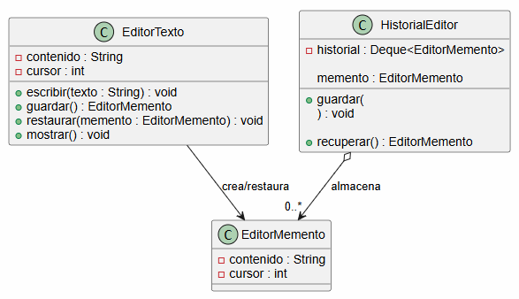
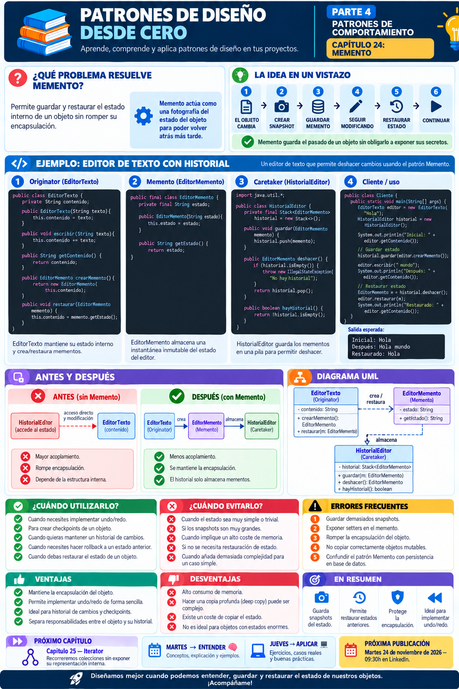

# 📚 Patrones de Diseño desde Cero

> **Aprende a diseñar software mantenible con ejemplos reales.**

# 📖 Capítulo 24 - Memento

> **📚 Patrones de Diseño desde Cero**  
> **🔄 Parte IV - Patrones de Comportamiento**

---

## 🧠 Introducción

Continuamos nuestro recorrido por los **patrones de comportamiento**.

Hasta ahora hemos estudiado:

### 🎯 Strategy

> **¿Cómo podemos intercambiar algoritmos o comportamientos?**

### 👀 Observer

> **¿Cómo podemos notificar automáticamente cambios a varios objetos?**

### 🎮 Command

> **¿Cómo podemos encapsular una operación dentro de un objeto?**

### 🔁 State

> **¿Cómo podemos cambiar el comportamiento de un objeto según su estado interno?**

### 🧩 Template Method

> **¿Cómo podemos definir la estructura de un algoritmo y personalizar algunos pasos?**

### ⛓️ Chain of Responsibility

> **¿Cómo podemos pasar una petición por una cadena de manejadores?**

### 🤝 Mediator

> **¿Cómo podemos centralizar la comunicación entre varios objetos?**

Ahora nos encontramos con un problema diferente.

Imaginemos un editor de texto.

Escribimos:

```text
Hola
```

Después:

```text
Hola mundo
```

Y finalmente:

```text
Hola mundo desde Java
```

Pero queremos poder pulsar:

```text
DESHACER
```

y volver al estado anterior.

Podríamos guardar directamente:

```text
texto
cursor
selección
formato
```

desde otra clase.

Pero entonces estaríamos exponiendo el estado interno del editor.

La pregunta será:

> **¿Cómo podemos guardar y restaurar el estado interno de un objeto sin romper su encapsulación?**

Aquí aparece:

# 💾 Memento

Memento permite capturar y almacenar el estado interno de un objeto para poder restaurarlo posteriormente, manteniendo encapsulados sus detalles internos.

---

# 🎯 Objetivos de aprendizaje

Al finalizar este capítulo deberías ser capaz de:

- Comprender qué problema intenta resolver Memento.
- Identificar los participantes `Originator`, `Memento` y `Caretaker`.
- Implementar Memento en Java.
- Guardar snapshots del estado de un objeto.
- Restaurar estados anteriores.
- Crear un historial de cambios.
- Comprender la relación entre Memento y Undo.
- Mantener encapsulado el estado interno.
- Diferenciar Memento de Command.
- Diferenciar Memento de Prototype.
- Comprender sus ventajas y desventajas.
- Identificar problemas de memoria cuando existen muchos snapshots.
- Decidir qué información debe formar parte del Memento.
- Reconocer cuándo una copia completa del estado es innecesaria.

---

# ❌ El problema

Imaginemos una clase:

```java
public class EditorTexto {

    private String contenido;
    private int cursor;

    public void escribir(String texto) {
        contenido += texto;
        cursor = contenido.length();
    }
}
```

Queremos implementar:

```text
Undo
```

Una primera solución podría ser permitir que otra clase acceda directamente a:

```java
contenido
cursor
```

Por ejemplo:

```java
historial.guardar(
    editor.getContenido(),
    editor.getCursor()
);
```

Pero entonces el historial necesita conocer:

```text
cómo está construido internamente
el EditorTexto
```

---

# ⚠️ ¿Qué problemas aparecen?

Si mañana añadimos:

```text
selección
fuente
tamaño
color
formato
```

el historial también debe cambiar.

Tenemos:

```text
alto acoplamiento
+
ruptura de encapsulación
```

La clase externa está conociendo detalles que deberían pertenecer únicamente al editor.

El problema real es:

> **Necesitamos guardar el estado sin exponer cómo está representado internamente.**

---

# 💡 Motivación

Queremos que el propio objeto sea responsable de crear una representación de su estado.

Conceptualmente:

```text
Editor
  │
  │ crear snapshot
  ▼
Memento
```

Y posteriormente:

```text
Memento
  │
  │ restaurar
  ▼
Editor
```

Otra clase puede guardar esos Mementos.

Pero no necesita conocer:

```text
cómo están construidos
```

---

# 💾 La solución

Memento separa tres responsabilidades:

```text
Originator
↓
crea y restaura estados

Memento
↓
almacena el snapshot

Caretaker
↓
guarda los snapshots
```

Conceptualmente:

```text
        Originator
        /        \
 guardar        restaurar
   ↓               ↑
 Memento ──────► Memento
   │
   ▼
Caretaker
```

---

# 🧱 Participantes del patrón

Memento tiene tres participantes principales.

## 1️⃣ Originator

Es el objeto cuyo estado queremos guardar.

En nuestro ejemplo:

```text
EditorTexto
```

Puede:

```text
crear Memento
restaurar Memento
```

---

## 2️⃣ Memento

Representa un snapshot del estado interno.

En nuestro ejemplo:

```text
EditorMemento
```

---

## 3️⃣ Caretaker

Guarda los Mementos.

En nuestro ejemplo:

```text
HistorialEditor
```

El Caretaker no debería modificar el contenido del Memento.

---

# ☕ Implementación en Java

## Memento - EditorMemento.java

```java
public final class EditorMemento {

    private final String contenido;
    private final int cursor;

    EditorMemento(String contenido, int cursor) {
        this.contenido = contenido;
        this.cursor = cursor;
    }

    String getContenido() {
        return contenido;
    }

    int getCursor() {
        return cursor;
    }
}
```

La idea es que:

```text
EditorTexto
```

pueda utilizar estos datos.

Pero el resto del sistema no debería manipularlos libremente.

---

# 📝 Originator - EditorTexto.java

```java
public class EditorTexto {

    private String contenido = "";
    private int cursor = 0;

    public void escribir(String texto) {
        contenido += texto;
        cursor = contenido.length();
    }

    public void reemplazar(String contenido) {
        this.contenido = contenido;
        this.cursor = contenido.length();
    }

    public EditorMemento guardar() {
        return new EditorMemento(contenido, cursor);
    }

    public void restaurar(EditorMemento memento) {
        this.contenido = memento.getContenido();
        this.cursor = memento.getCursor();
    }

    public void mostrar() {
        System.out.println("📝 " + contenido + " | cursor=" + cursor);
    }
}
```

---

# 📚 Caretaker - HistorialEditor.java

```java
import java.util.ArrayDeque;
import java.util.Deque;

public class HistorialEditor {

    private final Deque<EditorMemento> historial = new ArrayDeque<>();

    public void guardar(EditorMemento memento) {
        historial.push(memento);
    }

    public EditorMemento recuperar() {
        if (historial.isEmpty()) {
            return null;
        }
        return historial.pop();
    }

    public boolean estaVacio() {
        return historial.isEmpty();
    }
}
```

---

# ▶️ Cliente - Main.java

```java
public class Main {

    public static void main(String[] args) {

        EditorTexto editor = new EditorTexto();
        HistorialEditor historial = new HistorialEditor();
        editor.escribir("Hola");
        historial.guardar(editor.guardar());
        editor.escribir(" mundo");
        historial.guardar(editor.guardar());
        editor.escribir(" desde Java");
        editor.mostrar();
        editor.restaurar(historial.recuperar());
        editor.mostrar();
        editor.restaurar(historial.recuperar());
        editor.mostrar();
    }
}
```

---

# 📤 Posible salida

```text
📝 Hola mundo desde Java | cursor=21

📝 Hola mundo | cursor=10

📝 Hola | cursor=4
```

El editor ha recuperado estados anteriores sin que:

```text
HistorialEditor
```

necesite saber cómo modificar internamente:

```text
contenido
cursor
```

---

# 🔎 Explicación paso a paso

## 1️⃣ El Originator tiene estado

```text
contenido
cursor
```

---

## 2️⃣ Solicitamos un snapshot

```java
editor.guardar();
```

---

## 3️⃣ El Originator crea el Memento

```java
new EditorMemento(contenido,cursor);
```

---

## 4️⃣ El Caretaker lo almacena

```java
historial.guardar(memento);
```

---

## 5️⃣ El objeto sigue cambiando

Por ejemplo:

```java
editor.escribir(" mundo");
```

---

## 6️⃣ Recuperamos un estado anterior

```java
EditorMemento memento = historial.recuperar();
```

---

## 7️⃣ El Originator restaura su propio estado

```java
editor.restaurar(memento);
```

El Caretaker no modifica directamente al editor.

---

# 📊 UML

Podemos representar el patrón así:



Conceptualmente:

```text
             Originator
             EditorTexto
              /      \
         guardar    restaurar
            ↓          ↑
          Memento ─────┘
             │
             ▼
          Caretaker
           Historial
```

---

# 🔑 La idea clave

Memento separa:

```text
QUIÉN CONOCE EL ESTADO
```

de:

```text
QUIÉN LO GUARDA
```

El Originator sabe:

```text
qué estado necesita capturar
cómo restaurarlo
```

El Caretaker sabe:

```text
qué snapshots tiene
en qué orden
```

Pero no debería conocer:

```text
cómo interpretar internamente
el estado guardado
```

---

# 📸 Memento como snapshot

Podemos imaginar un Memento como una fotografía:

```text
Estado actual
     │
     📸
     ▼
 Snapshot
```

Después el objeto continúa cambiando:

```text
Estado 1
  ↓
Estado 2
  ↓
Estado 3
```

Pero podemos volver a:

```text
Estado 1
```

utilizando el snapshot.

---

# ↩️ Undo

Uno de los usos más conocidos de Memento es implementar:

```text
UNDO
```

Conceptualmente:

```text
Editar
  ↓
guardar snapshot

Editar
  ↓
guardar snapshot

Editar
  ↓

UNDO
  ↓
restaurar snapshot anterior
```

---

# ↪️ Undo / Redo

Podemos utilizar dos pilas:

```text
UNDO
REDO
```

Cuando hacemos una modificación:

```text
estado actual
↓
UNDO stack
```

Cuando ejecutamos:

```text
UNDO
```

el estado actual pasa a:

```text
REDO stack
```

y restauramos el anterior.

Conceptualmente:

```text
        UNDO STACK
             │
             ▼
         Originator
             │
             ▼
        REDO STACK
```

---

# 📚 Historial completo

También podemos mantener:

```text
Estado 1
Estado 2
Estado 3
Estado 4
Estado 5
```

y permitir volver a cualquiera.

Por ejemplo:

```java
List<EditorMemento>
```

en lugar de una pila.

Esto permite implementar:

```text
línea temporal
versiones
puntos de restauración
```

---

# 🔒 Encapsulación

La parte más importante del patrón no es simplemente:

> **guardar datos.**

La idea es guardar el estado:

> **sin permitir que objetos externos conozcan o manipulen sus detalles internos.**

El Caretaker debería tratar un Memento como:

```text
una caja cerrada
```

---

# 📦 Memento completo vs. parcial

No siempre necesitamos guardar todo el objeto.

Podemos guardar:

```text
estado completo
```

o únicamente:

```text
lo necesario para restaurarlo
```

Por ejemplo:

```text
contenido
cursor
```

pero quizá no necesitamos guardar:

```text
servicios
conexiones
cachés
dependencias
```

---

# 🧠 Estado derivado

Supongamos que tenemos:

```java
String contenido;

int numeroCaracteres;
```

Si:

```text
numeroCaracteres
```

puede calcularse fácilmente a partir de:

```text
contenido.length()
```

quizá no necesitamos almacenarlo dentro del Memento.

Esto ayuda a reducir:

```text
tamaño
duplicación
inconsistencias
```

---

# 🧱 Inmutabilidad del Memento

Un Memento debería ser normalmente:

> **inmutable**

Por eso utilizamos:

```java
private final
```

y evitamos setters.

Si un snapshot pudiera modificarse:

```text
dejaría de representar fielmente
un estado histórico
```

---

# 📝 Caso de uso: editor de texto

Es el ejemplo más evidente.

Podemos guardar:

```text
contenido
cursor
selección
formato
```

para implementar:

```text
Undo
Redo
Historial
```

---

# 🎨 Caso de uso: editor gráfico

Un objeto gráfico puede tener:

```text
posición
tamaño
rotación
color
```

Antes de realizar una transformación:

```text
guardamos snapshot
```

Después podemos restaurarlo.

---

# 🎮 Caso de uso: videojuegos

Podemos crear:

```text
checkpoints
```

que almacenen:

```text
posición
vida
inventario
misión actual
```

permitiendo restaurar una partida.

---

# ⚙️ Caso de uso: configuración

Antes de aplicar cambios:

```text
Configuración A
      ↓
Guardar Memento
      ↓
Configuración B
```

Si B falla:

```text
restaurar A
```

---

# 🧾 Caso de uso: formularios

Un formulario complejo puede permitir:

```text
editar
experimentar
cancelar cambios
```

Podemos recuperar el estado inicial.

---

# 🎯 ¿Cuándo utilizar Memento?

Memento puede resultar adecuado cuando:

- Necesitamos guardar snapshots.
- Queremos implementar Undo/Redo.
- Debemos restaurar estados anteriores.
- No queremos exponer el estado interno.
- El objeto tiene un estado suficientemente complejo.
- Necesitamos checkpoints.
- Queremos mantener un historial.
- El propio objeto sabe mejor qué datos necesita guardar.
- Queremos separar almacenamiento y restauración.

---

# 🚫 ¿Cuándo evitarlo?

Probablemente no necesitamos Memento cuando:

- El estado es trivial.
- Podemos reconstruirlo fácilmente.
- No necesitamos restauración.
- Los snapshots serían demasiado grandes.
- El estado cambia constantemente y guardar cada versión es costoso.
- Una copia simple es suficiente.
- El historial puede almacenarse de forma más sencilla.
- La persistencia requiere una solución diferente.

---

# ✅ Ventajas

## 🔹 Mantiene la encapsulación

No necesitamos exponer el estado interno del Originator.

---

## 🔹 Facilita Undo

Podemos volver a estados anteriores.

---

## 🔹 Permite historial

Podemos almacenar múltiples snapshots.

---

## 🔹 Separa responsabilidades

El Originator:

```text
crea/restaura
```

El Caretaker:

```text
almacena
```

---

## 🔹 Facilita checkpoints

Podemos guardar puntos de recuperación.

---

## 🔹 Simplifica rollback

Podemos recuperar una configuración anterior.

---

# ❌ Desventajas

## 🔸 Puede consumir mucha memoria

Guardar:

```text
1000 snapshots
```

de objetos grandes puede resultar costoso.

---

## 🔸 Copiar el estado puede ser caro

Especialmente con estructuras grandes.

---

## 🔸 Puede complicar objetos con referencias mutables

Debemos decidir entre:

```text
shallow copy
deep copy
```

---

## 🔸 El Caretaker puede crecer mucho

Si no eliminamos estados antiguos.

---

## 🔸 Gestionar Undo/Redo completo puede ser complejo

Especialmente cuando combinamos Memento con operaciones complejas.

---

# ⚠️ Memento no es simplemente serialización

Serializar un objeto puede producir un snapshot.

Pero:

```text
SERIALIZACIÓN
```

y:

```text
MEMENTO
```

tienen intenciones diferentes.

Serialización busca:

```text
convertir estado a un formato
```

Memento busca:

```text
capturar estado para restaurarlo
sin romper encapsulación
```

---

# ⚠️ Memento no es necesariamente persistencia

Un Memento puede existir únicamente:

```text
en memoria
```

durante unos segundos.

No implica:

```text
guardar en base de datos
guardar en archivo
```

aunque técnicamente pueda combinarse con ello.

---

# ⚠️ Shallow Copy vs. Deep Copy

Imaginemos:

```java
class Documento {

    String texto;

    Configuracion configuracion;
}
```

Si el Memento almacena:

```java
configuracion
```

como referencia compartida y luego esa configuración cambia:

```text
el snapshot también podría
reflejar indirectamente cambios
```

Por eso debemos decidir:

```text
¿copiar referencia?
```

o:

```text
¿crear una copia independiente?
```

Este problema conecta con lo visto en:

### Prototype

```text
Shallow Copy
vs.
Deep Copy
```

---

# 🚨 Errores frecuentes

## ❌ Guardar demasiados snapshots

Puede consumir mucha memoria.

---

## ❌ Exponer setters en Memento

El snapshot debería permanecer estable.

---

## ❌ Romper encapsulación

El Caretaker no debería modificar datos internos.

---

## ❌ Guardar información innecesaria

No todo el objeto necesita formar parte del snapshot.

---

## ❌ No copiar objetos mutables

Puede provocar snapshots inconsistentes.

---

## ❌ Confundir Memento con persistencia

El objetivo principal es restaurar estado.

---

# 🧠 Buenas prácticas

## 1️⃣ Haz Memento inmutable

Por ejemplo:

```java
final class EditorMemento
```

con:

```java
private final
```

---

## 2️⃣ Guarda solo lo necesario

Evita copiar:

```text
servicios
dependencias
cachés
```

si no forman parte del estado restaurable.

---

## 3️⃣ Limita el historial

Por ejemplo:

```text
últimos 100 estados
```

en lugar de guardar indefinidamente.

---

## 4️⃣ Considera snapshots incrementales

Si el estado es muy grande, quizá sea mejor almacenar:

```text
solo diferencias
```

en lugar de una copia completa.

---

## 5️⃣ Controla objetos mutables

Decide correctamente si necesitas:

```text
deep copy
```

---

## 6️⃣ Mantén al Caretaker ignorante del contenido

Debe tratar los Mementos como objetos opacos.

---

# 🆚 Memento vs. Command

Esta comparación es especialmente importante porque ambos pueden utilizarse para implementar Undo.

| Memento | Command |
|---|---|
| Guarda estado | Guarda acción |
| Restaura snapshot | Ejecuta/deshace operación |
| Se centra en el objeto | Se centra en la petición |
| Puede requerir mucha memoria | Puede requerir lógica inversa |
| Undo mediante estado | Undo mediante operación |

Podemos resumir:

```text
MEMENTO
↓
¿CÓMO ESTABA?
```

```text
COMMAND
↓
¿QUÉ HICE?
```

Ambos pueden colaborar.

---

# 🤝 Memento + Command

Imaginemos un:

```text
MoverObjetoCommand
```

Antes de mover:

```java
memento =
    objeto.guardar();
```

Ejecutamos:

```java
objeto.mover(...);
```

Para Undo:

```java
objeto.restaurar(
    memento
);
```

Command guarda:

```text
la operación
```

Memento guarda:

```text
el estado anterior
```

---

# 🆚 Memento vs. Prototype

Ambos pueden implicar copiar estado.

Pero su intención es diferente.

| Memento | Prototype |
|---|---|
| Guarda estado histórico | Crea nuevos objetos |
| Busca restauración | Busca clonación |
| Asociado a un Originator | El clon se usa como nueva instancia |
| Puede ser opaco | Normalmente devuelve objeto usable |

Podemos resumir:

```text
MEMENTO
↓
GUARDAR
```

```text
PROTOTYPE
↓
CLONAR
```

---

# 🆚 Memento vs. State

| Memento | State |
|---|---|
| Guarda estado | Representa comportamiento por estado |
| Permite restaurar | Permite cambiar comportamiento |
| Snapshot histórico | Estado activo |
| Caretaker guarda versiones | Context mantiene State actual |

Una misma aplicación puede usar ambos.

Por ejemplo:

```text
Pedido
↓
State
```

para comportamiento.

Y:

```text
Memento
```

para restaurar una versión anterior.

---

# 🆚 Memento vs. Event Sourcing

Memento guarda:

```text
snapshots
```

Event Sourcing guarda:

```text
eventos
```

Conceptualmente:

```text
MEMENTO

Estado 1
Estado 2
Estado 3
```

mientras que:

```text
EVENT SOURCING

Evento A
Evento B
Evento C
↓
reconstruir estado
```

Son enfoques diferentes.

---

# 🧠 Principios relacionados

Memento conecta especialmente con varios principios.

## 🔒 Encapsulación

El estado interno no necesita exponerse públicamente.

---

## 🎯 Responsabilidad única

El Originator gestiona su estado.

El Caretaker almacena snapshots.

---

## 🧩 Separación de responsabilidades

Guardar una versión y utilizar el objeto son responsabilidades distintas.

---

## ♻️ Inmutabilidad

Los snapshots deberían permanecer estables.

---

# 📌 Resumen

En este capítulo hemos aprendido que:

- Memento pertenece a los patrones de comportamiento.
- Permite capturar el estado de un objeto.
- Podemos restaurarlo posteriormente.
- `Originator` crea y restaura Mementos.
- `Memento` contiene el snapshot.
- `Caretaker` almacena los snapshots.
- El Caretaker no debería conocer los detalles internos del estado.
- Memento permite mantener encapsulación.
- Es especialmente útil para Undo/Redo.
- Puede utilizarse para checkpoints.
- Podemos almacenar estados completos o parciales.
- Los Mementos deberían ser preferiblemente inmutables.
- Debemos vigilar el consumo de memoria.
- Los objetos mutables pueden requerir Deep Copy.
- Memento y Command pueden colaborar.
- Memento guarda estado; Command representa acciones.
- Memento y Prototype pueden copiar datos, pero tienen intenciones diferentes.

La pregunta fundamental de Memento es:

> **¿Necesitamos poder volver a un estado anterior de un objeto sin exponer ni manipular directamente su representación interna?**

---

# 🎓 Conclusiones

Memento introduce una idea muy intuitiva:

> **Antes de cambiar algo, podemos guardar una fotografía de cómo estaba.**

Sin Memento podríamos tener:

```text
Historial
   │
   ├── conoce contenido
   ├── conoce cursor
   ├── conoce selección
   └── conoce formato
```

El historial necesita conocer demasiados detalles del objeto.

Con Memento:

```text
Editor
  │
  ├── crea
  ▼
Memento
  │
  ▼
Historial
```

El Caretaker guarda:

```text
snapshots
```

pero el Originator sigue siendo quien sabe:

```text
cómo crear
+
cómo restaurar
```

su propio estado.

Esto protege:

```text
encapsulación
```

y facilita funcionalidades como:

```text
Undo
Redo
Historial
Checkpoints
Rollback
```

Pero cada snapshot tiene un coste.

Por eso seguimos aplicando nuestra metodología:

```text
PROBLEMA
   ↓
CONTEXTO
   ↓
¿NECESITAMOS VOLVER
A UN ESTADO ANTERIOR?
   ↓
¿QUEREMOS EVITAR
EXPONER EL ESTADO?
   ↓
¿EL COSTE DE GUARDAR
SNAPSHOTS ES ACEPTABLE?
   ↓
ALTERNATIVAS
   ↓
¿MEMENTO APORTA VALOR?
```

No utilizamos Memento simplemente porque podamos copiar un objeto.

Lo utilizamos cuando necesitamos **conservar estados históricos y restaurarlos manteniendo encapsulada la representación interna del objeto**.

> **Memento guarda el pasado de un objeto sin obligarlo a exponer sus secretos.**

---

# 🖼️ Infografía

Aquí os dejo una infografía sobre este **capítulo 24**.



---

**📚 Patrones de Diseño desde Cero**

*Aprende a diseñar software mantenible con ejemplos reales.*