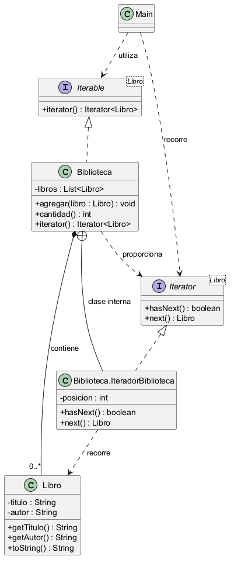
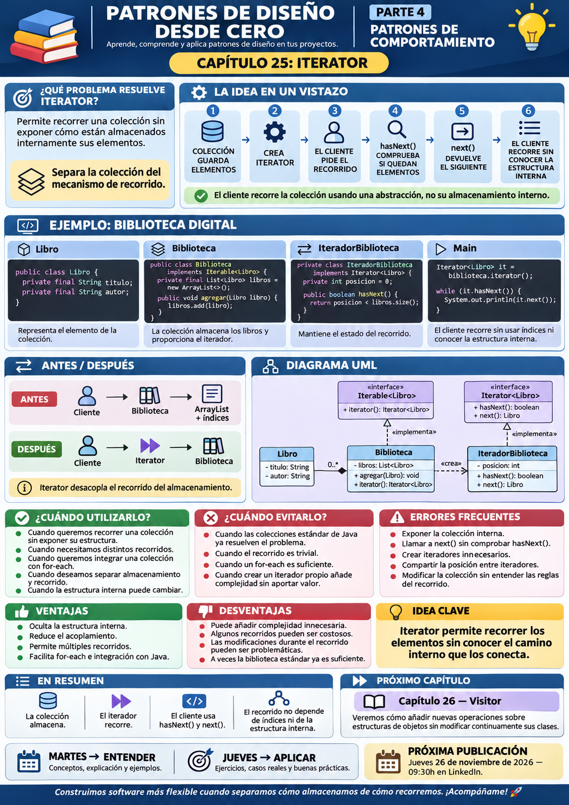

# 📚 Patrones de Diseño desde Cero

> **Aprende a diseñar software mantenible con ejemplos reales.**

# 📖 Capítulo 25 - Iterator

> **📚 Patrones de Diseño desde Cero**  
> **🔄 Parte IV - Patrones de Comportamiento**

---

## 🧠 Introducción

Continuamos nuestro recorrido por los **patrones de comportamiento**.

Hasta ahora hemos estudiado:

### 🎯 Strategy

> ¿Cómo podemos intercambiar algoritmos o comportamientos sin modificar el contexto que los utiliza?

### 👀 Observer

> ¿Cómo podemos notificar automáticamente a varios objetos cuando cambia el estado de otro?

### 🎮 Command

> ¿Cómo podemos encapsular una operación dentro de un objeto?

### 🔁 State

> ¿Cómo podemos cambiar el comportamiento de un objeto según su estado interno?

### 🧩 Template Method

> ¿Cómo podemos definir la estructura de un algoritmo y personalizar algunos pasos?

### ⛓️ Chain of Responsibility

> ¿Cómo podemos pasar una petición por una cadena de manejadores?

### 🤝 Mediator

> ¿Cómo podemos centralizar la comunicación entre varios objetos?

### 💾 Memento

> ¿Cómo podemos guardar y restaurar el estado interno de un objeto sin romper su encapsulación?

Ahora nos encontramos con un problema diferente.

Imaginemos una aplicación que gestiona una biblioteca digital.

Tenemos una colección de libros:

```text
Clean Code
Effective Java
Design Patterns
Refactoring
```

Queremos recorrerlos para mostrar su información.

Una primera solución podría ser utilizar un índice:

```java
for (int i = 0; i < libros.size(); i++) {
    System.out.println(libros.get(i));
}
```

Funciona perfectamente.

Pero ¿qué ocurre si mañana cambiamos nuestra estructura interna?

Por ejemplo:

```text
ArrayList
LinkedList
Árbol
Colección personalizada
```

¿Y si queremos recorrer los libros en diferentes órdenes?

```text
Orden de inserción
Orden alfabético
Orden inverso
Por autor
```

No queremos que el cliente tenga que conocer cómo se almacenan los elementos.

La pregunta será:

> **¿Cómo podemos recorrer una colección sin exponer su representación interna?**

Aquí aparece:

# 🔄 Iterator

Iterator proporciona una forma de acceder secuencialmente a los elementos de una colección sin exponer cómo están organizados o almacenados internamente.

---

# 🎯 Objetivos de aprendizaje

Al finalizar este capítulo deberías ser capaz de:

- Comprender qué problema intenta resolver Iterator.
- Identificar el acoplamiento entre el recorrido y la estructura de almacenamiento.
- Comprender qué significa separar una colección de su mecanismo de recorrido.
- Identificar los participantes `Iterator`, `ConcreteIterator`, `Aggregate` y `ConcreteAggregate`.
- Implementar Iterator en Java.
- Comprender el funcionamiento de `hasNext()` y `next()`.
- Utilizar `Iterator<T>` e `Iterable<T>`.
- Implementar un iterador personalizado.
- Integrar colecciones propias con el bucle `for-each`.
- Comprender qué ocurre cuando se modifica una colección durante su recorrido.
- Diferenciar los iteradores externos de los mecanismos de iteración interna.
- Reconocer cuándo utilizar las implementaciones estándar de Java.
- Diferenciar Iterator de Visitor.
- Comprender sus ventajas, desventajas y errores frecuentes.
- Evitar crear iteradores personalizados cuando no aportan valor.

---

# ❌ El problema

Imaginemos una clase que representa una biblioteca:

```java
import java.util.ArrayList;
import java.util.List;

public class Biblioteca {

    private final List<String> libros = new ArrayList<>();

    public void agregar(String libro) {
        libros.add(libro);
    }

    public List<String> getLibros() {
        return libros;
    }
}
```

El cliente podría recorrer sus elementos:

```java
Biblioteca biblioteca = new Biblioteca();

biblioteca.agregar("Clean Code");
biblioteca.agregar("Effective Java");
biblioteca.agregar("Design Patterns");

List<String> libros = biblioteca.getLibros();

for (int i = 0; i < libros.size(); i++) {
    System.out.println(libros.get(i));
}
```

Inicialmente parece razonable.

Pero tenemos varios problemas de diseño.

---

# ⚠️ El cliente conoce demasiado

El cliente sabe que:

```text
Biblioteca
    ↓
utiliza List
    ↓
permite acceder mediante índices
```

También conoce:

```java
size()
get(i)
```

Estamos haciendo que el cliente dependa del mecanismo de almacenamiento.

Además, nuestro método:

```java
public List<String> getLibros()
```

devuelve directamente la colección interna mutable.

Esto permite que un cliente haga:

```java
biblioteca.getLibros().clear();
```

y elimine todos los libros sin pasar por las operaciones controladas de `Biblioteca`.

Estamos exponiendo innecesariamente su representación interna.

---

# 📈 El problema crece

Supongamos que decidimos cambiar:

```java
ArrayList
```

por una estructura personalizada.

Por ejemplo:

```text
Árbol binario
```

Ahora no necesariamente tendremos:

```java
get(i)
```

Tampoco podemos asumir que recorrer los elementos mediante índices sea eficiente.

El cliente podría necesitar un algoritmo completamente diferente.

Conceptualmente:

```text
Cliente
   │
   ├── conoce ArrayList
   ├── conoce índices
   ├── conoce size()
   └── conoce get()
```

Si cambia la colección:

```text
puede cambiar también
el código cliente
```

---

# ⚠️ ¿Qué problemas aparecen?

Podemos encontrarnos con:

- Acoplamiento a la estructura interna.
- Duplicación de lógica de recorrido.
- Dificultad para sustituir colecciones.
- Exposición innecesaria de datos internos.
- Recorridos personalizados difíciles de reutilizar.
- Código cliente más complejo.

El problema principal es:

> **Estamos mezclando el acceso a los elementos con los detalles de cómo están almacenados.**

---

# 💡 Motivación

Queremos separar dos responsabilidades.

## 1️⃣ La colección

Debe encargarse de:

```text
almacenar
organizar
gestionar elementos
```

## 2️⃣ El iterador

Debe encargarse de:

```text
recorrer
controlar la posición
obtener el siguiente elemento
```

De esta manera, el cliente no necesita conocer los detalles internos.

Conceptualmente:

```text
Cliente
   │
   ▼
Iterator
   │
   ▼
Colección
```

El cliente únicamente pregunta:

```text
¿Quedan elementos?
```

y:

```text
¿Cuál es el siguiente?
```

---

# 🔄 La solución

Iterator encapsula el mecanismo de recorrido en un objeto independiente.

En lugar de:

```java
libros.get(i);
```

utilizamos:

```java
iterator.next();
```

Y para saber si existen más elementos:

```java
iterator.hasNext();
```

Conceptualmente:

```text
Cliente
   │
   ▼
Iterator
   │
   ├── hasNext()
   └── next()
         │
         ▼
      Colección
```

El cliente deja de preocuparse por:

```text
índices
posiciones internas
estructura de almacenamiento
```

---

# 🧱 Participantes del patrón

Iterator suele incluir cuatro participantes principales en su formulación clásica.

## 1️⃣ Iterator

Define el contrato común para recorrer los elementos.

En Java:

```java
Iterator<T>
```

Incluye:

```java
boolean hasNext();

T next();
```

---

## 2️⃣ ConcreteIterator

Implementa el mecanismo concreto de recorrido.

Por ejemplo:

```text
IteradorBiblioteca
```

Mantiene la posición y sabe cómo obtener los elementos.

---

## 3️⃣ Aggregate

Representa una colección que puede proporcionar iteradores.

En Java podemos utilizar:

```java
Iterable<T>
```

Su método fundamental es:

```java
Iterator<T> iterator();
```

---

## 4️⃣ ConcreteAggregate

Es la colección concreta.

En nuestro ejemplo:

```text
Biblioteca
```

Mantiene los libros y proporciona el iterador correspondiente.

---

# ☕ Iterator en Java

Java ya incorpora las abstracciones fundamentales del patrón.

Estas son:

```java
java.util.Iterator
```

y:

```java
java.lang.Iterable
```

Por tanto, normalmente no necesitamos crear nuestra propia interfaz `Iterator`.

Podemos reutilizar directamente las interfaces estándar.

---

# 🧩 Iterator<T>

La interfaz `Iterator<T>` proporciona las operaciones fundamentales del recorrido.

```java
Iterator<Libro> iterador;
```

Sus métodos principales son:

```java
boolean hasNext();
```

Indica si existe otro elemento disponible.

```java
Libro next();
```

Devuelve el siguiente elemento y avanza el recorrido.

También existe:

```java
void remove();
```

como operación opcional.

Su implementación predeterminada lanza:

```java
UnsupportedOperationException
```

si el iterador no admite eliminación.

---

# 🧩 Iterable<T>

La interfaz `Iterable<T>` permite que una clase proporcione un iterador.

Por ejemplo:

```java
public class Biblioteca
        implements Iterable<Libro> {

    @Override
    public Iterator<Libro> iterator() {
        // ...
    }
}
```

Esto tiene una ventaja importante.

Podemos utilizar:

```java
for (Libro libro : biblioteca) {
    // ...
}
```

sin necesidad de obtener manualmente el iterador.

---

# ☕ Implementación en Java

Vamos a construir una biblioteca digital con un iterador personalizado.

Utilizaremos:

```text
Libro
Biblioteca
IteradorBiblioteca
Main
```

El iterador será una clase interna privada de `Biblioteca`, lo que nos permite acceder a la colección sin exponerla públicamente.

---

# 📚 Modelo - Libro.java

```java
public class Libro {

    private final String titulo;
    private final String autor;

    public Libro(String titulo, String autor) {
        this.titulo = titulo;
        this.autor = autor;
    }

    public String getTitulo() {
        return titulo;
    }

    public String getAutor() {
        return autor;
    }

    @Override
    public String toString() {
        return titulo + " — " + autor;
    }
}
```

Esta clase representa un libro.

Contiene:

```text
título
autor
```

No necesita conocer nada sobre:

```text
Iterator
Biblioteca
recorridos
```

---

# 📦 Aggregate + ConcreteIterator - Biblioteca.java

```java
import java.util.ArrayList;
import java.util.Iterator;
import java.util.List;
import java.util.NoSuchElementException;

public class Biblioteca implements Iterable<Libro> {

    private final List<Libro> libros = new ArrayList<>();

    public void agregar(Libro libro) {
        libros.add(libro);
    }

    public int cantidad() {
        return libros.size();
    }

    @Override
    public Iterator<Libro> iterator() {
        return new IteradorBiblioteca();
    }

    private class IteradorBiblioteca implements Iterator<Libro> {

        private int posicion = 0;

        @Override
        public boolean hasNext() {
            return posicion < libros.size();
        }

        @Override
        public Libro next() {

            if (!hasNext()) {
                throw new NoSuchElementException();
            }

            return libros.get(posicion++);
        }
    }
}
```

Observa que `Biblioteca` mantiene:

```java
private final List<Libro> libros;
```

El cliente no puede acceder directamente a esa lista.

La clase interna:

```java
IteradorBiblioteca
```

puede recorrerla porque pertenece al ámbito de `Biblioteca`.

Cada llamada a:

```java
iterator()
```

crea un iterador nuevo con su propia posición.

Esto permite mantener varios recorridos independientes.

**Importante:** esta implementación es deliberadamente sencilla y educativa. No ofrece detección *fail-fast* de modificaciones concurrentes ni sincronización. Más adelante veremos por qué esto importa.

---

# ▶️ Cliente - Main.java

```java
import java.util.Iterator;

public class Main {

    public static void main(String[] args) {

        Biblioteca biblioteca = new Biblioteca();

        biblioteca.agregar(
            new Libro("Clean Code", "Robert C. Martin")
        );

        biblioteca.agregar(
            new Libro("Effective Java", "Joshua Bloch")
        );

        biblioteca.agregar(
            new Libro("Design Patterns", "Gang of Four")
        );

        biblioteca.agregar(
            new Libro("Refactoring", "Martin Fowler")
        );

        System.out.println("📚 Recorrido con Iterator:");

        Iterator<Libro> iterador = biblioteca.iterator();

        while (iterador.hasNext()) {

            Libro libro = iterador.next();

            System.out.println(libro);
        }

        System.out.println();

        System.out.println("📖 Recorrido con for-each:");

        for (Libro libro : biblioteca) {
            System.out.println(libro);
        }
    }
}
```

---

# 📤 Salida esperada

```text
📚 Recorrido con Iterator:

Clean Code — Robert C. Martin
Effective Java — Joshua Bloch
Design Patterns — Gang of Four
Refactoring — Martin Fowler

📖 Recorrido con for-each:

Clean Code — Robert C. Martin
Effective Java — Joshua Bloch
Design Patterns — Gang of Four
Refactoring — Martin Fowler
```

Hemos conseguido recorrer la biblioteca sin utilizar:

```java
biblioteca.getLibros();
```

ni:

```java
biblioteca.get(i);
```

El cliente desconoce cómo se almacenan internamente los elementos.

---

# 🔎 Explicación paso a paso

## 1️⃣ Creamos la colección

```java
Biblioteca biblioteca = new Biblioteca();
```

Internamente utiliza:

```java
ArrayList<Libro>
```

Pero el cliente no necesita conocerlo.

---

## 2️⃣ Añadimos elementos

```java
biblioteca.agregar(
    new Libro(
        "Clean Code",
        "Robert C. Martin"
    )
);
```

La colección se encarga de almacenarlos.

---

## 3️⃣ Solicitamos un iterador

```java
Iterator<Libro> iterador =
        biblioteca.iterator();
```

La biblioteca crea un nuevo:

```text
IteradorBiblioteca
```

---

## 4️⃣ Comprobamos si quedan elementos

```java
iterador.hasNext();
```

Devuelve:

```text
true
```

si existe un siguiente elemento.

---

## 5️⃣ Obtenemos el siguiente

```java
Libro libro = iterador.next();
```

El iterador:

```text
devuelve elemento actual
+
avanza posición
```

---

## 6️⃣ Repetimos el recorrido

```java
while (iterador.hasNext()) {

    Libro libro = iterador.next();

    System.out.println(libro);
}
```

---

## 7️⃣ Finalizamos

Cuando no quedan elementos:

```java
hasNext()
```

devuelve:

```text
false
```

Y el recorrido termina.

---

# 📊 UML

Podemos representar el patrón mediante PlantUML:



Conceptualmente:

```text
                 Iterable<Libro>
                       ▲
                       │
                   Biblioteca
                       │
                    iterator()
                       │
                       ▼
                 Iterator<Libro>
                       ▲
                       │
               IteradorBiblioteca
                       │
                   hasNext()
                     next()
                       │
                       ▼
                     Libro
```

---

# 🔑 La idea clave

Iterator separa:

```text
DÓNDE ESTÁN LOS ELEMENTOS
```

de:

```text
CÓMO LOS RECORREMOS
```

La colección se encarga de:

```text
almacenar
organizar
gestionar
```

El iterador se encarga de:

```text
recorrer
mantener posición
obtener siguiente
```

El cliente utiliza una abstracción.

---

# 🔄 Antes y después

## ❌ Antes — Sin Iterator

```text
Cliente
   │
   ▼
Biblioteca
   │
   ▼
ArrayList
   │
   ├── size()
   └── get(i)
```

El cliente necesita conocer detalles de acceso.

---

## ✅ Después — Con Iterator

```text
Cliente
   │
   ▼
Iterator<Libro>
   │
   ├── hasNext()
   └── next()
         │
         ▼
      Biblioteca
```

El recorrido queda encapsulado.

---

# 🧠 El estado del recorrido

Una característica importante es que el iterador mantiene su propio estado.

En nuestro ejemplo:

```java
private int posicion = 0;
```

Imaginemos:

```text
Libro A
Libro B
Libro C
Libro D
```

Inicialmente:

```text
posición = 0
```

Después de:

```java
next();
```

tenemos:

```text
posición = 1
```

Y así sucesivamente.

El cliente no necesita gestionar esa posición.

---

# 🔁 Múltiples iteradores independientes

Podemos obtener dos iteradores sobre la misma colección:

```java
Iterator<Libro> iterador1 =
        biblioteca.iterator();

Iterator<Libro> iterador2 =
        biblioteca.iterator();
```

Cada uno mantiene su propia posición.

Por ejemplo:

```java
iterador1.next();
iterador1.next();

iterador2.next();
```

Conceptualmente:

```text
Biblioteca
    │
    ├── Iterador 1 → posición 2
    │
    └── Iterador 2 → posición 1
```

Esto permite recorrer una misma colección desde diferentes puntos de avance.

En nuestro ejemplo, ambos iteradores comparten la colección subyacente, por lo que los cambios en ella pueden afectar al recorrido.

---

# 🔃 Recorridos personalizados

Iterator también permite crear distintas formas de recorrer una colección.

Por ejemplo:

```text
Orden de inserción
Orden inverso
Orden alfabético
Por autor
```

Podríamos diseñar:

```text
Biblioteca
    │
    ├── IteratorNormal
    ├── IteratorInverso
    └── IteratorPorAutor
```

Cada iterador proporciona una estrategia de recorrido diferente.

El cliente mantiene una interfaz común:

```java
Iterator<Libro>
```

Pero el orden cambia.

Para ciertos recorridos, podría ser necesario generar primero una vista ordenada de los datos, con un coste adicional de memoria y procesamiento.

---

# ⬅️ Iterator inverso

Imaginemos:

```text
Libro A
Libro B
Libro C
```

El recorrido habitual sería:

```text
A → B → C
```

Pero podemos crear otro iterador:

```text
C → B → A
```

Su posición inicial podría ser:

```java
private int posicion = libros.size() - 1;
```

Y sus métodos:

```java
@Override
public boolean hasNext() {
    return posicion >= 0;
}

@Override
public Libro next() {

    if (!hasNext()) {
        throw new NoSuchElementException();
    }

    return libros.get(posicion--);
}
```

Así podemos ofrecer:

```java
Iterator<Libro> iteratorInverso();
```

sin cambiar la interfaz básica que utiliza el cliente para recorrer los elementos.

---

# 🔄 Iterator y for-each

Una de las aplicaciones más importantes de Iterator en Java es el bucle:

```java
for (Libro libro : biblioteca) {

    System.out.println(libro);
}
```

Este código funciona porque:

```java
Biblioteca
```

implementa:

```java
Iterable<Libro>
```

El compilador utiliza el iterador proporcionado por la colección.

Conceptualmente, es equivalente a:

```java
Iterator<Libro> iterador = biblioteca.iterator();

while (iterador.hasNext()) {

    Libro libro = iterador.next();

    System.out.println(libro);
}
```

Esto demuestra que podemos utilizar un patrón de diseño sin escribir explícitamente su nombre.

---

# ☕ Iterator en la biblioteca estándar

Java utiliza ampliamente este patrón.

Por ejemplo:

```java
List<String> nombres = List.of("Ana", "José", "Laura");
```

Podemos recorrer:

```java
for (String nombre : nombres) {
    System.out.println(nombre);
}
```

O utilizar directamente:

```java
Iterator<String> iterador = nombres.iterator();
```

También encontramos Iterator en:

```text
ArrayList
LinkedList
HashSet
TreeSet
HashMap.entrySet()
```

Entre muchas otras estructuras de la biblioteca estándar.

**Importante:** un `Map` no implementa directamente `Iterable`, pero podemos recorrer sus vistas `keySet()`, `values()` y `entrySet()`.

---

# 🔍 Iterator externo vs. iteración interna

Existen dos formas habituales de organizar los recorridos.

## 1️⃣ Iteración externa

El cliente controla cuándo avanzar.

Por ejemplo:

```java
Iterator<Libro> iterador = biblioteca.iterator();

while (iterador.hasNext()) {
    Libro libro = iterador.next();
}
```

El cliente decide:

```text
cuándo preguntar
cuándo avanzar
cuándo detenerse
```

---

## 2️⃣ Iteración interna

La colección o una API de recorrido controla la ejecución.

Por ejemplo:

```java
biblioteca.forEach(
    System.out::println
);
```

En este caso proporcionamos:

```text
qué hacer con cada elemento
```

y delegamos el recorrido.

---

# 🆚 Iteración externa vs. interna

| Iteración externa | Iteración interna |
|---|---|
| Cliente controla avance | API controla recorrido |
| Usa `Iterator` explícitamente | Puede usar `forEach` |
| Permite detener el recorrido manualmente | Control del recorrido más abstracto |
| Facilita operaciones paso a paso | Favorece código declarativo |
| Útil para recorridos personalizados | Útil para operaciones sobre todos los elementos |

Ambos enfoques son válidos.

---

# ⚠️ Modificar una colección durante el recorrido

Este es uno de los problemas más importantes relacionados con Iterator.

Imaginemos:

```java
List<String> nombres = new ArrayList<>();

nombres.add("Ana");
nombres.add("José");
nombres.add("Laura");
```

Ahora intentamos:

```java
for (String nombre : nombres) {

    if (nombre.equals("José")) {
        nombres.remove(nombre);
    }
}
```

Esto puede provocar:

```text
ConcurrentModificationException
```

porque estamos modificando estructuralmente la colección mientras un iterador la recorre.

En muchas colecciones estándar, sus iteradores son *fail-fast*.

Sin embargo, esta detección es de mejor esfuerzo: no constituye una garantía de sincronización ni un mecanismo de seguridad ante concurrencia.

---

# ✅ Eliminar mediante Iterator

Si el iterador admite eliminación, podemos utilizar:

```java
Iterator<String> iterador = nombres.iterator();

while (iterador.hasNext()) {

    String nombre = iterador.next();

    if (nombre.equals("José")) {
        iterador.remove();
    }
}
```

La eliminación se realiza mediante el propio iterador.

Otra opción muy habitual es:

```java
nombres.removeIf(
    nombre -> nombre.equals("José")
);
```

No todos los iteradores admiten `remove()`.

Por ejemplo, nuestro iterador educativo no implementa esa operación.

---

# ⚠️ Iterator no garantiza seguridad entre hilos

Un error frecuente es pensar:

> Si utilizo Iterator, mi colección es segura para concurrencia.

No es así.

Iterator define:

```text
cómo recorrer
```

pero no garantiza:

```text
sincronización
seguridad entre hilos
consistencia concurrente
```

El comportamiento dependerá de la colección utilizada.

Por ejemplo, ciertas colecciones concurrentes proporcionan iteradores con garantías diferentes a las de `ArrayList`.

---

# 🏗️ Caso de uso: bibliotecas digitales

Es nuestro ejemplo principal.

Podemos recorrer:

```text
libros
autores
categorías
resultados
```

sin exponer la estructura de almacenamiento.

---

# 📁 Caso de uso: sistemas de archivos

Podemos recorrer:

```text
directorio
  ├── archivo A
  ├── archivo B
  └── subdirectorio
         ├── archivo C
         └── archivo D
```

Un iterador puede ofrecer diferentes recorridos.

Por ejemplo:

```text
profundidad primero
anchura primero
```

Sin obligar al cliente a conocer todos los detalles internos.

---

# 🌳 Caso de uso: árboles

Una estructura de árbol puede proporcionar:

```text
preorden
inorden
postorden
```

Cada recorrido representa una forma diferente de visitar los nodos.

Iterator permite encapsular estos algoritmos de recorrido.

---

# 🎮 Caso de uso: videojuegos

Imaginemos una colección de entidades:

```text
Jugadores
Enemigos
Objetos
Proyectiles
```

Podemos recorrer sus elementos para:

```text
actualizar
renderizar
comprobar colisiones
```

sin acoplar necesariamente las operaciones cliente a la estructura interna.

---

# 📊 Caso de uso: informes

Un generador de informes puede recorrer:

```text
resultados
registros
ventas
movimientos
```

utilizando un contrato común.

El origen de los datos podría cambiar sin obligar a reescribir todo el código consumidor.

---

# 🎯 ¿Cuándo utilizar Iterator?

Iterator puede resultar adecuado cuando:

- Queremos recorrer una colección sin exponer su estructura.
- Trabajamos con colecciones personalizadas.
- Necesitamos distintos recorridos.
- Queremos mantener varios recorridos independientes.
- El cliente no debería conocer índices internos.
- Queremos integrar una colección con `for-each`.
- Necesitamos separar almacenamiento y recorrido.
- Queremos ofrecer un acceso secuencial uniforme.
- La estructura interna puede evolucionar.

---

# 🚫 ¿Cuándo evitar implementaciones personalizadas?

Normalmente no necesitamos crear nuestro propio Iterator cuando:

- Utilizamos colecciones estándar de Java.
- Un `for-each` resuelve completamente el problema.
- No necesitamos ningún recorrido especial.
- `Iterable` y los iteradores existentes ya son suficientes.
- Una implementación personalizada añade complejidad sin valor.
- El recorrido es trivial.
- La colección no necesita encapsular una estructura diferente.

Por ejemplo:

```java
List<String> nombres;
```

ya proporciona:

```java
iterator()
```

No deberíamos crear:

```java
MiIteratorDeArrayList
```

sin una razón concreta.

---

# ✅ Ventajas

## 🔹 Oculta la estructura interna

El cliente no necesita conocer cómo se almacenan los elementos.

---

## 🔹 Reduce el acoplamiento

El cliente depende de:

```java
Iterator<T>
```

y no de detalles concretos.

---

## 🔹 Separa responsabilidades

La colección almacena.

El iterador recorre.

---

## 🔹 Permite múltiples recorridos

Podemos tener diferentes iteradores para una misma colección.

---

## 🔹 Permite recorridos independientes

Cada iterador puede mantener su propia posición.

---

## 🔹 Facilita reutilización

Podemos utilizar una interfaz común para recorrer estructuras diferentes.

---

## 🔹 Se integra con Java

Podemos aprovechar:

```java
Iterable<T>
Iterator<T>
for-each
```

---

# ❌ Desventajas

## 🔸 Puede añadir complejidad

Especialmente cuando creamos iteradores personalizados innecesarios.

---

## 🔸 Puede requerir objetos adicionales

Cada iterador mantiene su propio estado de recorrido.

---

## 🔸 Algunos recorridos son costosos

Por ejemplo:

```text
ordenaciones
recorridos de árboles complejos
consultas remotas
```

---

## 🔸 Las modificaciones pueden complicar el recorrido

Debemos definir qué ocurre cuando cambia la colección.

---

## 🔸 Puede ocultar el coste real

Una llamada aparentemente sencilla:

```java
next();
```

podría implicar una operación costosa.

---

## 🔸 Puede ser innecesario

La biblioteca estándar de Java ya implementa gran parte de lo que necesitamos.

---

# ⚠️ Iterator no significa copiar la colección

Un Iterator no tiene por qué crear:

```text
una copia completa
```

de todos los elementos.

En nuestro ejemplo:

```java
private int posicion = 0;
```

El iterador mantiene únicamente su posición.

Accede a la colección original cuando necesita el siguiente elemento.

Algunas implementaciones sí pueden utilizar snapshots, pero no es un requisito del patrón.

---

# ⚠️ Iterator no implica orden

No debemos asumir que todas las colecciones se recorren:

```text
en orden de inserción
```

Por ejemplo:

```java
HashSet
```

no garantiza dicho orden.

El orden dependerá de:

```text
tipo de colección
+
implementación
+
contrato del iterador
```

---

# ⚠️ Iterator no elimina todos los detalles del dominio

El cliente sigue necesitando conocer:

```java
Libro
```

si desea trabajar con libros.

Iterator oculta:

```text
cómo se recorre la colección
```

No elimina la necesidad de conocer el tipo de elemento.

---

# 🚨 Errores frecuentes

## ❌ Exponer la colección interna

Por ejemplo:

```java
public List<Libro> getLibros() {
    return libros;
}
```

si no queremos permitir modificaciones externas.

---

## ❌ Crear iteradores innecesarios

No necesitamos reinventar `Iterator` para cada lista.

---

## ❌ No comprobar hasNext()

Llamar a:

```java
next();
```

cuando no quedan elementos debe provocar:

```java
NoSuchElementException
```

según el contrato estándar.

---

## ❌ Compartir la posición entre iteradores

Cada iterador debería mantener su propia posición de recorrido.

---

## ❌ Modificar colecciones sin comprender las reglas

Podemos provocar errores o recorridos inconsistentes.

---

## ❌ Suponer que todos los iteradores son fail-fast

No todas las implementaciones tienen ese comportamiento.

---

## ❌ Confundir Iterator con ordenación

Iterator recorre elementos.

Ordenarlos es una responsabilidad diferente, aunque un iterador pueda proporcionar un orden determinado.

---

# 🧠 Buenas prácticas

## 1️⃣ Utiliza las interfaces estándar

Preferimos:

```java
Iterator<T>
```

e:

```java
Iterable<T>
```

antes que crear interfaces equivalentes sin necesidad.

---

## 2️⃣ Mantén encapsulada la colección

Evita exponer directamente estructuras mutables internas cuando no sea necesario.

---

## 3️⃣ Respeta el contrato Iterator

Especialmente:

```java
hasNext()
next()
```

Y lanza:

```java
NoSuchElementException
```

cuando corresponda.

---

## 4️⃣ Crea iteradores independientes

Cada llamada a:

```java
iterator()
```

debería proporcionar un recorrido nuevo para las colecciones reiterables habituales.

---

## 5️⃣ Documenta modificaciones permitidas

Deja claro si se puede modificar la colección durante el recorrido.

---

## 6️⃣ Utiliza for-each cuando sea suficiente

En Java:

```java
for (Libro libro : biblioteca) {
    // ...
}
```

suele resultar más legible que gestionar manualmente el iterador.

---

## 7️⃣ Considera Stream para transformaciones

Si necesitamos:

```text
filtrar
transformar
agrupar
reducir
```

la API Stream puede ser más expresiva.

---

# ☕ Iterator y Stream

Java también ofrece:

```java
Stream<T>
```

Pero Iterator y Stream no son lo mismo.

Iterator se centra en:

```text
recorrido secuencial
```

Stream permite expresar:

```text
operaciones sobre secuencias de elementos
```

Por ejemplo:

```java
List<String> titulos = libros.stream()
    .filter(libro -> libro.getAutor().equals("Joshua Bloch"))
    .map(Libro::getTitulo)
    .toList();
```

En este caso utilizamos una secuencia de operaciones declarativas.

---

# 🆚 Iterator vs. Stream

| Iterator | Stream |
|---|---|
| Control explícito del avance | Pipeline de operaciones |
| `hasNext()` y `next()` | `filter()`, `map()`, `reduce()` |
| Recorrido externo habitual | Iteración interna habitual |
| Permite avanzar paso a paso | Favorece transformación declarativa |
| Puede existir sobre colección personalizada | Puede utilizar diferentes fuentes |

Ambas herramientas son complementarias.

---

# 🆚 Iterator vs. Visitor

Esta comparación será especialmente importante cuando estudiemos Visitor.

Ambos están relacionados con estructuras de objetos.

Pero sus intenciones son diferentes.

| Iterator | Visitor |
|---|---|
| Recorre elementos | Define operaciones sobre elementos |
| Oculta mecanismo de recorrido | Separa operaciones de las clases de elementos |
| Se centra en acceder | Se centra en qué hacer |
| Utiliza `next()` | Utiliza `visit()` |
| Gestiona posición | Implementa comportamientos externos |

Podemos resumir:

```text
ITERATOR
↓
¿CÓMO RECORRO?
```

```text
VISITOR
↓
¿QUÉ OPERACIÓN REALIZO?
```

Los patrones pueden colaborar.

Un Iterator puede recorrer una colección de elementos y un Visitor puede realizar operaciones sobre cada elemento.

---

# 🆚 Iterator vs. Composite

Composite permite representar:

```text
objetos individuales
+
composiciones de objetos
```

Iterator permite:

```text
recorrer elementos
```

Por ejemplo:

```text
Composite
↓
Árbol de objetos
```

Y:

```text
Iterator
↓
Recorrido de ese árbol
```

Los patrones pueden complementarse.

---

# 🆚 Iterator vs. Strategy

| Iterator | Strategy |
|---|---|
| Encapsula recorrido | Encapsula algoritmo |
| Proporciona acceso secuencial | Permite sustituir comportamientos |
| Mantiene posición | Representa una alternativa de ejecución |
| Trabaja con colecciones | Trabaja con algoritmos intercambiables |

Un recorrido concreto puede diseñarse internamente utilizando diferentes estrategias, aunque eso no siempre sea necesario.

---

# 🆚 Iterator vs. Memento

| Iterator | Memento |
|---|---|
| Recorre elementos | Guarda estados |
| Mantiene estado de recorrido | Captura estado de un objeto |
| Permite acceder secuencialmente | Permite restaurar |
| No busca historial | Puede utilizarse para Undo |

Ambos encapsulan información, pero resuelven problemas completamente diferentes.

---

# 🧠 Principios relacionados

Iterator conecta con varios principios importantes.

## 🔒 Encapsulación

Podemos recorrer elementos sin exponer la estructura interna.

---

## 🎯 Responsabilidad única

La colección gestiona los datos.

El iterador gestiona el recorrido.

---

## 🔗 Bajo acoplamiento

El cliente depende de una interfaz común.

---

## 🧱 Programar hacia abstracciones

Utilizamos:

```java
Iterator<T>
```

en lugar de una implementación concreta.

---

## ♻️ Reutilización

Podemos aplicar el mismo mecanismo de recorrido a diferentes colecciones.

---

## ➕ Open/Closed Principle

Podemos incorporar nuevos recorridos sin modificar necesariamente el código cliente.

---

# 📌 Resumen

En este capítulo hemos aprendido que:

- Iterator pertenece a los patrones de comportamiento.
- Permite recorrer colecciones sin exponer su representación interna.
- Separa almacenamiento y recorrido.
- `Iterator` define las operaciones de avance.
- `ConcreteIterator` implementa el recorrido.
- `Aggregate` representa una colección que proporciona iteradores.
- En Java utilizamos `Iterator<T>` e `Iterable<T>`.
- `hasNext()` indica si quedan elementos.
- `next()` devuelve el siguiente elemento.
- Una clase que implementa `Iterable` puede utilizarse con `for-each`.
- Podemos mantener varios iteradores independientes.
- Podemos crear recorridos personalizados.
- No todos los iteradores admiten modificaciones.
- Debemos comprender los problemas derivados de modificar colecciones durante su recorrido.
- Iterator no garantiza seguridad entre hilos.
- Java ya proporciona numerosas implementaciones estándar.
- Iterator y Stream son herramientas complementarias.
- Iterator y Visitor resuelven problemas diferentes.
- No debemos crear iteradores personalizados cuando las soluciones existentes son suficientes.

La pregunta fundamental de Iterator es:

> **¿Necesitamos recorrer los elementos de una colección sin conocer ni exponer cómo están almacenados internamente?**

---

# 🎓 Conclusiones

Iterator introduce una idea sencilla, pero muy importante:

> **Para recorrer una colección no necesitamos conocer cómo está construida.**

Sin Iterator podemos tener:

```text
Cliente
   │
   ├── conoce índices
   ├── conoce size()
   ├── conoce get()
   └── conoce estructura interna
```

Con Iterator:

```text
Cliente
   │
   ▼
Iterator
   │
   ├── hasNext()
   └── next()
         │
         ▼
      Colección
```

El cliente solamente necesita:

```text
preguntar si queda algo
+
obtener el siguiente elemento
```

La colección puede cambiar su representación interna sin obligar necesariamente a modificar el código que utiliza su iterador.

Además, Java lleva años aplicando esta idea mediante:

```java
Iterable<T>
```

e:

```java
Iterator<T>
```

Por eso muchas veces utilizamos Iterator sin darnos cuenta.

Cada vez que escribimos:

```java
for (Libro libro : biblioteca) {
    System.out.println(libro);
}
```

estamos aprovechando este mecanismo.

Pero existe una conclusión importante.

No necesitamos implementar patrones manualmente cuando el lenguaje o sus bibliotecas ya nos ofrecen una solución adecuada.

Por eso seguimos nuestra metodología:

```text
PROBLEMA
   ↓
CONTEXTO
   ↓
¿NECESITAMOS RECORRER
UNA COLECCIÓN?
   ↓
¿QUEREMOS OCULTAR
SU ESTRUCTURA INTERNA?
   ↓
¿EXISTE YA UN ITERATOR
EN JAVA?
   ↓
ALTERNATIVAS
   ↓
¿NECESITAMOS UN
ITERATOR PERSONALIZADO?
```

No utilizamos Iterator simplemente porque tengamos una colección.

Lo utilizamos cuando queremos **separar cómo se recorren los elementos de cómo están almacenados**, aprovechando las implementaciones existentes siempre que sea posible.

> **Iterator nos permite recorrer los elementos sin conocer el camino interno que los conecta.**

---

# 🖼️ Infografía

Aquí os dejo una infografía sobre este **capítulo 25**.



---

**📚 Patrones de Diseño desde Cero**

*Aprende a diseñar software mantenible con ejemplos reales.*