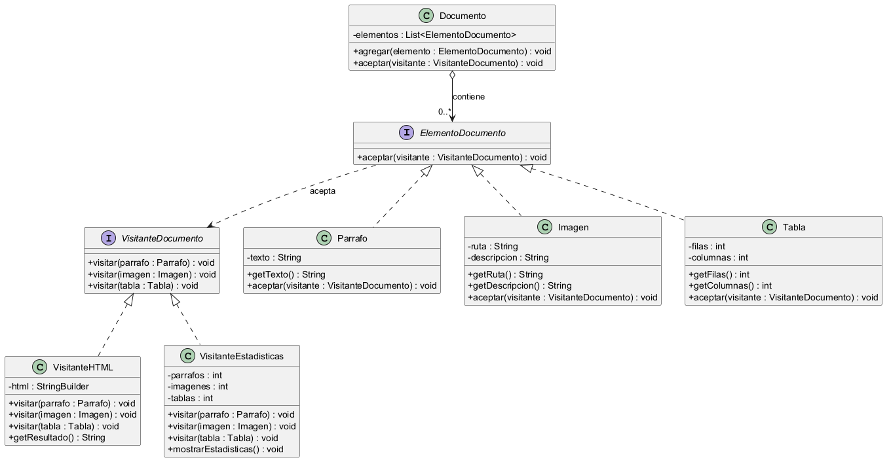
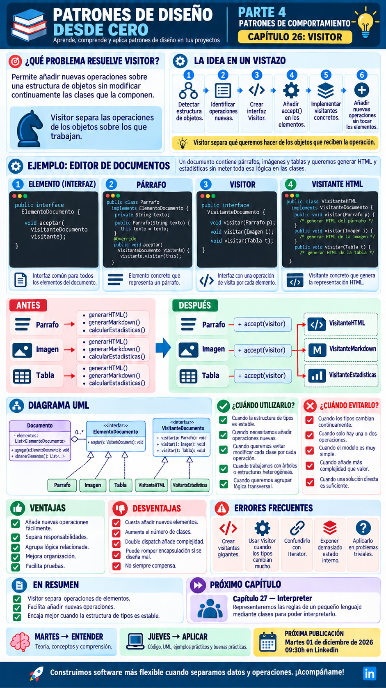

# 📚 Patrones de Diseño desde Cero

> **Aprende a diseñar software mantenible con ejemplos reales.**

# 📖 Capítulo 26 - Visitor

> **📚 Patrones de Diseño desde Cero**  
> **🔄 Parte IV - Patrones de Comportamiento**

---

## 🧠 Introducción

Continuamos nuestro recorrido por los **patrones de comportamiento**.

Hasta ahora hemos estudiado:

### 🎯 Strategy

> ¿Cómo podemos intercambiar algoritmos o comportamientos sin modificar el contexto que los utiliza?

### 👀 Observer

> ¿Cómo podemos notificar automáticamente a varios objetos cuando cambia el estado de otro?

### 🎮 Command

> ¿Cómo podemos encapsular una operación dentro de un objeto?

### 🔁 State

> ¿Cómo podemos cambiar el comportamiento de un objeto según su estado interno?

### 🧩 Template Method

> ¿Cómo podemos definir la estructura de un algoritmo y personalizar algunos pasos?

### ⛓️ Chain of Responsibility

> ¿Cómo podemos pasar una petición por una cadena de manejadores?

### 🤝 Mediator

> ¿Cómo podemos centralizar la comunicación entre varios objetos?

### 💾 Memento

> ¿Cómo podemos guardar y restaurar el estado interno de un objeto sin romper su encapsulación?

### 🔄 Iterator

> ¿Cómo podemos recorrer una colección sin conocer cómo están almacenados sus elementos?

Ahora nos encontramos con un problema diferente.

Imaginemos que estamos desarrollando un editor de documentos.

Un documento puede contener:

```text
Documento
    │
    ├── Párrafo
    ├── Imagen
    ├── Tabla
    └── Párrafo
```

Cada elemento tiene características y responsabilidades diferentes.

Por ejemplo:

**Párrafo**

```text
Texto
Formato
Alineación
```

**Imagen**

```text
Ruta
Descripción
Dimensiones
```

**Tabla**

```text
Filas
Columnas
Contenido
```

Hasta aquí, nuestro modelo parece razonable.

Pero ahora necesitamos realizar diferentes operaciones sobre esos elementos.

Por ejemplo:

```text
Generar HTML
Exportar Markdown
Calcular estadísticas
Validar contenido
Generar informes
```

Una primera solución podría consistir en añadir todos esos métodos directamente a las clases.

Pero ¿qué ocurrirá cuando aparezcan nuevas operaciones?

¿Tendremos que modificar continuamente todas las clases del documento?

La pregunta será:

> **¿Cómo podemos añadir nuevas operaciones sobre una estructura de objetos sin modificar constantemente las clases que la componen?**

Aquí aparece:

# 🧳 Visitor

Visitor permite separar determinados algoritmos u operaciones de los objetos sobre los que trabajan.

En lugar de incorporar todas las operaciones dentro de las clases de elementos, podemos representarlas mediante objetos visitantes independientes.

---

# 🎯 Objetivos de aprendizaje

Al finalizar este capítulo deberías ser capaz de:

- Comprender qué problema intenta resolver Visitor.
- Identificar estructuras de objetos con múltiples tipos de elementos.
- Reconocer cuándo las operaciones están creciendo más que los tipos de elementos.
- Comprender qué significa separar operaciones de estructuras de datos.
- Identificar los participantes `Visitor`, `ConcreteVisitor`, `Element` y `ConcreteElement`.
- Implementar Visitor en Java.
- Comprender el mecanismo `accept()` y `visit()`.
- Entender el concepto de doble despacho (*double dispatch*).
- Añadir nuevas operaciones mediante nuevos visitantes.
- Reconocer las limitaciones de Visitor al incorporar nuevos tipos de elementos.
- Comprender su relación con el principio abierto/cerrado.
- Diferenciar Visitor de Iterator.
- Diferenciar Visitor de Strategy.
- Diferenciar Visitor de Composite.
- Analizar sus ventajas y desventajas.
- Evitar visitantes que acumulen responsabilidades innecesarias.
- Identificar cuándo una solución más sencilla resulta suficiente.

---

# ❌ El problema

Imaginemos una interfaz que representa cualquier elemento de un documento.

```java
public interface ElementoDocumento {
}
```

Y tres implementaciones:

```java
public class Parrafo implements ElementoDocumento {

    private final String texto;

    public Parrafo(String texto) {
        this.texto = texto;
    }

    public String getTexto() {
        return texto;
    }
}
```

```java
public class Imagen implements ElementoDocumento {

    private final String ruta;

    public Imagen(String ruta) {
        this.ruta = ruta;
    }

    public String getRuta() {
        return ruta;
    }
}
```

```java
public class Tabla implements ElementoDocumento {

    private final int filas;
    private final int columnas;

    public Tabla(int filas, int columnas) {
        this.filas = filas;
        this.columnas = columnas;
    }

    public int getFilas() {
        return filas;
    }

    public int getColumnas() {
        return columnas;
    }
}
```

Tenemos una estructura formada por diferentes objetos.

Ahora queremos exportarla a HTML.

Podríamos añadir a cada clase:

```java
String generarHTML();
```

Por ejemplo:

```java
public class Parrafo implements ElementoDocumento {

    private final String texto;

    public String generarHTML() {
        return "<p>" + texto + "</p>";
    }
}
```

La solución parece sencilla.

Pero pronto aparecen nuevos requisitos.

---

# 📈 El problema crece

Ahora queremos:

```text
Generar HTML
Exportar Markdown
Calcular estadísticas
Validar contenido
Generar texto plano
```

Nuestra interfaz podría terminar así:

```java
public interface ElementoDocumento {

    String generarHTML();

    String generarMarkdown();

    String generarTextoPlano();

    void calcularEstadisticas();

    boolean validar();
}
```

Y todas las implementaciones tendrían que incorporar esos métodos.

Conceptualmente:

```text
Parrafo
    ├── generarHTML()
    ├── generarMarkdown()
    ├── generarTextoPlano()
    ├── calcularEstadisticas()
    └── validar()

Imagen
    ├── generarHTML()
    ├── generarMarkdown()
    ├── generarTextoPlano()
    ├── calcularEstadisticas()
    └── validar()

Tabla
    ├── generarHTML()
    ├── generarMarkdown()
    ├── generarTextoPlano()
    ├── calcularEstadisticas()
    └── validar()
```

Cada vez que aparece una operación nueva, debemos modificar las clases de elementos.

---

# ⚠️ ¿Qué problemas aparecen?

Las clases empiezan a acumular responsabilidades.

Por ejemplo:

```text
Parrafo
    │
    ├── representa contenido
    ├── genera HTML
    ├── genera Markdown
    ├── calcula estadísticas
    └── valida exportaciones
```

Pero no todas esas responsabilidades pertenecen necesariamente al modelo de un párrafo.

Aparecen problemas como:

- Clases con demasiadas responsabilidades.
- Acoplamiento entre el modelo y las operaciones externas.
- Modificaciones repetidas en muchas clases.
- Mayor dificultad para incorporar operaciones.
- Código más difícil de mantener.
- Mayor riesgo de introducir errores.

El problema principal es:

> **Las operaciones que realizamos sobre los objetos están demasiado mezcladas con las clases que representan esos objetos.**

---

# 💡 Motivación

Queremos separar dos conceptos.

## 1️⃣ Elementos

Representan los datos y el comportamiento propio de cada objeto.

Por ejemplo:

```text
Parrafo
Imagen
Tabla
```

## 2️⃣ Operaciones

Representan las acciones adicionales que queremos realizar.

Por ejemplo:

```text
GenerarHTML
CalcularEstadisticas
ExportarMarkdown
```

En lugar de:

```text
Parrafo
    ├── generarHTML()
    ├── generarMarkdown()
    └── calcularEstadisticas()
```

queremos:

```text
Parrafo
    │
    ▼
Visitor
    │
    ├── HTMLVisitor
    ├── EstadisticasVisitor
    └── MarkdownVisitor
```

Cada visitante encapsula una operación sobre los diferentes tipos de elementos.

---

# 🧳 La solución

Visitor introduce una interfaz que declara una operación para cada tipo concreto de elemento.

Por ejemplo:

```java
public interface VisitanteDocumento {

    void visitar(Parrafo parrafo);

    void visitar(Imagen imagen);

    void visitar(Tabla tabla);
}
```

Ahora podemos crear distintos visitantes.

```text
    VisitanteDocumento
             ▲
             │
    ┌────────┴──────────┐
    │                   │
HTMLVisitor     EstadisticasVisitor
```

Cada visitante implementa la operación correspondiente a cada tipo de elemento.

Los elementos, por su parte, incorporan un método común:

```java
void aceptar(VisitanteDocumento visitante);
```

Este método permite que el elemento reciba al visitante.

---

# 🧱 Participantes del patrón

Visitor suele incluir cinco participantes principales.

## 1️⃣ Visitor

Define el contrato de las operaciones que pueden realizarse sobre los diferentes elementos.

En nuestro ejemplo:

```java
VisitanteDocumento
```

---

## 2️⃣ ConcreteVisitor

Implementa una operación concreta.

Por ejemplo:

```text
VisitanteHTML
VisitanteEstadisticas
```

---

## 3️⃣ Element

Define el método que permite aceptar visitantes.

Por ejemplo:

```java
public interface ElementoDocumento {

    void aceptar(VisitanteDocumento visitante);
}
```

---

## 4️⃣ ConcreteElement

Representa los tipos concretos de elementos.

En nuestro ejemplo:

```text
Parrafo
Imagen
Tabla
```

Cada uno implementa:

```java
aceptar(...)
```

---

## 5️⃣ ObjectStructure

Representa la estructura que contiene los elementos.

En nuestro ejemplo:

```text
Documento
```

Puede almacenar una colección de:

```java
ElementoDocumento
```

y permitir aplicar un visitante sobre todos ellos.

---

# ☕ Implementación en Java

Vamos a construir un ejemplo completo.

Tendremos:

```text
ElementoDocumento
Parrafo
Imagen
Tabla
VisitanteDocumento
VisitanteHTML
VisitanteEstadisticas
Documento
Main
```

El objetivo es poder añadir nuevas operaciones sin modificar las clases de elementos existentes.

---

# 🧩 Element - ElementoDocumento.java

```java
public interface ElementoDocumento {

    void aceptar(VisitanteDocumento visitante);
}
```

Esta interfaz define el contrato común de todos los elementos del documento.

El método:

```java
aceptar(...)
```

será fundamental para implementar Visitor.

---

# 📄 ConcreteElement - Parrafo.java

```java
public class Parrafo implements ElementoDocumento {

    private final String texto;

    public Parrafo(String texto) {
        this.texto = texto;
    }

    public String getTexto() {
        return texto;
    }

    @Override
    public void aceptar(VisitanteDocumento visitante) {
        visitante.visitar(this);
    }
}
```

Observa:

```java
visitante.visitar(this);
```

El objeto `Parrafo` recibe un visitante y le permite realizar la operación correspondiente.

---

# 🖼️ ConcreteElement - Imagen.java

```java
public class Imagen implements ElementoDocumento {

    private final String ruta;
    private final String descripcion;

    public Imagen(String ruta, String descripcion) {
        this.ruta = ruta;
        this.descripcion = descripcion;
    }

    public String getRuta() {
        return ruta;
    }

    public String getDescripcion() {
        return descripcion;
    }

    @Override
    public void aceptar(VisitanteDocumento visitante) {
        visitante.visitar(this);
    }
}
```

La estructura es similar a `Parrafo`.

Pero ahora:

```java
this
```

representa un objeto `Imagen`.

---

# 📊 ConcreteElement - Tabla.java

Para mantener el ejemplo sencillo, representaremos una tabla mediante su número de filas y columnas.

```java
public class Tabla implements ElementoDocumento {

    private final int filas;
    private final int columnas;

    public Tabla(int filas, int columnas) {
        this.filas = filas;
        this.columnas = columnas;
    }

    public int getFilas() {
        return filas;
    }

    public int getColumnas() {
        return columnas;
    }

    @Override
    public void aceptar(VisitanteDocumento visitante) {
        visitante.visitar(this);
    }
}
```

Cada tipo de elemento implementa el mismo método:

```java
aceptar(...)
```

Pero la llamada:

```java
visitante.visitar(this);
```

seleccionará la sobrecarga correspondiente al tipo concreto.

---

# 🧳 Visitor - VisitanteDocumento.java

```java
public interface VisitanteDocumento {

    void visitar(Parrafo parrafo);

    void visitar(Imagen imagen);

    void visitar(Tabla tabla);
}
```

Esta interfaz define las operaciones que cada visitante deberá implementar.

Tenemos tres métodos:

```text
visitar(Parrafo)
visitar(Imagen)
visitar(Tabla)
```

Cada uno corresponde a un tipo concreto de elemento.

---

# 🌐 ConcreteVisitor - VisitanteHTML.java

Crearemos un visitante que genere HTML.

```java
public class VisitanteHTML implements VisitanteDocumento {

    private final StringBuilder html = new StringBuilder();

    @Override
    public void visitar(Parrafo parrafo) {
        html.append("<p>")
            .append(escapar(parrafo.getTexto()))
            .append("</p>\n");
    }

    @Override
    public void visitar(Imagen imagen) {
        html.append("\n");
    }

    @Override
    public void visitar(Tabla tabla) {
        html.append("<table>\n");

        for (int i = 0; i < tabla.getFilas(); i++) {

            html.append("  <tr>\n");

            for (int j = 0;
                    j < tabla.getColumnas();
                    j++) {

                html.append("    <td></td>\n");
            }

            html.append("  </tr>\n");
        }

        html.append("</table>\n");
    }

    public String getResultado() {
        return html.toString();
    }

    private String escapar(String valor) {

        return valor
            .replace("&", "&amp;")
            .replace("<", "&lt;")
            .replace(">", "&gt;")
            .replace("\"", "&quot;")
            .replace("'", "&#39;");
    }
}
```

Cada método implementa una operación distinta según el tipo de elemento.

Por ejemplo:

```java
visitar(Parrafo)
```

genera:

```html
<p>Texto del párrafo</p>
```

Mientras que:

```java
visitar(Imagen)
```

genera:

```html

```

Y:

```java
visitar(Tabla)
```

genera la estructura HTML de una tabla.

**Importante:** este es un exportador didáctico. En una aplicación real sería necesario validar las rutas y completar otras reglas propias de la generación segura de documentos HTML.

---

# 📈 ConcreteVisitor - VisitanteEstadisticas.java

Ahora crearemos otro visitante.

Pero esta vez no generaremos HTML.

Nuestro objetivo será calcular:

```text
Número de párrafos
Número de imágenes
Número de tablas
```

```java
public class VisitanteEstadisticas implements VisitanteDocumento {

    private int parrafos = 0;
    private int imagenes = 0;
    private int tablas = 0;

    @Override
    public void visitar(Parrafo parrafo) {
        parrafos++;
    }

    @Override
    public void visitar(Imagen imagen) {
        imagenes++;
    }

    @Override
    public void visitar(Tabla tabla) {
        tablas++;
    }

    public void mostrarEstadisticas() {
        System.out.println("📊 ESTADÍSTICAS DEL DOCUMENTO");
        System.out.println("Párrafos: " + parrafos);
        System.out.println("Imágenes: " + imagenes);
        System.out.println("Tablas: " + tablas);
    }
}
```

Observa algo muy importante.

No hemos modificado:

```text
Parrafo
Imagen
Tabla
```

para añadir esta nueva operación.

Simplemente hemos creado otra implementación de:

```java
VisitanteDocumento
```

---

# 📚 ObjectStructure - Documento.java

Necesitamos una clase que contenga los elementos.

```java
import java.util.ArrayList;
import java.util.List;

public class Documento {

    private final List<ElementoDocumento> elementos = new ArrayList<>();

    public void agregar(ElementoDocumento elemento) {
        elementos.add(elemento);
    }

    public void aceptar(VisitanteDocumento visitante) {

        for (ElementoDocumento elemento : elementos) {
            elemento.aceptar(visitante);
        }
    }
}
```

Esta clase mantiene una colección de:

```java
ElementoDocumento
```

Cuando recibe un visitante:

```java
documento.aceptar(visitante);
```

recorre los elementos y aplica el visitante a cada uno.

En este punto también estamos aprovechando una idea vista anteriormente:

> **Iterator permite recorrer los elementos; Visitor permite ejecutar operaciones sobre ellos.**

---

# ▶️ Cliente - Main.java

```java
public class Main {

    public static void main(String[] args) {

        Documento documento = new Documento();

        documento.agregar(
            new Parrafo("Patrones de Diseño desde Cero")
        );

        documento.agregar(
            new Imagen(
                "portada.png",
                "Portada del documento"
            )
        );

        documento.agregar(
            new Tabla(2, 3)
        );

        documento.agregar(
            new Parrafo(
                "Aprendiendo el patrón Visitor"
            )
        );

        // Primera operación: generar HTML

        VisitanteHTML html = new VisitanteHTML();

        documento.aceptar(html);

        System.out.println("🌐 DOCUMENTO HTML");

        System.out.println(
            html.getResultado()
        );

        // Segunda operación: estadísticas

        VisitanteEstadisticas estadisticas = new VisitanteEstadisticas();

        documento.aceptar(estadisticas);

        estadisticas.mostrarEstadisticas();
    }
}
```

---

# 📤 Posible salida

```text
🌐 DOCUMENTO HTML

<p>Patrones de Diseño desde Cero</p>


<table>
  <tr>
    <td></td>
    <td></td>
    <td></td>
  </tr>
  <tr>
    <td></td>
    <td></td>
    <td></td>
  </tr>
</table>

<p>Aprendiendo el patrón Visitor</p>


📊 ESTADÍSTICAS DEL DOCUMENTO

Párrafos: 2
Imágenes: 1
Tablas: 1
```

Hemos aplicado:

```text
Generación HTML
```

y:

```text
Cálculo de estadísticas
```

sobre los mismos elementos.

Sin modificar sus clases para cada nueva operación.

---

# 🔎 Explicación paso a paso

## 1️⃣ Definimos los elementos

Tenemos:

```text
Parrafo
Imagen
Tabla
```

Todos implementan:

```java
ElementoDocumento
```

---

## 2️⃣ Definimos el Visitor

```java
VisitanteDocumento
```

declara una operación para cada tipo de elemento.

---

## 3️⃣ Creamos visitantes concretos

```text
VisitanteHTML
VisitanteEstadisticas
```

Cada uno representa una operación diferente.

---

## 4️⃣ Creamos la estructura

```java
Documento documento = new Documento();
```

Y añadimos los elementos.

---

## 5️⃣ Seleccionamos una operación

Por ejemplo:

```java
VisitanteHTML html =
        new VisitanteHTML();
```

---

## 6️⃣ Aplicamos el visitante

```java
documento.aceptar(html);
```

---

## 7️⃣ Documento recorre sus elementos

```java
for (ElementoDocumento elemento : elementos) {

    elemento.aceptar(visitante);
}
```

---

## 8️⃣ Cada elemento llama al visitante

Por ejemplo:

```java
visitante.visitar(this);
```

---

## 9️⃣ Se ejecuta el método específico

Dependiendo del elemento:

```text
visitar(Parrafo)
visitar(Imagen)
visitar(Tabla)
```

---

# 📊 UML

Podemos representar el patrón mediante PlantUML.



Conceptualmente:

```text
                 Visitor
                    ▲
          ┌─────────┴──────────┐
          │                    │
       HTMLVisitor      EstadisticasVisitor
          │                    │
          └─────────┬──────────┘
                    │
                  visita
                    │
                    ▼
                 Element
                    ▲
          ┌─────────┼─────────┐
          │         │         │
        Parrafo    Imagen     Tabla
```

---

# 🔑 La idea clave

Visitor separa:

```text
ESTRUCTURA DE OBJETOS
```

de:

```text
OPERACIONES SOBRE ESOS OBJETOS
```

Los elementos mantienen:

```text
datos
+
comportamiento propio
```

Los visitantes contienen:

```text
operaciones adicionales
```

Esto nos permite añadir nuevas operaciones creando nuevos visitantes.

---

# 🧠 ¿Qué es el doble despacho?

Uno de los conceptos más importantes de Visitor es el:

# 🔄 Double Dispatch

O:

> **Doble despacho.**

Para entenderlo debemos recordar cómo Java selecciona los métodos.

---

# 🔹 Despacho simple

Imaginemos:

```java
ElementoDocumento elemento = new Parrafo("Hola");
```

Aunque el objeto real es:

```text
Parrafo
```

la variable está declarada como:

```java
ElementoDocumento
```

Ahora tenemos:

```java
elemento.aceptar(visitante);
```

Java utiliza el tipo real del objeto receptor para seleccionar la implementación sobrescrita de `aceptar()`.

En este caso:

```java
Parrafo.aceptar(...)
```

---

# 🔹 Segundo despacho mediante sobrecarga

Dentro de `Parrafo` tenemos:

```java
@Override
public void aceptar(VisitanteDocumento visitante) {
    visitante.visitar(this);
}
```

Aquí:

```java
this
```

tiene tipo estático:

```text
Parrafo
```

Por eso la sobrecarga seleccionada es:

```java
visitar(Parrafo)
```

Y el objeto visitante concreto determina qué implementación ejecutará.

Por ejemplo:

```text
VisitanteHTML
```

o:

```text
VisitanteEstadisticas
```

---

# 🔄 ¿Cómo funciona Double Dispatch?

Conceptualmente:

```text
Cliente
   │
   ▼
elemento.aceptar(visitor)
   │
   ▼
Parrafo.aceptar(visitor)
   │
   ▼
visitor.visitar(this)
   │
   ▼
VisitanteHTML.visitar(Parrafo)
```

El resultado depende de dos participantes:

```text
Tipo concreto del elemento
            +
Tipo concreto del visitante
```

---

# 🧪 Ejemplo del doble despacho

Tenemos:

```java
ElementoDocumento elemento =
        new Imagen(
            "foto.png",
            "Fotografía"
        );
```

Y:

```java
VisitanteDocumento visitante = new VisitanteHTML();
```

Ejecutamos:

```java
elemento.aceptar(visitante);
```

Primero se ejecuta:

```java
Imagen.aceptar(...)
```

Después:

```java
visitante.visitar(this);
```

Y finalmente:

```java
VisitanteHTML.visitar(Imagen)
```

Por tanto:

> **Visitor permite seleccionar el comportamiento según el tipo concreto del elemento y del visitante, combinando despacho dinámico y sobrecarga de métodos.**

---

# ⚠️ Java no tiene despacho múltiple general

Es importante aclarar algo.

Java utiliza normalmente:

```text
despacho dinámico sobre el receptor
```

pero la selección de métodos sobrecargados depende de los tipos conocidos durante la compilación.

Por ejemplo:

```java
void visitar(ElementoDocumento elemento);

void visitar(Parrafo parrafo);
```

Si hacemos:

```java
ElementoDocumento elemento = new Parrafo("Hola");

visitante.visitar(elemento);
```

la sobrecarga seleccionada dependerá del tipo declarado de `elemento`, no únicamente de su tipo real.

Por eso Visitor utiliza:

```java
aceptar(...)
```

como mecanismo para recuperar el tipo concreto del elemento.

---

# 🔄 Antes y después

## ❌ Antes - Operaciones dentro de los elementos

```text
Parrafo
    ├── generarHTML()
    ├── generarMarkdown()
    └── calcularEstadisticas()

Imagen
    ├── generarHTML()
    ├── generarMarkdown()
    └── calcularEstadisticas()

Tabla
    ├── generarHTML()
    ├── generarMarkdown()
    └── calcularEstadisticas()
```

Cada operación nueva puede obligarnos a modificar todas las clases.

---

## ✅ Después - Con Visitor

```text
 ELEMENTOS

  Parrafo
  Imagen
  Tabla

    │
    ▼

 VISITOR

    │
    ├── VisitanteHTML
    ├── VisitanteMarkdown
    └── VisitanteEstadisticas
```

Las operaciones quedan agrupadas en visitantes independientes.

---

# ➕ Añadir una nueva operación

Supongamos que ahora necesitamos exportar:

```text
Markdown
```

Podemos crear:

```java
public class VisitanteMarkdown implements VisitanteDocumento {

    private final StringBuilder markdown = new StringBuilder();

    @Override
    public void visitar(Parrafo parrafo) {
        markdown.append(parrafo.getTexto()).append("\n\n");
    }

    @Override
    public void visitar(Imagen imagen) {
        markdown.append("
            .append(imagen.getRuta())
            .append(")\n\n");
    }

    @Override
    public void visitar(Tabla tabla) {
        markdown.append(
            "Tabla: "
            + tabla.getFilas()
            + " filas y "
            + tabla.getColumnas()
            + " columnas\n\n"
        );
    }

    public String getResultado() {
        return markdown.toString();
    }
}
```

Esta implementación utiliza una representación simplificada de las tablas para centrarnos en el patrón.

Ahora podemos hacer:

```java
VisitanteMarkdown markdown = new VisitanteMarkdown();
documento.aceptar(markdown);
System.out.println(markdown.getResultado());
```

No hemos necesitado modificar:

```text
Parrafo
Imagen
Tabla
Documento
```

Solo hemos añadido un nuevo visitante.

---

# ⚠️ ¿Qué ocurre al añadir un nuevo elemento?

Aquí aparece una de las principales limitaciones de Visitor.

Supongamos que añadimos:

```text
Video
```

al documento.

Creamos:

```java
public class Video implements ElementoDocumento {

    @Override
    public void aceptar(VisitanteDocumento visitante) {
        visitante.visitar(this);
    }
}
```

Pero nuestra interfaz:

```java
VisitanteDocumento
```

todavía no dispone de:

```java
void visitar(Video video);
```

Por tanto, la implementación anterior no compilará.

Necesitamos añadir ese método:

```java
public interface VisitanteDocumento {
    void visitar(Parrafo parrafo);
    void visitar(Imagen imagen);
    void visitar(Tabla tabla);
    void visitar(Video video);
}
```

Y modificar todos los visitantes existentes para implementar la nueva operación.

Por ejemplo:

```text
VisitanteHTML
VisitanteMarkdown
VisitanteEstadisticas
```

---

# ⚖️ El intercambio fundamental de Visitor

Visitor facilita:

```text
AÑADIR OPERACIONES
```

pero puede dificultar:

```text
AÑADIR TIPOS DE ELEMENTOS
```

Por eso suele resultar especialmente adecuado cuando:

> **La estructura de tipos es relativamente estable, pero esperamos incorporar nuevas operaciones con frecuencia.**

Este es uno de los criterios más importantes para decidir si debemos utilizar Visitor.

---

# 🧩 Visitor y Open/Closed Principle

Visitor está muy relacionado con el principio:

> **Abierto para extensión, cerrado para modificación.**

Sin embargo, conviene entender sus límites.

## Añadir una operación

Podemos incorporar:

```text
VisitanteHTML
VisitanteMarkdown
VisitanteEstadisticas
```

sin modificar las clases de elementos.

En este sentido, el diseño resulta extensible.

## Añadir un tipo de elemento

Si incorporamos:

```text
Video
```

debemos ampliar:

```java
VisitanteDocumento
```

y adaptar todos sus visitantes concretos.

Por tanto:

> **Visitor favorece la extensión por operaciones, pero no necesariamente la extensión por tipos de elementos.**

No existe una solución universalmente mejor.

Depende de qué dimensión cambie con más frecuencia.

---

# 🔄 Visitantes con estado

Un visitante puede mantener información durante el recorrido.

Por ejemplo:

```java
private int parrafos = 0;
```

o:

```java
private final StringBuilder html;
```

Esto permite acumular resultados.

Pero debemos tener en cuenta su ciclo de vida.

Si reutilizamos:

```java
VisitanteEstadisticas
```

sobre varios documentos, las estadísticas seguirán acumulándose salvo que implementemos un mecanismo de reinicio o creemos un visitante nuevo.

Por tanto, conviene definir claramente:

```text
Una operación → un visitante nuevo
```

cuando ese sea el comportamiento deseado.

---

# 🏗️ Caso de uso: editores de documentos

Es nuestro ejemplo principal.

Podemos realizar operaciones sobre:

```text
Párrafos
Imágenes
Tablas
Encabezados
Enlaces
```

como:

```text
Exportar
Validar
Analizar
Generar estadísticas
```

sin mezclar necesariamente esas responsabilidades con las clases del modelo.

---

# 🌳 Caso de uso: árboles sintácticos

Visitor es especialmente interesante en compiladores e intérpretes.

Imaginemos un árbol de expresiones:

```text
       Suma
       /  \
      5  Multiplicar
          /      \
         2        3
```

Podemos tener diferentes visitantes:

```text
EvaluarExpresionVisitor
ImprimirExpresionVisitor
ValidarExpresionVisitor
GenerarCodigoVisitor
```

Cada uno realiza una operación diferente sobre los mismos nodos.

Este es uno de los ejemplos más representativos de Visitor.

---

# 🧮 Caso de uso: expresiones matemáticas

Imaginemos elementos como:

```text
Numero
Suma
Resta
Multiplicacion
Division
```

Podríamos añadir operaciones como:

```text
Evaluar
Simplificar
Mostrar
Convertir a otra notación
```

mediante visitantes independientes.

---

# 🧾 Caso de uso: generación de informes

Un sistema empresarial puede contener:

```text
Factura
Pedido
Albaran
Presupuesto
```

Y necesitar diferentes operaciones:

```text
Exportar
Validar
Calcular estadísticas
Generar resumen
```

Visitor puede resultar útil si esas operaciones son realmente transversales a los diferentes tipos de documentos y su estructura permanece estable.

---

# 🎮 Caso de uso: videojuegos

Podemos tener:

```text
Jugador
Enemigo
Objeto
Obstaculo
```

Y operaciones como:

```text
Generar estadísticas
Inspeccionar escena
Exportar estado
Detectar determinados elementos
```

Visitor podría permitir añadir determinadas operaciones sin modificar continuamente las entidades.

Sin embargo, no debería utilizarse para trasladar indiscriminadamente toda la lógica del juego a visitantes.

---

# 🛠️ Caso de uso: herramientas de análisis

Imaginemos un analizador de código fuente.

Tenemos:

```text
Clase
Metodo
Variable
Expresion
```

Y queremos ejecutar:

```text
Análisis de complejidad
Detección de errores
Generación de documentación
Métricas de calidad
```

Visitor permite organizar esas operaciones en componentes especializados.

---

# 🎯 ¿Cuándo utilizar Visitor?

Visitor puede resultar adecuado cuando:

- Tenemos una estructura de objetos con varios tipos concretos.
- La estructura de tipos es relativamente estable.
- Necesitamos añadir nuevas operaciones frecuentemente.
- Queremos evitar modificar cada clase al incorporar una operación.
- Las operaciones son independientes del comportamiento principal de los elementos.
- Queremos agrupar una misma operación sobre diferentes tipos de objetos.
- Trabajamos con árboles sintácticos.
- Necesitamos analizadores, exportadores o generadores.
- Queremos separar algoritmos transversales del modelo.
- Necesitamos operaciones que dependan del tipo concreto de elemento.

---

# 🚫 ¿Cuándo evitarlo?

Probablemente no necesitamos Visitor cuando:

- Solo existe un tipo de elemento.
- Tenemos pocas operaciones.
- Los tipos de elementos cambian constantemente.
- Añadimos nuevas clases con mucha frecuencia.
- El doble despacho introduce complejidad innecesaria.
- Una operación sencilla puede resolverse con un método normal.
- Los visitantes necesitan acceder a demasiados detalles internos.
- El diseño resulta más difícil de comprender que la solución directa.
- Estamos creando una jerarquía artificial sin una necesidad real.

---

# ✅ Ventajas

## 🔹 Facilita añadir operaciones

Podemos crear nuevos visitantes.

---

## 🔹 Separa responsabilidades

Las clases de elementos no necesitan incorporar todas las operaciones externas.

---

## 🔹 Agrupa operaciones relacionadas

Por ejemplo:

```text
VisitanteHTML
```

contiene toda la lógica de generación HTML.

---

## 🔹 Reduce modificaciones repetidas

Podemos añadir operaciones sin cambiar cada elemento existente.

---

## 🔹 Permite acumular resultados

Un visitante puede mantener estadísticas o información de recorrido.

---

## 🔹 Favorece la organización

Las operaciones transversales quedan agrupadas en clases especializadas.

---

## 🔹 Facilita pruebas independientes

Podemos probar cada visitante por separado.

---

# ❌ Desventajas

## 🔸 Dificulta añadir nuevos elementos

Cada nuevo tipo puede obligar a modificar todos los visitantes.

---

## 🔸 Introduce complejidad

El doble despacho no siempre resulta intuitivo.

---

## 🔸 Puede aumentar el número de clases

Por ejemplo:

```text
VisitanteHTML
VisitanteMarkdown
VisitanteXML
VisitanteEstadisticas
VisitanteValidacion
...
```

---

## 🔸 Puede romper encapsulación

Si los visitantes necesitan conocer demasiados detalles internos de los elementos.

---

## 🔸 Puede generar interfaces grandes

Si existen muchos tipos de elementos:

```java
VisitanteDocumento
```

podría contener numerosas operaciones.

---

## 🔸 Puede dificultar la evolución del modelo

Un cambio importante en la jerarquía puede afectar a numerosos visitantes.

---

# ⚠️ Visitor no significa mover todos los métodos a visitantes

Una clase debe seguir siendo responsable de su propio comportamiento.

Por ejemplo:

```java
Parrafo
```

puede seguir teniendo:

```java
getTexto()
```

o métodos propios relacionados con su representación.

Visitor resulta útil para operaciones adicionales y transversales.

No deberíamos convertir las clases de dominio en simples contenedores de datos sin comportamiento por aplicar el patrón indiscriminadamente.

---

# ⚠️ Visitor no elimina completamente el acoplamiento

Los elementos conocen:

```java
VisitanteDocumento
```

Y los visitantes conocen los tipos concretos:

```text
Parrafo
Imagen
Tabla
```

Por tanto, Visitor reorganiza las dependencias.

No las elimina por completo.

La pregunta importante es:

> **¿La nueva distribución de responsabilidades facilita realmente la evolución del sistema?**

---

# ⚠️ Cuidado con la encapsulación

Si un visitante necesita acceder a:

```text
todos los atributos privados
```

de cada elemento, podríamos terminar exponiendo demasiada información.

Preferiblemente, cada elemento debería proporcionar las operaciones de consulta necesarias.

Por ejemplo:

```java
getTexto()
```

en lugar de exponer directamente:

```java
public String texto;
```

---

# 🚨 Errores frecuentes

## ❌ Aplicar Visitor a estructuras inestables

Si añadimos nuevos tipos constantemente, tendremos que modificar todos los visitantes.

---

## ❌ Crear visitantes para operaciones triviales

Puede añadir más complejidad que valor.

---

## ❌ Romper encapsulación

Los visitantes no deberían necesitar acceso indiscriminado al estado interno.

---

## ❌ Confundir Visitor con Iterator

Iterator recorre.

Visitor realiza operaciones sobre elementos.

---

## ❌ Crear visitantes gigantes

Un visitante con demasiadas responsabilidades puede convertirse en un nuevo problema.

---

## ❌ Ignorar el doble despacho

Sin comprender:

```java
aceptar(...)
```

y:

```java
visitar(...)
```

es fácil implementar incorrectamente el patrón.

---

## ❌ Reutilizar visitantes con estado sin control

Las estadísticas o resultados pueden acumularse de forma inesperada.

---

# 🧠 Buenas prácticas

## 1️⃣ Utiliza Visitor cuando los tipos sean estables

Es especialmente adecuado cuando esperamos añadir más operaciones que tipos.

---

## 2️⃣ Mantén visitantes cohesionados

Cada visitante debería representar una responsabilidad clara.

Por ejemplo:

```text
VisitanteHTML
```

no debería gestionar simultáneamente:

```text
seguridad
persistencia
estadísticas
notificaciones
```

---

## 3️⃣ Respeta la encapsulación

Proporciona únicamente los datos necesarios.

---

## 4️⃣ Mantén sencillo el método accept()

Normalmente:

```java
@Override
public void aceptar(VisitanteDocumento visitante) {
    visitante.visitar(this);
}
```

es suficiente.

---

## 5️⃣ Evita jerarquías innecesarias

No necesitamos Visitor para cualquier conjunto de clases.

---

## 6️⃣ Controla el ciclo de vida del visitante

Especialmente si mantiene estado interno.

---

## 7️⃣ Considera alternativas modernas de Java

En determinados diseños, especialmente con jerarquías cerradas, las clases `sealed` y el reconocimiento de patrones pueden ofrecer soluciones alternativas.

Por ejemplo, un `switch` sobre tipos en versiones modernas de Java puede simplificar ciertas operaciones.

Sin embargo, debemos valorar qué ocurre cuando añadimos nuevas operaciones o nuevos tipos.

---

# ☕ Visitor y Java moderno

Desde Java 21, podemos utilizar capacidades modernas como:

```java
sealed interface ElementoDocumento permits Parrafo, Imagen, Tabla {
}
```

Esto permite declarar explícitamente los tipos admitidos en una jerarquía cerrada.

También podemos utilizar reconocimiento de patrones mediante `switch`.

Conceptualmente:

```java
static String describir(ElementoDocumento elemento) {

    return switch (elemento) {

        case Parrafo p -> "Párrafo: " + p.getTexto();

        case Imagen i -> "Imagen: " + i.getRuta();

        case Tabla t ->
            "Tabla: "
            + t.getFilas()
            + "x"
            + t.getColumnas();
    };
}
```

Este ejemplo presupone que `Parrafo`, `Imagen` y `Tabla` son los tipos permitidos por la jerarquía `sealed`.

No estamos implementando Visitor clásico.

Estamos utilizando otra característica del lenguaje para resolver una operación basada en tipos.

La elección dependerá del contexto, de la versión de Java y de cómo esperamos que evolucione el modelo.

---

# 🆚 Visitor vs. Iterator

Esta es una de las comparaciones fundamentales.

Ambos patrones pueden utilizarse sobre estructuras de objetos.

Pero sus responsabilidades son diferentes.

| Visitor | Iterator |
|---|---|
| Ejecuta operaciones | Recorre elementos |
| Se centra en qué hacer | Se centra en cómo acceder |
| Utiliza `accept()` y `visit()` | Utiliza `hasNext()` y `next()` |
| Separa operaciones | Separa recorrido |
| Puede depender de tipos concretos | Oculta la estructura de almacenamiento |
| Puede mantener resultados | Mantiene estado de recorrido |

Podemos resumir:

```text
ITERATOR
    ↓
¿CÓMO RECORRO?
```

```text
VISITOR
    ↓
¿QUÉ HAGO CON CADA ELEMENTO?
```

---

# 🤝 Visitor + Iterator

Ambos pueden colaborar.

Por ejemplo:

```java
for (ElementoDocumento elemento : elementos) {

    elemento.aceptar(visitante);
}
```

Iterator proporciona:

```text
el recorrido
```

Visitor proporciona:

```text
la operación
```

Conceptualmente:

```text
Colección
    │
    ▼
Iterator
    │
    ▼
Elemento
    │
    ▼
Visitor
    │
    ▼
Operación
```

---

# 🆚 Visitor vs. Strategy

Ambos permiten encapsular operaciones.

Pero su intención es diferente.

| Visitor | Strategy |
|---|---|
| Opera sobre distintos tipos de elementos | Encapsula algoritmos intercambiables |
| Utiliza doble despacho | Utiliza delegación |
| Suele conocer una jerarquía de elementos | Define una familia de algoritmos |
| Favorece añadir operaciones | Favorece intercambiar algoritmos |
| Suele utilizar `visit()` | Suele utilizar un método común |

Podemos resumir:

```text
STRATEGY
    ↓
¿QUÉ ALGORITMO UTILIZO?
```

```text
VISITOR
    ↓
¿QUÉ HAGO CON CADA TIPO
DE ELEMENTO?
```

---

# 🆚 Visitor vs. Composite

Composite permite representar:

```text
objetos individuales
+
grupos de objetos
```

de forma uniforme.

Visitor permite:

```text
realizar operaciones
```

sobre esos objetos.

Conceptualmente:

```text
COMPOSITE
    ↓
ORGANIZAR UNA ESTRUCTURA
```

```text
VISITOR
    ↓
OPERAR SOBRE ESA ESTRUCTURA
```

Los patrones pueden colaborar.

Por ejemplo, un árbol de componentes Composite puede aceptar visitantes para calcular estadísticas o generar una representación textual.

---

# 🆚 Visitor vs. Template Method

| Visitor | Template Method |
|---|---|
| Separa operaciones de los elementos | Define el esqueleto de un algoritmo |
| Utiliza doble despacho | Utiliza herencia |
| Operaciones sobre tipos diferentes | Pasos personalizables |
| Añadir visitantes es sencillo | Añadir subclases especializa pasos |
| No fija necesariamente un flujo global | Fija el orden general del proceso |

---

# 🆚 Visitor vs. Command

| Visitor | Command |
|---|---|
| Encapsula operaciones sobre tipos de elementos | Encapsula una petición |
| Utiliza `visit()` | Utiliza `execute()` |
| Suele operar sobre estructuras | Representa acciones ejecutables |
| Puede acumular resultados | Puede almacenarse o deshacerse |
| Busca separar operaciones del modelo | Busca separar petición y ejecución |

---

# 🧠 Principios relacionados

Visitor conecta con varios principios importantes.

## 🎯 Responsabilidad única

Podemos separar las operaciones externas de las responsabilidades propias de los elementos.

---

## ➕ Open/Closed Principle

Favorece añadir nuevas operaciones sin modificar las clases de elementos existentes.

Pero añadir nuevos tipos puede requerir modificar los visitantes.

---

## 🧩 Separación de responsabilidades

El modelo representa la estructura.

Los visitantes implementan determinadas operaciones.

---

## 🔒 Encapsulación

Debemos evitar que los visitantes necesiten acceder a detalles privados innecesarios.

---

## 🧱 Programar hacia abstracciones

Los elementos reciben:

```java
VisitanteDocumento
```

en lugar de depender de cada visitante concreto.

---

## 🔄 Polimorfismo

Visitor aprovecha el despacho dinámico y la sobrecarga para seleccionar operaciones específicas.

---

# 📌 Resumen

En este capítulo hemos aprendido que:

- Visitor pertenece a los patrones de comportamiento.
- Permite separar operaciones de las estructuras de objetos sobre las que trabajan.
- `Visitor` define operaciones para los diferentes tipos de elementos.
- `ConcreteVisitor` implementa una operación concreta.
- `Element` proporciona el método `accept()`.
- `ConcreteElement` permite ejecutar la operación correspondiente.
- Una estructura puede contener múltiples tipos de elementos.
- Visitor utiliza doble despacho.
- Podemos añadir nuevas operaciones mediante nuevos visitantes.
- No necesitamos modificar los elementos para cada operación nueva.
- Añadir nuevos tipos de elementos puede obligar a modificar todos los visitantes.
- Visitor resulta especialmente útil cuando los tipos son estables y las operaciones cambian con frecuencia.
- Los visitantes pueden mantener estado y acumular resultados.
- Debemos controlar su ciclo de vida.
- Visitor no elimina todas las dependencias.
- Visitor y Iterator pueden colaborar.
- Iterator se centra en recorrer.
- Visitor se centra en qué operación realizar.
- Visitor y Strategy encapsulan comportamiento con intenciones diferentes.
- No debemos utilizar Visitor si su complejidad supera los beneficios.

La pregunta fundamental de Visitor es:

> **¿Tenemos una estructura de objetos relativamente estable sobre la que necesitamos incorporar nuevas operaciones con frecuencia?**

---

# 🎓 Conclusiones

Visitor introduce una idea muy interesante:

> **Podemos separar lo que son los objetos de determinadas operaciones que queremos realizar sobre ellos.**

Sin Visitor podemos terminar con:

```text
Parrafo
    ├── HTML
    ├── Markdown
    └── Estadisticas

Imagen
    ├── HTML
    ├── Markdown
    └── Estadisticas

Tabla
    ├── HTML
    ├── Markdown
    └── Estadisticas
```

Cada nueva operación afecta a varias clases.

Con Visitor:

```text
Elementos
    │
    ├── Parrafo
    ├── Imagen
    └── Tabla

        │
        ▼

Visitantes
    │
    ├── VisitanteHTML
    ├── VisitanteMarkdown
    └── VisitanteEstadisticas
```

Las operaciones quedan encapsuladas.

Además, podemos aplicar:

```text
un mismo visitante
```

a:

```text
diferentes tipos de elementos
```

mediante:

```java
aceptar(...)
```

y:

```java
visitar(...)
```

Pero esta flexibilidad tiene un precio.

Visitor facilita añadir:

```text
OPERACIONES
```

pero puede dificultar añadir:

```text
TIPOS DE ELEMENTOS
```

Por eso seguimos aplicando nuestra metodología:

```text
PROBLEMA
   ↓
CONTEXTO
   ↓
¿TENEMOS VARIOS
TIPOS DE ELEMENTOS?
   ↓
¿LA ESTRUCTURA ES
RELATIVAMENTE ESTABLE?
   ↓
¿NECESITAMOS AÑADIR
NUEVAS OPERACIONES?
   ↓
¿QUEREMOS SEPARAR
ESAS OPERACIONES?
   ↓
ALTERNATIVAS
   ↓
¿VISITOR APORTA VALOR?
```

No utilizamos Visitor simplemente porque tengamos varias clases.

Lo utilizamos cuando necesitamos **añadir operaciones sobre una estructura estable de objetos sin modificar constantemente los elementos que la forman**.

> **Visitor permite añadir nuevas formas de trabajar con nuestros objetos sin obligarlos a asumir todas esas responsabilidades.**

---

# 🖼️ Infografía

Aquí os dejo una infografía sobre este **capítulo 26**.



---

**📚 Patrones de Diseño desde Cero**

*Aprende a diseñar software mantenible con ejemplos reales.*